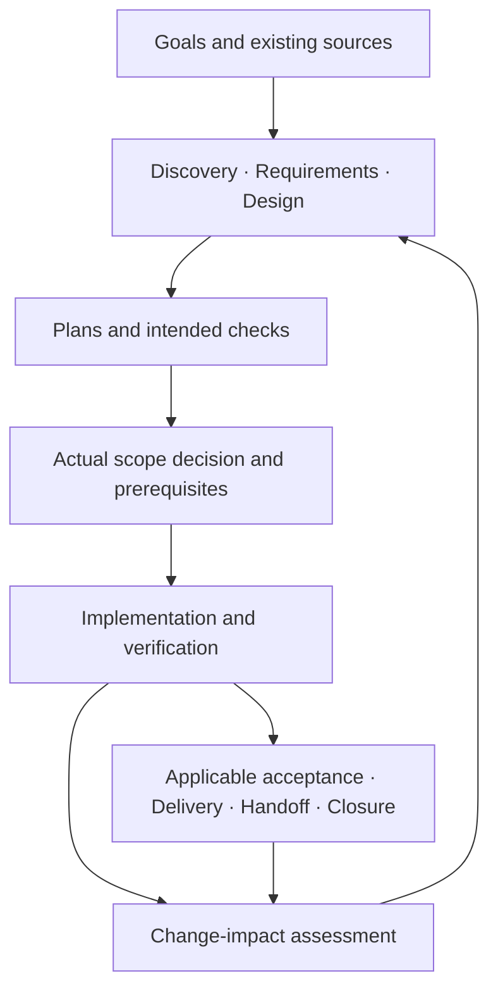

# Project Harness

[한국어](README.md) | **English**

**A policy and documentation framework for users and AI agents to connect goals, requirements, work and verification across software project sessions.**

The agent uses the current state and actual request to define concrete scope, perform authorized work, and record results and remaining prerequisites. The next session or owner continues from those records.

This repository provides policy and guidance. It requires no runtime, CLI or schema installation; implementation and test environments belong to the product. Choose and extend document kinds and ID formats only as the project needs them.

[Getting started](#getting-started) · [Documents](#what-documents-record) · [IDs and filenames](#document-and-item-ids) · [Implementation decisions](#implementation-decisions-and-changes) · [Verification](#verification-and-completion) · [Detailed guidance](#detailed-documentation)

## Getting started

1. Have the agent read [AGENTS.md](AGENTS.md) and the entry guidance for its tool.
2. Provide the goal, relevant sources and code locations, constraints, and this request's stopping point.
3. The agent checks Git status, existing documents and decisions, and the actual implementation state. Without Git, preserve a baseline copy before replacing files.
4. Reuse the project overview and ID conventions. For a new project, establish the needed document formats, folders and relationships in its overview.
5. Prepare the requested outputs and perform relevant checks. A clear implementation or fix request supplies the decision for its scope; resolve missing prerequisites or separate authority at the affected boundary.
6. Review the result, actual verification coverage, unfinished items and next action.

Tool entry guidance: [Codex](CODEX_START_PROMPT.md), [Claude](CLAUDE_START_PROMPT.md), and the [Claude adapter](CLAUDE.md). Agents apply detailed rules through the [reading triggers](AGENTS.md#startup-and-context).

### Request a small fix directly

> Fix the search result count showing 1 when there are no results. Show 0 and also check the count when results exist.

This request covers the relevant correction and verification. No second proceed response is needed for the same scope. Use the [minimum documentation](#minimum-documentation-for-a-small-fix) appropriate to the change.

### Prepare a new project through planning

> Plan a service with web, backend, database and AI components, plus user and administrator interfaces. Prepare requirements, screen/API specifications, design and a work plan, but stop at planning. Use only the needed ID dictionary entries and add missing classifications.

The agent clarifies goals and inputs and prepares executable work definitions. It assesses planning completion after consequential unknowns are resolved or properly disposed of within the stated scope. Implementation is outside this request.

### Analyze and continue an existing project

> Recover requirements and design from the code and plan the remaining work. Distinguish observed implementation, inferred intent and confirmed requirements. Preserve existing filenames, IDs and change history.

Start from actual progress. If the project already uses API as a plan ID, preserve that meaning; do not bulk migrate its records to match the new examples.

### Implement a prepared scope

> Proceed with the scope and verification methods in the plan you presented. Exclude production deployment this time.

As an actual response to a concrete plan, this supplies the decision for that scope. The agent links the decision and input versions and performs ready work.

### Request only review or handoff

> Review this release's changes and verification evidence and prepare a handoff. Include unrun checks, known issues and the next owner's first action.

Stop at the review and handoff outputs. These requests illustrate usage; the README itself is not actual approval or verification evidence.

## Purpose

Preserve goals, reasons for changes, actual decisions and verification results across sessions and owners. Maintain links from requirements to design, contracts, work and verification, and distinguish existing implementation from behavior that has actually been checked.

## Applicable projects

Use the framework for discovery and planning, changes to existing products, recovering documentation from code, reviews and handoffs. It applies to services combining web, mobile, backend, databases and AI; each project determines its technology choices and verification methods.

Keep documentation small for a bounded correction, and separate navigation and ownership when teams or independent work streams grow. An available document kind does not require creating a file of that kind.

## Components

| Component | Role |
|---|---|
| [AGENTS.md](AGENTS.md) | Common authority, work and verification rules, with routes to detailed guidance |
| Tool entry guidance and adapters | Direct agents to the shared policy and current context |
| [Information model](docs/DATA_MODEL.md) | Item boundaries, IDs, numbering, paths and references |
| [ID dictionary](docs/ID_DICTIONARY.md) | Simple starter formats and codes that projects can select and extend |
| Actual project overview and item documents | Goals, specifications, plans, decisions, progress and evidence |
| Product environments and external controls | Build, test and deployment environments, access controls and required approvals |

The README introduces usage and representative examples. Detailed procedures and required checks remain in their owning documents.

## What documents record

Write new management documents in Markdown and keep each definition in one owning location. Preserve the formats needed by existing records, original evidence and product files. Link information owned by a designated external tracker instead of duplicating it. Apply the [management format policy](AGENTS.md#management-document-format) and [Information model](docs/DATA_MODEL.md).

**Requirements are the primary boundaries for product scope.** Separate distinct outcomes or constraints, and keep supporting conditions and acceptance criteria with their requirement. A fix restoring specified behavior references the existing requirement.

| Information | What it records |
|---|---|
| Project overview | Goals, scope, baseline, item index, progress summary, ID formats and folders |
| Requirements and features | Requirements define outcomes and conditions; features link related items |
| Screens, APIs and design | Screen behavior, API contracts, components, data, interactions and design rationale |
| Plans and tasks | Plans define order, dependencies and overall completion; tasks define outputs, owners, execution detail and checks |
| Open items and decisions | Questions, impacts, next action and resolution criteria, plus actual decisions and sources |
| Verification | Subject version and environment, expected/observed results, execution status, evidence and limits |
| Changes and handoffs | Change impacts, current state, unfinished obligations and the next owner's action |

These are information kinds. Separate files when the work needs independent assignment, delivery, completion status or a shared definition, following the [item boundaries](docs/DATA_MODEL.md#independent-items-and-supporting-detail).

### Document and item IDs

**Use a small project format table.** Choose flat IDs, screen/task classifications or parent-specific detail numbers where useful. These representative [dictionary](docs/ID_DICTIONARY.md) examples are neither mandatory kinds nor allocated IDs.

| Purpose | Example IDs | Interpretation |
|---|---|---|
| Requirements and features | `REQ-001`, `FEATURE-001` | Independent counters; record relationships through links |
| Screens | `SCR-PC-001`, `SCR-MOB-001`, `SCR-AD-001` | Desktop user, mobile user and administrator screen classifications |
| API contract | `API-024` | Specifies requests, responses and behavior; implementation planning is a separate role |
| Tasks | `TASK-API-060`, `TASK-ADMIN-001` | Counters per work classification; actual ownership is recorded in the body |
| Open items and decisions | `OI-012`, `OD-012-01`, `ADR-001` | OD holds separate decision/resolution detail for OI; ADR records architecture choices |
| API-related verification | `CT-API-024-01`, `BT-API-024-01` | Contract/backend checks for API-024; the two kinds have independent counters |

Register formats such as DOC, DES, PLAN and VER for overviews, shared designs, plans or combined verification when needed. There is no universal serial width, prefix length or required area segment.

A few rows in the project overview are enough. Create a separate dictionary and link it when independent management becomes useful. If database or AI tasks need separate classification, add entries such as `TASK-DB-001` or `TASK-AI-001`. Registration, numbering and compatibility follow [Item IDs](docs/DATA_MODEL.md#item-ids).

Use **`<ID>.md` or `<ID>-<word>-<word>.md`**. The optional description has exactly two lowercase ASCII words joined by a hyphen and is not part of the ID.

```text
API-024-service-context.md
ID: API-024
Description: service-context
```

If a project registers `API-{area}-NNNNN` and the USER area, `API-USER-00001-service-context.md` follows the same rule. Its ID is `API-USER-00001`.

Do not create multiple owning files for one ID with different descriptions. Title edits do not require filename edits; when a filename changes, update links to its actual path. See [Document paths](docs/DATA_MODEL.md#document-paths).

### Minimum documentation for a small fix

A correction to the empty-result count can use **the existing overview plus one change document**, such as `CHG-001-result-count.md`. Link the existing requirement and record the actual request, baseline, expected correction, scope, approach, owner, work sequence, check results and limits.

No separate plan, task and verification files are needed solely to repeat that content when there are no independently managed outputs. If no requirement exists yet, identify the actual source of expected behavior. Apply the [small-change guidance](docs/DATA_MODEL.md#minimum-documentation-for-a-small-change).

### Overview and feature/work documents

This example organizes an administrator user-list feature. Folders and numbers are project choices; create only files required by the requested stage and actual management boundaries.

```text
project-docs/
  overview/DOC-001-project-overview.md
  features/FEATURE-001-user-management.md
  requirements/REQ-001-user-list.md
  screens/SCR-AD-001-user-list.md
  contracts/API-024-user-list.md
  plans/PLAN-001-user-list.md
  tasks/TASK-ADMIN-001-user-list.md
  tasks/TASK-API-060-user-list.md
  open-items/OI-012-access-scope.md
  decisions/OD-012-01-access-policy.md
  verifications/CT-API-024-01-response-contract.md
  verifications/BT-API-024-01-access-scope.md
  verifications/VER-001-user-list.md
```

The overview connects documents and progress; details stay in their owning files. Add [area overviews](docs/DATA_MODEL.md#area-overviews) when navigation needs to split across features or teams. When a designated [external tracker](docs/DATA_MODEL.md#external-work-trackers) owns assignment or status, do not maintain that information in parallel Markdown records.

### Connecting items

In the example, FEATURE-001 groups REQ-001 and related screens, contracts and work. PLAN-001 references input specifications and defines the order and completion criteria for TASK-ADMIN-001 and TASK-API-060. Verification documents link the relevant contracts, requirements and checked versions.

OD-012-01 is separately managed decision/resolution detail for OI-012. A short answer can stay in OI, and a decision already owned by an ADR needs no duplicate OD. The existence of a document does not establish resolution or approval.

Body IDs and link labels omit the description. Actual link targets can include it.

```markdown
### API-024

Contract for administrators to list users within their authorized scope.

Requirement: [REQ-001](../requirements/REQ-001-user-list.md#req-001)
```

Do not infer other parent relationships from matching numbers. Several plans may share one task; record the actual relationships through links.

### Rules to apply when changing documents

Preserve existing IDs, meanings and decision/evidence history; update links when paths change. Keep established API/SCR meanings and number formats when they differ from these examples. Apply [required-name exceptions](docs/DATA_MODEL.md#required-name-exceptions) for consumer-required files such as README.md, AGENTS.md and SKILL.md.

Before completing document work, apply [Document validation](docs/DATA_MODEL.md#document-validation). Check ID allocation and parent scopes, duplicate owning files and links; use [allocation reuse](docs/DATA_MODEL.md#allocation-and-validation-reuse) for applicable prior checks.

## Roles of users and agents

Users provide goals, constraints and priorities and decide concrete execution scope. Agents analyze inputs, prepare specifications, plans and verification, and perform authorized work. Final customer acceptance and production authority belong to the authorized people and external controls.

### Collaboration across agents

All writers use shared item definitions, ID formats, allocation scopes and folder mappings. Before concurrent editing, agree outputs, file/resource ownership, shared-document owners and Git integration. Separate checkouts use the same allocations; do not invent writer-specific prefixes or duplicate owning files.

A single writer needs no separate claim system. Apply the [collaboration basis](docs/COLLABORATION.md#collaboration-basis).

## Development flow

Make inputs and outputs concrete through discovery, requirements, design, planning, implementation, verification and applicable acceptance, delivery and closure. Changes can revise affected specifications and plans throughout this waterfall structure.



### Stage inputs and outputs

Each stage has input versions, outputs, dependencies and exit criteria. Stop at the requested stage; a full-workflow request continues through stages with actual authority and ready inputs. Readiness does not imply execution authority, and stages do not require repeated human approval by themselves. Apply the [stage contract](docs/DEVELOPMENT_METHOD.md#stage-contract).

### Development plan detail and omission review

The plan and linked specifications/tasks must be concrete enough that implementers need not invent consequential behavior or decisions. Apply the [detailed planning procedure](docs/DEVELOPMENT_METHOD.md#detailed-planning-procedure) and [completion checks](docs/DEVELOPMENT_METHOD.md#planning-completion-checks) for source coverage, execution detail, verification and consequential unknown dispositions.

### Tracking open items through resolution

Keep owners, next actions, impacts and resolution criteria in the owning record. RESOLVED means resolution evidence is established; CLOSED also includes checking and propagation into related definitions and work. Deferral is not resolution; reopen invalidated resolutions while preserving history. Apply the [open-item lifecycle](docs/WORKFLOW.md#open-item-lifecycle) and [required content](docs/DATA_MODEL.md#open-items).

## Recovering documentation from existing code

First identify the version, dirty files, existing policies and actual implementation, verification and deployment state. Read relevant code, tests, configuration and documents, and distinguish the following.

| Classification | What to record |
|---|---|
| Observed implementation | Behavior visible at the inspected version and code location |
| Inferred intent | Interpretation of observations and its limits |
| Confirmed requirements | Actual requirement sources and intended outcomes |
| Unknowns | Missing or contradictory evidence, impacts and next action |
| Proposed changes | Changes distinct from current implementation, with intended verification |

Reading code and tests does not establish successful execution. Do not invent past authority or results; report analysis coverage and omissions. See [existing-project intake](docs/DEVELOPMENT_METHOD.md#existing-project-intake-and-reverse-engineering) and the [web project example](docs/EXAMPLE_WEB_PROJECT.md).

## Implementation decisions and changes

**A clear implementation or fix request supplies the scope decision.** Before implementation, connect the request, input versions and concrete scope and check prerequisites. Respect a discovery-only or planning-only stopping point.

One applicable decision may cover several plans and tasks. Do not repeat permission requests for file selection or work ordering within that scope. When commitments, risk or external effects change, prepare the concrete delta and obtain the required decision. Apply [decision preparation](docs/APPROVALS.md#preparing-and-recording-one-decision) and [material-change criteria](docs/APPROVALS.md#material-changes).

Cancellation or a pause does not automatically authorize deletion or rollback. Preserve affected work and history and reassess authority and prerequisites under [cancellation and resumption](docs/APPROVALS.md#cancellation-withdrawal-and-resumption).

## Verification and completion

Record the subject version and environment, expected and observed results, evidence and limitations.

| Status | Meaning |
|---|---|
| `IMPLEMENTED` | Implementation exists |
| `STATIC_VERIFIED` | Checked within the stated static-analysis scope |
| `INTEGRATION_VERIFIED` | Component interactions were checked |
| `BROWSER_VERIFIED` | Behavior was checked in the stated browser and scenarios |
| `LIVE_ENV_VERIFIED` | Checked in the actual target environment with authority |
| `CUSTOMER_ACCEPTED` | An authorized customer actually accepted the specific version and scope |
| `CLOSED` | Applicable closure obligations for the scope were addressed |

These states make distinct claims. Not every project needs every check, but unrun, failed, partial or ambiguous results cannot be PASS. Do not hide a newer failure behind an older success.

Distinguish document checks from product verification. Passing ID, filename and link checks does not establish API, screen or model behavior. Check affected outputs and dependencies, and reuse applicable evidence under [verification reuse](docs/CONTEXT_EFFICIENCY.md#reuse-and-verification).

## Collaboration and handoff

Use separate worktrees where practical for concurrent work and inspect actual file/resource conflicts. A handoff carries baseline and changed versions, actual decisions, passing/failing/unrun checks and limits, unfinished obligations and the next owner's first action.

Project closure aggregates contributing plans and applicable acceptance, delivery and maintenance obligations. Deployment alone is not closure. Apply [Collaboration and handover](docs/COLLABORATION.md) and [closure preparation](docs/WORKFLOW.md#closure-preparation).

## Intended benefits

The next owner can find the reason for a change and the scope to verify, and continue remaining work from actual progress. Use only needed documents and formats while distinguishing decisions, verification and unfinished work.

Results depend on source/document quality, work scale and tools. Policy alone does not guarantee a measured improvement in token usage, development speed or defect rates.

## Blockers and high-risk controls

Stop affected work and dependents when required authority, inputs or dependencies are missing, ownership conflicts exist, or safety, decision provenance or current verification is unreliable. Unrelated drafts or old records alone do not stop independent work.

Classify risk by actual effects. Production deployment/data changes, destructive operations, protected-credential access and final customer acceptance require specific human decisions and independent controls for the subject and effect. External messages and material external effects also require explicit authority. Apply [Security](docs/SECURITY.md) and [development action boundaries](docs/SECURITY.md#classifying-development-actions), and keep secrets out of documents and logs.

Prepare a project-record reset only after an explicit current request and under the [reset procedure](docs/WORKFLOW.md#starting-over).

## Adoption limitations

Policy text does not technically enforce external permissions. Actual access controls, approvals and product-specific verification environments are also necessary. Code analysis cannot establish all business intent or customer requirements.

When adopting the harness in another repository, inspect conflicts with existing policies, contracts, tools and CI and integrate within actual authority. Do not overwrite AGENTS.md or project records without checking them. Authority granted here does not automatically extend to another project.

## Maintaining the harness policy itself

The harness's own policy, README and guidance are outside project-deliverable ID scope. Use meaningful filenames and edit current files; Git diffs/history and the conversation carry scope, actual decisions and verification.

Do not add separate change notes, policy-work indexes or archives solely to record policy edits. Preserve existing records and commit/push when requested for the scope. Apply [policy maintenance](AGENTS.md#harness-policy-maintenance) and [ID scope](docs/DATA_MODEL.md#id-scope).

## Detailed documentation

The [AGENTS.md entry map](AGENTS.md#startup-and-context) owns required reading triggers. This list helps readers find guidance; it does not require loading every document each time.

| Document | What it covers |
|---|---|
| [Shared policy](AGENTS.md) | Authority, scope, work, verification and routes to detailed rules |
| [Information model](docs/DATA_MODEL.md) | Item boundaries, IDs, numbering, filenames, links and validation |
| [ID dictionary](docs/ID_DICTIONARY.md) | Starter formats/classifications, two-word descriptions and extensions |
| [Development method](docs/DEVELOPMENT_METHOD.md) | Stages, detailed planning, existing-project intake and change impacts |
| [Workflow](docs/WORKFLOW.md) | Work transitions, open items, handoff, closure and former runtime records |
| [Approvals and decisions](docs/APPROVALS.md) | Actual decision sources/scopes, reuse and material changes |
| [Collaboration and handover](docs/COLLABORATION.md) | Ownership, concurrent work, delegation and Git integration |
| [Security](docs/SECURITY.md) | High-risk actions, protected material and external controls |
| [Context efficiency](docs/CONTEXT_EFFICIENCY.md) | Relevant context selection and evidence reuse |
| [Architecture](docs/ARCHITECTURE.md) · [Constitution](docs/CONSTITUTION.md) | Roles of policy, documents and tools, and common principles |
| [Existing web project example](docs/EXAMPLE_WEB_PROJECT.md) | Applying the guidance from specification recovery through implementation, verification and delivery |
