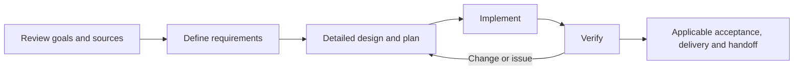

# Project Harness

[한국어](README.md) | **English**

**A working framework for managing software projects with AI agents, connecting customer requirements to detailed plans, implementation and verification.**

The aim is to define behavior and implementation approaches early enough to reduce guesswork and rework during development. Documents preserve the reasons for the work and its results so another session or contributor can continue it.

This repository provides policies and guidance for agents. There is no separate harness application to install; each product supplies its own build and test environment.

[Getting started](#getting-started) · [Development flow](#development-flow) · [Reading the documents](#what-documents-record) · [Example requests](#example-requests) · [Checking results](#verification-and-completion)

## Purpose

The framework helps you keep track of four things throughout a project:

- **What to build:** customer requirements and the conditions for satisfying them.
- **How to build it:** detailed design, implementation order, failure handling and verification methods.
- **Where the work stands:** completed work, observed results, blockers and next actions.
- **What a change affects:** related requirements and work that need updates.

Detailed planning, separate documents for requirements and their related work, stable IDs, and the agent's own judgment and verification are core principles. Existing content is reused after checking that it still applies.

## Getting started

1. Have the agent read this repository's [shared policy](AGENTS.md) and the entry guidance for its tool.
2. Describe the intended result, source/code locations, constraints and how far to proceed this time. Mention any build and test approach you have already chosen; otherwise it is decided during design and planning.
3. The agent checks the current state and prepares the documents and work for that scope.

Entry guidance is available for [Codex](CODEX_START_PROMPT.md) and [Claude](CLAUDE_START_PROMPT.md). When adopting the harness in another project, inspect its existing policies and documents before integrating the relevant guidance.

A first request can look like this. You do not need to specify every document ID or file path yourself.

> Use this harness to plan an administrator user-management feature.
> Administrators should be able to search users and export search results as CSV.
> Existing code and requirements are at [source location].
> Keep the existing login and permission model. For now, prepare requirements, design and a detailed plan only.

If the goal is still unclear, start with discovery and requirements. The agent prepares evidence and options for decisions that need your input.

## Development flow

Plans cover normal behavior, errors and boundary cases, data and interfaces, work order and verification methods. They should be concrete enough that the implementer does not have to guess consequential behavior.

Work stops at the requested stage. A planning-only request ends with the plan; a request to implement a concrete scope continues through ready implementation and verification work. The same scope does not require approval again at every step.

Existing projects start from their actual progress. The agent distinguishes implemented behavior from remaining work and uses existing documents, IDs and history. Behavior observed in code is also distinguished from requirements confirmed by the customer.

## What documents record

**Start with the project overview.** It shows progress and blockers by requirement and links to the details you want to inspect.

| Document | What you can learn |
|---|---|
| Project overview | Overall goals, progress by requirement, major blockers and document links |
| Requirements | Customer outcomes and the conditions for satisfying them |
| Design | How screens, APIs and data behave and connect |
| Plan | Implementation order, dependencies, verification methods and completion criteria |
| Task | Owner, concrete execution steps and progress |
| Verification | Which version was checked, the method, actual results and limitations |
| Open items and decisions | Questions still to settle, their impact and next action, and actual decisions |

Requirements, designs, plans, tasks and verification have separate linked files. Files are prepared for the relevant stage; a design or contract shared by several requirements has one owning document.

For example, **user search** and **CSV export** are separate requirements. “Display zero when no results match” is a condition within the search requirement. Fixing a search defect continues to reference that requirement.

IDs such as `REQ-001` and `PLAN-001` let you trace an item even when its title or owner changes. Relationships come from document links, not matching or similar numbers. The agent applies numbering and filename rules from the [document standard](docs/DATA_MODEL.md).

## Example requests

The only required input is which feature and what to do with it. You do not need IDs, file paths, folder names or new numbers. The agent finds the matching documents in the overview and plans and reports which items it resolved to, with their IDs. When several items could match, it presents the candidates before editing; when nothing matches, it says so instead of creating a new item.

Everything else has a default and is added only when you want something different.

| Optional line | Default | Example addition |
|---|---|---|
| Stopping point | Continue through ready stages | `plan only`, `define the task only` |
| Exclusions | Production deployment, production data, secrets and final acceptance need separate approval even if unstated | `propose changes to the shared API contract, do not edit it` |
| Owned area | Derived from records after planning | `authentication area` |

Name the area only during planning. Once planning is done, every task, requirement and contract records its owning area and the agent knows who is asking from the git user identity, so it derives the area and owner from the feature and checks them against the requester. When a feature spans several areas, the agent asks. If no allocation record exists and the agent sees traces of other writers, it does not create a new ID and asks for confirmation instead.

`〈 〉` marks a placeholder; delete lines you do not need.

### Planning stage: name the area

**Analyze an existing project**

> Analyze the current code and documents and identify implemented features and remaining work.
> Distinguish observed facts, inferred intent and confirmed customer requirements.
> Stop after analysis and planning this time.

**Join and check the current state**

> I am joining this project as the owner of the 〈authentication area〉.
> Read the overview and my area's items, and tell me the current stage, assigned tasks, open items and blockers.
> Report only; do not edit documents.

When the overview already records each git user's assignment, the first line can simply be "tell me the current state of my assigned items".

**Plan a new feature**

> Plan a 〈password reset link expiry〉 feature in the 〈authentication area〉.
> Write the requirement, design and detailed plan only, and flag any impact on other areas.

**Define a new task**

> Create a new task in the 〈authentication area〉.
> Content: 〈notify an administrator when an unlock is requested〉. It belongs to the 〈account lockout〉 requirement.
> Allocate the ID under the area's allocation rule and link it in that plan's task list.
> Define the task only; do not implement it.

If the behavior is not in any requirement, the agent reports that a requirement change comes first.

### After planning: name only the feature

**Implement a defined task**

> Work on the 〈lock the account after five failed sign-ins〉 task.
> Follow the task document's actions and completion checks, and continue through verification.

The agent first states which task it is and checks that the task's owner matches the requester. Documents owned by others are not edited; the agent leaves a proposal instead. The completion report lists the checks actually run and their results.

**Fix a defect**

> Fix 〈the lock notice not appearing after failed sign-ins〉.
> Report the cause and affected scope first, then after the fix check 〈before lock, at lock and after unlock〉.

The agent finds the related requirement from the symptom and reuses that requirement and its existing verification. No new requirement is created.

**Review a proposed change**

> I want to change 〈the session timeout from 30 to 15 minutes〉.
> Summarize the impact on related requirements, shared contracts, and other areas' tasks and verification.
> Mark the parts that need another area owner's decision. Do not edit yet.

**Request a change to a shared document**

> The 〈sign-in API〉 response needs 〈a lock-status field〉.
> Do not edit it; leave the owner a proposal with the change, reason and impact.
> Mark work that depends on this input as waiting until the proposal is applied, and continue independent work.

**Check progress and requirement trace**

> Summarize the current project progress from the project documents.
> For each requirement, show how far design, plan, tasks and verification are linked, and where links or work are missing or blocked.
> Report only; do not edit the documents.

Where an overview summary and the owning record differ, the owning record is reported and the difference is flagged.

**Report a blocker and record an open item**

> The 〈account lockout〉 task is blocked because 〈the sign-in API has no lock-status response definition〉.
> Record it as an open item with affected work, resolution criterion, owner and needed-by point.
> Continue the remaining unblocked work.

**Prepare for integration**

> Prepare my changes for integration.
> Summarize the diff of changed documents and code, the verification actually run, and checks that failed or did not run, and confirm new IDs and links follow the rules.
> Fetch and tell me about conflicts with 〈main〉; push only after I confirm.

**Hand off to another session or contributor**

> Summarize the changes to my assigned items so far and the actual verification results.
> Include unfinished work, blockers, pending shared-document changes and what the next contributor should do first.

## Implementation decisions and changes

You decide the goals, priorities, constraints and execution scope. Within that scope, the agent investigates technical details and performs detailed planning, implementation and verification.

When a material commitment changes, such as behavior, cost, data handling or use of an external service, the agent presents the reason and impact and obtains any needed decision. Production deployment, production data changes, destructive actions, protected-credential access and final customer acceptance need specific authorization and safeguards for the subject and effect. Sending external messages also needs explicit authority. See [decisions](docs/APPROVALS.md) and [security](docs/SECURITY.md) for the boundaries.

For a correction, the agent reuses applicable content and keeps affected documents current. Changes to shared functions or APIs also require checking other requirements that use them. The overview is updated when its summary changes, including major stages, blockers or dependencies.

Concurrent agents agree owners and edit boundaries. For post-planning requests to work without naming an area, the overview must record once the area owners (by git user) and the ID allocation rule, the owners of the overview, shared documents and Git integration, and which tracker holds task status. Using the area as an ID classification value avoids number collisions without a range table. Work that needs an unresolved contract or input waits; independent work with ready prerequisites can continue. Questions are tracked through their answers and incorporation into related documents, without copying the same evidence into multiple records.

## Verification and completion

Look for three things in a result report:

1. **Completed scope:** which requirements and tasks were addressed.
2. **Observed results:** what was checked, against which version and environment, and what passed or failed.
3. **Remaining work:** unrun checks, unresolved issues, required decisions and next actions.

Planning completion, implementation, verification, customer acceptance and project closure are distinct. Prepared documents or existing code do not by themselves establish working behavior or customer acceptance. Failed, unrun and partial checks are reported as such. The commands and environments used for checks are recorded in the project overview once decided, and verification records refer to them.

If work is blocked, the report identifies the cause and affected scope. A handoff states what the next contributor should do and which inputs are needed.

The policy does not guarantee development speed or token savings. Results depend on planning quality, the project and how the guidance is applied.

## Detailed documentation

This README explains the harness for people using it. Agents apply the relevant detailed rules through the [shared policy's reading guide](AGENTS.md#startup-and-context).

| To learn more about | Read |
|---|---|
| Overall operating principles | [Shared policy](AGENTS.md) · [Constitution](docs/CONSTITUTION.md) |
| Detailed planning and existing-project analysis | [Development method](docs/DEVELOPMENT_METHOD.md) |
| Document organization and IDs | [Information model](docs/DATA_MODEL.md) · [ID dictionary](docs/ID_DICTIONARY.md) |
| Decisions, permissions and protection | [Approvals](docs/APPROVALS.md) · [Security](docs/SECURITY.md) |
| Open items, progress and closure | [Workflow](docs/WORKFLOW.md) |
| Concurrent work and handoff | [Collaboration](docs/COLLABORATION.md) |
| Reusing content and verification | [Context efficiency](docs/CONTEXT_EFFICIENCY.md) |
| A worked project flow | [Web project example](docs/EXAMPLE_WEB_PROJECT.md) |
