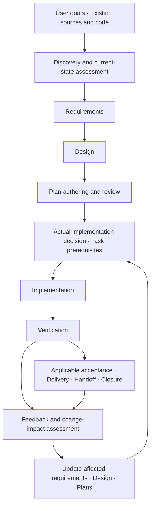

# Project Harness

[한국어](README.md) | **English**

**Project Harness is a policy and documentation framework that helps users and AI agents follow consistent practices throughout a software project, from discovery to maintenance.**

It connects what to build, why it was designed that way, which work was authorized, and what was actually verified. Agents use this evidence to continue work, while users decide important scope and changes.

A harness provides direction and checks for an agent's work. Its core components are repository policy, development procedures, project documents, and actual decision records. Normal operation follows the policy and project documents; the repository ships no runtime, CLI or schema and needs no tool setup.

[Getting started](#getting-started) · [Documents](#what-documents-record) · [Implementation decisions](#implementation-decisions-and-changes) · [High-risk controls](#blockers-and-high-risk-controls) · [Detailed guidance](#detailed-documentation)

## Getting started

Normal operation needs an agent that can read and edit repository files, together with project inputs. Git can track versions and changes. Without Git, preserve a baseline copy before replacing existing files. Implementation and testing also need the environment appropriate to the product's technology.

1. Have the agent read the [shared policy](AGENTS.md) and relevant entry guidance.
2. State the desired result and this request's stopping point.
3. Provide relevant code and document locations, existing decisions, constraints and protected scope.
4. Let the agent inspect the current state and necessary inputs, then author the requested outputs.
5. Use a clear implementation or fix request as the scope decision, check prerequisites and proceed. Resolve material open choices and actions needing separate authority at their applicable boundaries.
6. Review the deliverables, checks performed and remaining limitations.

Tool entry guidance is available in the [Codex start prompt](CODEX_START_PROMPT.md), [Claude start prompt](CLAUDE_START_PROMPT.md) and [Claude adapter](CLAUDE.md).

### Request a small fix directly

> Fix the search result count showing 1 when there are no results. Show 0 and verify that the count is also correct when results exist.

The agent records this request as the scope decision, identifies the cause, edit scope and verification methods, then performs the covered changes and checks. No second proceed response is needed for the same scope. A small fix with no independently managed outputs can use the existing overview and one change document. See the [minimum documentation example](#minimum-documentation-for-a-small-fix). Requests and results in this section illustrate usage; they are not actual approval or check evidence.

### Prepare a new project through planning

> I want to build a work-management service for a small team. Define the goals and constraints, then prepare requirements, design and a work plan. Stop at planning this time, and identify important open questions and alternatives.

This request authorizes investigation and document creation. The agent defines how requirements will be checked and reviews whether the design and work sequence support them. Once the requested plan is complete, it reports the result and remaining execution prerequisites.

### Analyze and continue an existing project

> Recover the requirements and design from the current code. Distinguish what is implemented, inferred intent and questions that need confirmation, then plan the remaining work. Preserve existing changes and history.

The agent identifies a baseline commit or snapshot and analyzes relevant code. It identifies missing evidence and actual remaining work rather than replanning completed implementation from scratch.

### Implement a prepared scope

> Proceed with the scope and verification methods in the plan you presented. Exclude production deployment this time.

When this is an actual response to a concrete plan, it supplies the decision for that scope. The agent records the response and proposal version, then performs covered work. Example wording in this README is not an actual approval record for any project.

### Request only review or handoff

> Review this release's changes and verification evidence, and prepare a handoff document. Include unrun checks, known issues and the next owner's first action.

This request ends with review and handoff material. Fixing product defects discovered during review requires checking the actual authority and scope for those fixes.

## Purpose

Project documents and versions preserve the evidence needed to address these problems across conversations and work sessions.

| Common problem | Guidance provided by the harness |
|---|---|
| A request leads directly to code changes without clear scope | Establish goals, acceptance criteria, design and work boundaries, and link the actual implementation decision. |
| A new session or owner cannot recover earlier decisions | Preserve the baseline, decision source, status and next action in a form suitable for handoff. |
| Implementation and documentation describe different states | Trace requirements, design, work and verification, and reflect change impacts. |
| Splitting or reordering plans triggers repeated approval | Reuse applicable decisions for adjustments within the reviewed scope. |
| Existing code is reported as verified functionality | Distinguish implementation, static checks, integration checks, live-environment verification and customer acceptance. |
| Applying a process to an existing project requires starting over | Preserve actual progress and history, and plan the remaining work. |
| Tool states or record formats stop unrelated work | Determine the affected scope from actual authority, dependency, safety and verification impacts. |

## Applicable projects

Use the framework when preparing requirements and designs for a new project, changing an existing product, or handing work over. Scale documentation and verification to the work's size and risk.

| Situation | Main use |
|---|---|
| A new project starting from an idea | Define goals and constraints, then prepare requirements, design and plans. |
| A project where code came first | Recover current specifications and identify unresolved requirements and remaining work. |
| Requirements change during development | Preserve the baseline and document scope, impacts and necessary reverification. |
| Review or documentation only | Report findings and limitations, ending at the requested stage. |
| A project with several work streams | Manage dependencies and ownership across plans, and aggregate their results for delivery. |
| A change of owner or agent session | Hand over actual decisions, changed versions, check results and unfinished work. |

The same operating principles apply to web, mobile, library and data projects. Each project still needs suitable design and testing methods. The harness does not provide product-specific implementation tools or test environments.

## Components

[AGENTS.md](AGENTS.md) is the governing operating policy. This README provides an overview, getting-started guidance and representative examples. Agents use the policy's [reading triggers](AGENTS.md#startup-and-context) to consult detailed rules and actual project decisions/evidence before the affected action. Linked owning documents maintain the detailed procedures and checklists.

| Component and location | Role |
|---|---|
| [Shared policy](AGENTS.md) | Defines agent authority, development methods, change handling, verification and safety. |
| [Codex entry](CODEX_START_PROMPT.md), [Claude entry](CLAUDE_START_PROMPT.md) and [adapter](CLAUDE.md) | Direct each agent to the shared policy and current work context. |
| [Development and operating guidance](#detailed-documentation) in `docs/` | Explains stage outputs, approvals, collaboration, handoff and closure. |
| Actual project documents | Hold goals, requirements, design, plans, decisions, verification and progress. |
| External authority controls | Enforce high-risk permissions through protected CI, environment approvals and access controls. |

The project overview connects documents by feature and work unit. See the [document layout example](#overview-and-featurework-documents), and apply the detailed [Information model](docs/DATA_MODEL.md) when authoring documents.

## Roles of users and agents

Users provide the problem, desired result, constraints and priorities. Agents analyze inputs, consider alternatives, and define work and verification. Users decide concrete implementation scope and important changes; agents perform work within that authority.

| Participant | Main role |
|---|---|
| User or project owner | Provides goals and constraints, and decides concrete implementation scope and important changes |
| Agent | Investigates, documents, plans, checks prerequisites, performs authorized implementation and verification, and reports results and limits |
| Authorized customer | Makes the final acceptance decision for the identified result and version |
| Operators and external systems | Control high-risk authority for production deployment, data changes and protected-resource access |

Agents cannot invent user consent or interpret a passing check as approval. Renaming plans or adjusting task order within the reviewed scope preserves item IDs and existing applicable decisions.

### Collaboration across agents

Agents such as Codex and Claude share three foundations: **clear plan/task boundaries, directory structure, and Markdown filenames and numbering**.

| Foundation | What to define |
|---|---|
| Plans and tasks | Plans define goals, scope, dependencies, task order and overall completion criteria, and link individual task files. Tasks define concrete outputs, owners, affected paths and shared resources, and completion criteria. |
| Directory structure | Choose a document root and classification folders for the project and record them in the overview. All agents share the mapping; several writers may use one folder when their files and resources do not overlap. |
| Markdown filenames and numbering | Each independent item owns an ID file such as `REQ-00001.md`, `API-00001.md`, `SCR-00001.md` or `TASK-API-00001.md`. Allocate numbers uniquely across the project for each complete prefix. |

Share ownership boundaries and number ranges before concurrent work. Separate checkouts use the same shared allocations; do not invent agent-specific prefixes for the same document type. Extend folders and prefixes as needed, and use the chosen conventions consistently.

Assign shared-document editing and Git integration as part of the work. In a shared checkout, the integration owner serializes Git index and branch changes. Existing overview, plan and task documents can hold this coordination. Apply the existing exceptions for consumer-required filenames; see [Collaboration and handover](docs/COLLABORATION.md#collaboration-basis).

## Development flow

Development is organized into discovery, requirements, design, planning, implementation, verification, acceptance, delivery, closure and maintenance. A waterfall structure makes stage inputs and outputs explicit while allowing change impacts to be addressed at any stage.

The diagram shows how stage work and change handling connect.



The requested stopping point is part of the scope. A requirements-only request ends with requirements and open questions. Completing a planning-only request does not require permission to implement. A full-workflow request continues through stages whose authority and prerequisites are satisfied.

### Stage inputs and outputs

Each stage has input versions, outputs, dependencies and exit criteria. For example, planning defines concrete work and intended checks, while verification records actual results. Readiness neither requires another human approval at every stage nor grants implementation authority. Apply the [Development method's stage contract](docs/DEVELOPMENT_METHOD.md#stage-contract) for detailed criteria.

### Development plan detail and omission review

**Use the development plan and its linked design/task documents as the primary basis for implementation.** Make required behavior and consequential decisions concrete, connecting original inputs to work and intended verification. Document count does not substitute for detail.

When creating, revising or assessing a plan, apply the [detailed planning procedure](docs/DEVELOPMENT_METHOD.md#detailed-planning-procedure) and [completion checks](docs/DEVELOPMENT_METHOD.md#planning-completion-checks). Those rules distinguish consequential unknowns from later execution prerequisites. The [small-correction example](docs/EXAMPLE_WEB_PROJECT.md#detailed-planning-example) illustrates the required depth.

### Tracking open items through resolution

Track owners, next actions, impacts and resolution criteria in the owning documents. `RESOLVED` means resolution evidence is established; `CLOSED` means it has also been checked and propagated into related definitions and dependent work. Deferral is not resolution; reopen an invalidated resolution while preserving history.

When recording, resolving, reopening or handing off items, apply the [open-item lifecycle](docs/WORKFLOW.md#open-item-lifecycle) and [record content](docs/DATA_MODEL.md#open-items). Those documents maintain the transition, review and closure criteria.

## Recovering documentation from existing code

Reverse engineering can produce requirements, design and plans for an existing project. It recovers structure and behavior from implementation and presents them in a reviewable form.

First identify the version under analysis, dirty files, available sources, and actual development, verification and deployment status. Read relevant code, tests, configuration, interfaces and documents, and attribute important judgments to their sources.

| Classification | Example observation | Interpretation |
|---|---|---|
| Observed implementation | A list API has a page-size limit at a particular revision | An observation about the inspected code and path. |
| Inferred intent | The limit appears intended to control response size or performance | Label this as an evidence-based inference, separate from confirmed requirements. |
| Confirmed requirement | The owner explicitly specified a maximum number of response items | Link the actual source and acceptance criterion. |
| Contradiction or uncertainty | A document describes a different limit | Identify which basis needs confirmation and which work is affected. |
| Proposed change | The limit may need adjustment for the intended use case | Keep this separate from current implementation and prepare impact and verification details. |

Code alone does not prove original intent, correct behavior, passing tests or customer acceptance. Reading a test and executing it are different observations. Actual execution needs a suitable environment and authority.

Report the analyzed scope and omissions. If earlier approval or verification is missing, say so; do not retroactively portray past work as approved.

See [Development method](docs/DEVELOPMENT_METHOD.md#existing-project-intake-and-reverse-engineering) and the [existing web project example](docs/EXAMPLE_WEB_PROJECT.md) for the detailed flow.

## What documents record

New harness management documents use Markdown (`.md`) and contain the information needed for subsequent work and decisions. The table lists information types. Each row does not require its own file; files belong to items that are actually managed independently.

**Requirements are the primary unit for separating product scope.** Give a behavior, outcome or constraint its own REQ when its fulfillment needs a separate assessment. Keep supporting conditions, explanations and check methods with the same requirement. For example, search and exporting search results are separate requirements, while displaying zero for an empty result is a condition of search.

Fixes that restore specified behavior and added tests reference the existing REQ. Connect designs, plans, tasks and verification to the requirements they cover, separating them when the actual work needs its own assignment, deliverable, completion status or shared definition. Several tasks can implement one requirement, and one task or check can cover several requirements. See [Requirement boundaries](docs/DATA_MODEL.md#requirement-boundaries) and [Related work boundaries](docs/DATA_MODEL.md#related-work-and-supporting-detail) for the detailed criteria.

| Information | Essential content |
|---|---|
| Project overview | Goals, scope, shared constraints, baseline, feature/work document index, progress summary and ID convention |
| Requirements | Outcomes, acceptance criteria, priorities, sources and open questions |
| Design | Structure, data and interfaces, alternatives, reasoning and risks |
| Plan | Goals and scope, dependencies, task-file links and order, and overall completion criteria |
| Task | Concrete output, owner, affected paths and shared resources, related plans/inputs, prerequisites, status and completion checks |
| Decision | Concrete scope and version, actual user request or response with its source, and conditions |
| Change trace | Request, before/after differences, impacts, relevant decision and reverification |
| Verification evidence | Subject version, method and environment, expected/observed result, artifacts and limitations |
| Handoff/closure | Contributing work, delivered version, remaining obligations, owner and next action |

### Minimum documentation for a small fix

For example, correcting the count displayed for an empty search result can use **the existing project overview plus one change document**. The change document contains:

- The actual request and source, baseline version, expected outcome and edit scope.
- The cause, approach, owner and assessment of authority, dependencies and risks.
- Work order and progress.
- The checked version, environment, expected and observed results, failures, unrun checks and remaining limits.

Update the overview's change link, progress summary and ID allocation. The change references the existing search REQ; if no requirement is recorded yet, retain the actual source of the expected behavior. Stages and test commands alone do not create new requirements or files for each stage. Split work that needs separately managed assignment, deliverables or completion status, and link existing definitions and evidence.

ID, allocation and verification rules, and contractually required separate deliverables, still apply. See [Minimum documentation for a small change](docs/DATA_MODEL.md#minimum-documentation-for-a-small-change) for the detailed example and split criteria.

### Overview and feature/work documents

When several items need independent management, connect **one `<ID>.md` file per independent item in classification folders** through the project overview. Detailed rules are in [Document organization](docs/DATA_MODEL.md#document-organization) and [Document paths](docs/DATA_MODEL.md#document-paths).

The following illustrates a project with several features and work items. Choose folder names and hierarchy for the project; these IDs are examples. Create documents needed for the requested stage and actual item boundaries.

```text
project-docs/
  overview/
    DOC-00001.md             Overview, feature index and ID/folder conventions
  requirements/
    REQ-00001.md             Sign-in requirement and acceptance criteria
    REQ-00002.md             Search requirement and acceptance criteria
  designs/
    DES-00001.md             Shared architecture
    DES-00002.md             Sign-in design
  backend-plans/
    API-00001.md             Backend plan and related task links
  screen-plans/
    SCR-00001.md             Screen plan and related task links
  tasks/
    TASK-API-00001.md        Backend task
    TASK-SCR-00001.md        Screen task
  verifications/
    VER-00001.md             Subject, method, execution status and actual results
  decisions/
    DEC-00001.md             Actual decision and source
  changes/
    CHG-00001.md             Small change scope and related stage notes
  handoffs/
    HANDOFF-00001.md         Handoff details and next action
```

This example connects the sign-in requirement, design, backend and screen plans, tasks and verification through links. Use [Independent items and supporting detail](docs/DATA_MODEL.md#independent-items-and-supporting-detail) to decide when an item needs a separate file.

When several teams, work streams or subsystems can no longer share one overview, add [area overviews](docs/DATA_MODEL.md#area-overviews) under the project overview. The project overview keeps shared conventions, the area index and ID range delegations; each area overview keeps its document index, progress summary and use of its delegated serials. If task status or open items live in a tool such as GitHub Issues or Jira, designate it as an [external work tracker](docs/DATA_MODEL.md#external-work-trackers) and link that information instead of duplicating it in Markdown.

### Document and item IDs

Use a type prefix and five-digit serial, such as `REQ-00001`, `API-00001`, `SCR-00001` or `TASK-API-00001`. Follow [Item IDs](docs/DATA_MODEL.md#item-ids) for allocation, preservation, extensions and plan/task relationships.

Apply [Required-name exceptions](docs/DATA_MODEL.md#required-name-exceptions) when a tool or contract requires a fixed filename. The Information model owns the detailed conditions.

### Connecting items

The following hypothetical example connects a sign-in requirement to implementation work and verification. These IDs are illustrative, not actual project items or completion evidence.

| Item | Related items and meaning |
|---|---|
| `REQ-00001` sign-in requirement | `DES-00002` describes how to satisfy it. |
| `API-00001` backend plan | References `REQ-00001` and `DES-00002`, and includes `TASK-API-00001`. |
| `SCR-00001` sign-in screen plan | References the same requirement and design, and includes `TASK-SCR-00001`. |
| `VER-00001` verification item | Links the requirements, tasks and candidate version being checked, and records execution status and actual results. |

In actual documents, use the ID as a link to its owning item. An ID-only heading keeps the anchor stable when descriptive text changes:

```markdown
### REQ-00001

Users must be able to sign in with a valid account.

Acceptance criterion: signing in with a valid account opens the user's page.
```

For example, `designs/DES-00002.md` can reference `[REQ-00001](../requirements/REQ-00001.md#req-00001)` across classification folders. Several plans can implement one requirement, and multiple features can reference a shared design. Filenames and IDs do not establish approval or verification; retain actual decisions, reviewed versions and observations as well.

### Rules to apply when changing documents

Apply [ID preservation and numbering](docs/DATA_MODEL.md#item-ids) and [allocation reuse](docs/DATA_MODEL.md#allocation-and-validation-reuse), then check [Document validation](docs/DATA_MODEL.md#document-validation) before completion. Handle existing records and external tool formats under the [management document format policy](AGENTS.md#management-document-format).

## Implementation decisions and changes

**When a user explicitly requests implementation or a fix and the outcome and bounds are clear in context, the request itself supplies the scope decision.** The agent records concrete scope and provenance, then performs covered changes and checks. Routine file selection, implementation details or test methods within that scope do not require the same permission again. Stage-only stopping points and high-risk/external controls still apply.

Before implementation, establish reviewable scope under [decision preparation](docs/APPROVALS.md#preparing-and-recording-one-decision) and link the actual request/response. **One applicable decision can cover several plans and tasks.** Splitting screen and API work may be within scope, while adding a new production data change requires a separate assessment. Apply the [material-change criteria](docs/APPROVALS.md#material-changes), preserving earlier decisions and observations while checking current applicability.

For cancellation, pause or permission withdrawal, apply the [cancellation and resumption procedure](docs/APPROVALS.md#cancellation-withdrawal-and-resumption). A stop request does not authorize deletion or rollback; resumption requires checking current authority and prerequisites.

## Verification and completion

Report the subject version and environment, criteria, actual observations and limits with each verification result. Distinguish the claims each result establishes.

| Status | Meaning |
|---|---|
| `IMPLEMENTED` | Implementation exists for the scope; this does not establish verified behavior. |
| `STATIC_VERIFIED` | Results were confirmed within the stated static-check scope. |
| `INTEGRATION_VERIFIED` | Component interactions were checked in the stated environment. |
| `BROWSER_VERIFIED` | UI behavior was checked in the stated browser and scenarios. |
| `LIVE_ENV_VERIFIED` | Specified behavior was checked in the actual target environment with authority. |
| `CUSTOMER_ACCEPTED` | The authorized customer actually accepted the identified candidate and scope. |
| `CLOSED` | Applicable closure obligations for the declared project or delivery scope were addressed. |

These are not mandatory successive grades for every project. A library without a browser does not need browser checks, and a documentation contract does not necessarily include production deployment. Choose checks for the actual deliverable and agreed criteria.

Do not mark unrun, failed, partial or ambiguous results as PASS. Reuse older success only after checking applicability, and never hide a newer failure behind it. Passing document link and format checks does not establish passing product tests.

Apply [Efficiency guidance](docs/CONTEXT_EFFICIENCY.md#reuse-and-verification) when setting verification scope or reusing results. Check changes and affected dependencies without repeating the same checks solely because a push follows a completion report. Mandatory CI checks and project-wide ID uniqueness remain required.

## Collaboration and handoff

A single writer needs no separate claim record. Concurrent writers agree ownership of paths and logical resources and use isolated worktrees where practical. Different files can still affect the same data structure or generated output, so assess actual collisions.

A handoff gives the next owner enough context to decide immediately:

- The starting baseline and the versions and files changed.
- The actual decisions authorizing the current work.
- Checks performed, failures, unrun checks and limitations.
- Unfinished work and whose decision or action is needed.
- The next owner's first action.

Markdown can serve as a handoff when it meets the agreed delivery contract. At project closure, aggregate contributions from multiple plans and address required work and acceptance, delivery and maintenance obligations.

See [Collaboration and handover](docs/COLLABORATION.md) for detailed criteria.

## Intended benefits

These are the practical effects the policy aims to support. Actual outcomes depend on the quality of documentation and evidence, project size and tools used.

### Preserve the basis for decisions

Links between requirements, design, decisions and verification help the next owner find the reason for a change and the scope to check.

### Preserve existing progress

Plan remaining work from the current version and actual progress.

### Separate routine adjustments from important scope changes

Agents adjust work within scope, while users decide changes to actual commitments.

### Make completion reports precise

Users can distinguish what has actually been verified from checks that remain.

### Adopt only what the work needs

Document the requested stage and actual item boundaries, using existing files and work-management practices.

### Explain blockers and their impact

Identify affected work and determine which independent work can continue.

The policy does not guarantee token savings, faster development or fewer defects by a stated percentage. Such comparisons require separate measurement under comparable scope and conditions.

## Blockers and high-risk controls

Stop affected work and its dependents when authority is missing, required inputs or dependencies are not ready, ownership conflicts exist, or safety, decision provenance or current verification is unreliable. Stop the entire project only for a genuinely global condition.

Unrelated unfinished drafts or historical evidence that no longer applies do not alone stop independent work. Preserve the issue and limitations, and assess actual impact.

Assess risk by actual effects rather than command names. Version-preserved source edits, reproducible local-output cleanup and internal authentication can use existing authority under [development action boundaries](docs/SECURITY.md#classifying-development-actions). Do not treat loss of unique work or exposure of protected values as equivalent actions.

Production deployment/data changes, destructive operations, protected-credential access and final customer acceptance require specific human decisions and independent controls for their subjects and effects. Apply [Security](docs/SECURITY.md) before those actions, and the [reset procedure](docs/WORKFLOW.md#starting-over) for project records. External messages and material external effects need explicit authority; never store secrets or protected material in documents/logs.

## Adoption limitations

Policy text does not technically enforce permissions in external systems. Agent adherence, actual access controls, required human decisions and product-specific verification environments must work together.

Code analysis cannot fully recover business intent or customer requirements. Keep unsupported or contradictory points unresolved, and obtain the information necessary for important judgments.

This repository's policy governs this repository by default. Before adopting it elsewhere, inspect the target project's existing policies, contracts, tools and protected CI, and integrate guidance within actual authority. Do not overwrite an existing `AGENTS.md` without review or assume authority granted here automatically extends to an external project.

Documentation also needs maintenance. Preserve the context, changes and verification needed for the next decision rather than recording every action at length. Document volume alone does not guarantee project quality.

## Maintaining the harness policy itself

Edit current policy, README and agent-guidance files directly, and manage history through Git commits and diffs. Commit messages record the reason and relevant verification. Before committing, the working diff and conversation can carry the requested scope, actual decision and check results.

Policy maintenance does not require operating `archive/` or `changes/`, creating separate change notes, or updating a policy-work index. Earlier archives and change records remain in Git history; new policy edits do not add or update them.

**The harness's own policy, overview and exception guidance do not receive IDs.** New guidance uses meaningful Markdown filenames and Git history. Actual project overviews, requirements, plans, tasks, decisions and verification remain subject to the ID rules. See [ID scope](docs/DATA_MODEL.md#id-scope) and [Policy maintenance](AGENTS.md#harness-policy-maintenance).

## Detailed documentation

The [shared policy's entry map](AGENTS.md#startup-and-context) owns mandatory reading triggers for agents. The list below introduces documents for readers; it is not a requirement to load them all for each task.

| Document | What it covers |
|---|---|
| [Shared policy](AGENTS.md) | Authority, progress, verification, safety and exceptions |
| [Development method](docs/DEVELOPMENT_METHOD.md) | Stage inputs/outputs, reverse engineering, change impacts and baselines |
| [Workflow](docs/WORKFLOW.md) | Startup, execution readiness, open items, handoff, closure and former runtime records |
| [Approvals and decisions](docs/APPROVALS.md) | Actual decision sources and bounds, reuse and high-risk boundaries |
| [Information model](docs/DATA_MODEL.md) | Document content and evidence relationships |
| [Collaboration and handover](docs/COLLABORATION.md) | Ownership, concurrent work, subagent delegation, transfer and integration |
| [Security](docs/SECURITY.md) | Human authorization, protected material and external controls |
| [Architecture](docs/ARCHITECTURE.md) · [Constitution](docs/CONSTITUTION.md) | Roles of policy, documents and tools, and core principles |
| [Context efficiency](docs/CONTEXT_EFFICIENCY.md) | Relevant context selection, evidence reuse, model selection and handoff context |
| [Existing web project example](docs/EXAMPLE_WEB_PROJECT.md) | From document recovery through implementation, verification and delivery |
