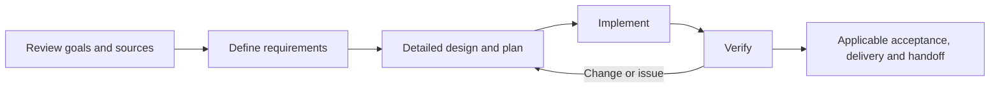

# Project Harness

[한국어](README.md) | **English**

**A working framework for managing software projects with AI agents, connecting customer requirements to detailed plans, implementation and verification.**

The aim is to define behavior and implementation approaches early enough to reduce guesswork and rework during development. Documents preserve the reasons for the work and its results so another session or contributor can continue it.

This repository provides policies and guidance for agents. There is no separate harness application to install; each product supplies its own build and test environment.

[Getting started](#getting-started) · [Development flow](#development-flow) · [Reading the documents](#what-documents-record) · [Example requests](#example-requests) · [Checking results](#verification-and-completion)

## Purpose

The framework helps you keep track of four things throughout a project:

- **What to build:** customer requirements and the conditions for satisfying them.
- **How to build it:** design, implementation order, failure handling and verification methods at the depth the work needs.
- **Where the work stands:** completed work, observed results, blockers and next actions.
- **What a change affects:** related requirements and work that need updates.

Planning depth matched to risk, separate documents for independent items, stable IDs, and the agent's own judgment and verification are core principles. Existing content is reused after checking that it still applies.

## Getting started

1. Have the agent read this repository's [shared policy](AGENTS.md) and the entry guidance for its tool.
2. Describe the intended result, source/code locations, constraints and how far to proceed this time. Mention any build and test approach you have already chosen; otherwise it is decided during design and planning.
3. The agent checks the current state and prepares the documents and work for that scope.

Entry guidance is available for [Codex](CODEX_START_PROMPT.md) and [Claude](CLAUDE_START_PROMPT.md). When adopting the harness in another project, inspect its existing policies and documents before integrating the relevant guidance.

A first request can look like this. You do not need to specify every document ID or file path yourself.

> Use this harness to plan an administrator user-management feature.
> Administrators should be able to search users and export search results as CSV.
> Existing code and requirements are at [source location].
> Keep the existing login and permission model. For now, prepare requirements, design and a detailed plan only.

If the goal is still unclear, start with discovery and requirements. The agent prepares evidence and options for decisions that need your input.

### Applying it to another project

1. **Copy the harness, unchanged, into its own folder.** Copy all files this repository tracks in Git (`git archive` extracts them conveniently) into the project's `harness/` folder, and do not edit them inside the project. Avoid `.harness/`, the name used by former runtime records. Links inside the harness are relative, so the folder works wherever it sits. Copying keeps the policy versioned with the project, which helps tracing.
2. **The project owns its root entry files.** The project writes its own root `CLAUDE.md` and `AGENTS.md` and routes them to the harness policy and the tool adapters in the copy. The [Claude adapter](CLAUDE.md#in-an-adopting-project) and the [Codex adapter](CODEX_START_PROMPT.md#in-an-adopting-project) show how. Record the copied harness folder and harness commit once in the entry file. Every session loads that root file, so it carries what work cannot start without — the stack, the check commands (what each verifies, what it needs to run and which not to run routinely; the command definitions stay in the build files), the code and document layout, the conventions a writer would otherwise violate — plus a short pointer to the current stage and the first documents to read. Content that an item owns stays with that item; see [project instruction files](docs/DATA_MODEL.md#project-instruction-files). If the project already has a CLAUDE.md or AGENTS.md, add the harness route and pointers to it and resolve conflicts between its rules and the harness policy. The harness policy never weakens the project's contracts or CI rules. In a large repository, rules for one area can live in a [path-scoped instruction file](docs/DATA_MODEL.md#path-scoped-instruction-files) inside that subtree, read together with the root policy by work that touches those paths. A path-scoped file adds detail; it cannot weaken the root policy or a contract.
3. **Choose a document root and folders by kind.** For example, place requirements in `requirements/`, plans in `plans/` and tasks in `tasks/` beneath `project-docs/`. Where no convention exists, use the [default folder table](docs/DATA_MODEL.md#folders-by-document-kind) and record the chosen layout in the overview.
4. **Establish the overview when document work starts.** Reuse an existing overview; otherwise follow [compact documentation](docs/DATA_MODEL.md#minimum-documentation-for-a-small-change), which allows an eligible work document to also serve as the overview. A report-only request creates no files. Record the objective and scope, the document root and type-to-folder mapping, the ID format table (only the kinds needed, from the [starter table](docs/ID_DICTIONARY.md)), the ID allocation section, and any project conventions already decided, such as the verification kinds and environments a release needs and the integration model. Check commands go in the entry file, not the overview. An undecided convention is recorded as undecided and settled during design and planning. Material that is not a development basis — customer communication documents, a superseded source, a legacy implementation being replaced — is designated in the overview as a [non-authoritative input](docs/DEVELOPMENT_METHOD.md#non-authoritative-inputs): it is not used as requirement, scope or evidence, and its divergence from the product is not raised as a defect or blocker.
5. **An existing project starts from its actual state.** Record the intake commit, analysis scope, what is already implemented and the known verification and deployment status in the overview. Requirements recovered from code are marked as observed or inferred; only what the customer confirmed counts as a confirmed requirement. Existing documents and IDs stay as they are and are referenced.
6. **Add tool settings when the project has secrets, deployments or shared branches.** Policy text changes what the agent attempts; it does not stop execution. Configure blocked secret-file reads and prompts for risky commands from the [tool-level supporting controls](docs/SECURITY.md#tool-level-supporting-controls), and keep the actual boundary, such as refusing force pushes, in controls the agent cannot change, like branch protection.

An adopted project divides roughly as follows. Harness files and project files never mix, so the harness also stays clear of the project's own `docs/` folder.

```text
my-project/
  AGENTS.md          # project-owned: harness route and commit, stack, commands, layout, resumption pointer
  CLAUDE.md          # project-owned: imports the harness Claude adapter and the root AGENTS.md
  harness/           # harness copy: never edited
    AGENTS.md  CLAUDE.md  CODEX_START_PROMPT.md  README.md  docs/  tools/
  project-docs/      # project documents
  src/
```

**Updating the harness.** Replace the contents of `harness/` with a newer commit's tracked files and update the commit recorded in the entry file. The project never edited the copy, so nothing needs merging. If the harness itself needs a change, make it in this repository and bring it in again. After an update, check the entry files' and documents' links, for example with `node harness/tools/check-docs.mjs AGENTS.md CLAUDE.md harness project-docs`. An existing project that copied the harness into its root [moves to this layout](docs/DATA_MODEL.md#project-instruction-files) when requested.

Before completing adoption, check that the root instructions reach the harness policy and tool adapters, the project overview and the current resumption point. The project's README introduces the product and links its overview, with a separate link to `harness/README.md` for harness usage. The actual stack, commands and paths must be discoverable. See the [project entry rules](docs/DATA_MODEL.md#project-instruction-files).

Place each item's Markdown file in its document-kind folder. This shows part of the default layout; create only the folders and files needed. Preserve existing projects' folders and IDs.

```text
project-docs/
  overview/DOC-001.md            # overview: objective, folder mapping, ID formats and allocation, conventions, item index
  requirements/
    REQ-001.md                  # one file per requirement
    REQ-002.md
  designs/DES-001.md             # shared design
  contracts/API-001.md           # API contract
  screens/SCR-PC-001.md          # screen specification
  plans/PLAN-001.md              # implementation order and task links
  tasks/
    TASK-AUTH-001.md             # tasks per area
    TASK-AUTH-002.md
  verifications/VER-001.md       # verification records
  verifications/contracts/CT-API-001-01.md  # separately managed contract check
  open-items/OI-001.md           # open items
  decisions/DEC-001.md           # decision
  decisions/architecture/ADR-001.md        # architecture decision
```

Use the [default folder table](docs/DATA_MODEL.md#folders-by-document-kind) for research, guides, meeting notes, reviews, reports, changes and handoffs. Add a suitable folder mapping for each new kind. Connect feature relationships through the overview and document links. When files become hard to distinguish, add descriptions to new filenames, such as `TASK-UI-025-popup-migration.md`, or subdivide kind folders by work area.

## Development flow



Each stage has defined inputs and outputs. You do not approve every stage — only the decisions in the last column.

| Stage | Inputs | Outputs | What you decide |
|---|---|---|---|
| Discovery | Goals, sources, existing code | Problem boundaries, stakeholders, constraints, unresolved questions | How far to investigate |
| Requirements | Discovery results and supporting evidence | Intended outcomes, acceptance criteria, priorities, source trace | Whether these are the right requirements |
| Design | Requirements at a fixed version, and constraints | Components, interfaces, data, alternatives, risks, requirement coverage | Which alternative to take |
| Planning | Original scope sources, requirements, design, current progress | Work order, exception handling, verification methods and unknown dispositions at the selected depth | Only where a choice is left open |
| Implementation | A concrete scope decision, ready inputs and permissions | Code and document changes, with deviations from the plan recorded | What to implement this time |
| Verification | Candidate version, criteria, check environment | Actual results, failures, limits of applicability | How far to verify |
| Acceptance | The candidate and its verification | The authorized customer's acceptance or feedback | Whether to accept — never done on your behalf |
| Delivery | Release scope, operational prerequisites, permissions | The deployed version and post-delivery checks | Approval to go to production |
| Closure | All contributing work, evidence, outstanding obligations | An honest disposition per item, and acceptance, delivery, handover and maintenance obligations settled | When to declare closure |
| Maintenance | The released baseline, new requests and incidents | Traced changes and recheck results, with earlier observations preserved | The next request |

**Moving between stages.** Work stops at the requested stage. A planning-only request ends with the plan; a request to implement a concrete scope continues through ready implementation and verification work, and the same scope does not require approval again at every step. Planning is finished when it passes its completion checks, not when a document exists: the original sources are reflected in the plan, the detail is concrete enough that the implementer does not have to guess consequential behavior, and every unknown has a disposition. Listing open questions is not a pass. Starting implementation additionally needs a scope decision and ready prerequisites.

A small change that finishes in one session and leaves nothing behind is a direct change with no work document. This applies when the request sets the scope, every needed check passes in that session, the change adds no new requirement, contract or design decision and changes nothing existing records define, and no high-risk action or overlap with other work is involved. Changes that alter behavior qualify too, such as a fix that restores specified behavior. A new capability does not, however clear its request: the request sets the scope, but the capability still needs its requirement and planning records. The report — request and scope, starting state, changed paths, check results and a draft commit message — and the commit carry the record. If something remains, such as a failing check or a needed decision, it is recorded in a work document before the session ends. See [direct changes](docs/DEVELOPMENT_METHOD.md#direct-changes).

Otherwise, compact planning is the default for bounded, reversible low-risk work with a clear outcome, including corrections and small additions using established contracts. Record the basis, expected result, paths, steps and checks in the work document, review them and proceed; no separate exception justification or planning-review log is needed. Public contract, data lifecycle or access-policy changes, coordinated independent outputs and high-risk external effects require detailed planning for the affected scope. See [planning depth](docs/DEVELOPMENT_METHOD.md#choosing-planning-depth).

**Models suited to the work.** Definition, analysis, design, planning, decisions and verification judgments use the strongest suitable model currently available. Implementation models vary with difficulty and failure impact; analysis or design judgments discovered during development return to a strong model. Concrete models are selected from the execution environment using current evidence, respecting explicit model pins and usage constraints. See [model selection](docs/CONTEXT_EFFICIENCY.md#model-selection-and-delegation).

**Going back.** When implementation behaves unexpectedly, the cause is investigated first, then the affected plan is revised or the missing decision requested. Where that change touches what was already agreed, the related requirements, design, tasks and verification are updated with it. A failed check or a withdrawn pass is reported as it stands, and dependent work waits until the condition for restoring it is met.

**What needs its own approval.** Production deployment, production data changes, destructive operations, access to secrets and protected credentials, and final customer acceptance are never covered by development authority. These five are confirmed separately even when you do not mention them, and acceptance requires the authorized customer's own sign-off.

**Existing projects** start from their actual progress. The agent distinguishes implemented behavior from remaining work and uses existing documents, IDs and history, keeping behavior observed in code, inferred intent, requirements confirmed by the customer and open unknowns apart from each other.

## What documents record

**Start with the overview for the whole project, or the task document for work already identified.** Work items own execution state, authority, immediate next action and prerequisites; verification records own check results. Plans manage order, dependencies and resumption positions. Overviews and parent plans link these owners without repeating task statuses or pass counts.

Work spanning sessions uses a resumption record linking the current item, next item and first owning sections to read. Read execution mode, next action and blockers from the work item, and checkpoint results from their evidence. Check [current instructions](docs/WORKFLOW.md#updating-current-work-state) when switching, resuming or handing off. A task status change alone requires no overview edit. Derive progress reports from the owners when requested; retained reports are dated snapshots.

| Document | What you can learn |
|---|---|
| Project overview | Overall goals, shared conventions, item index and links to current owning work |
| Requirements | Customer outcomes and the conditions for satisfying them |
| Design | How screens, APIs and data behave and connect |
| Plan | Implementation order, dependencies, verification methods, completion criteria and the current resumption point for work spanning sessions |
| Task | Owner, what the work may currently produce, the inputs it reads and the paths it shares with other work, concrete execution steps, declared stop conditions, completion checks written as actual commands, and progress |
| Verification | Which version was checked, the method, actual results and limitations |
| Open items and decisions | Questions still to settle, their impact and next action, and actual decisions |

Independently managed requirements and shared designs or contracts have their own linked documents. For bounded low-risk work, [compact documentation](docs/DATA_MODEL.md#minimum-documentation-for-a-small-change) keeps missing local approach, plan and verification definitions in distinct sections of the work document. Existing owners stay in place and are updated only when their facts change.

For example, **user search** and **CSV export** are separate requirements. “Display zero when no results match” is a condition within the search requirement. Fixing a search defect continues to reference that requirement.

IDs such as `REQ-001` and `PLAN-001` let you trace an item even when its title or owner changes. Relationships come from document links, not matching or similar numbers. The agent applies numbering and filename rules from the [document standard](docs/DATA_MODEL.md).

## Example requests

The only required input is which feature and what to do with it. You do not need IDs, file paths, folder names or new numbers. The agent finds the matching documents in the overview and plans and reports which items it resolved to, with their IDs. When several items could match, it presents the candidates before editing; when nothing matches, it says so instead of creating a new item.

Everything else has a default and is added only when you want something different.

| Optional line | Default | Example addition |
|---|---|---|
| Stopping point | Continue through ready stages within the request's authority and stopping point | `plan only`, `define the task only` |
| Exclusions | Production deployment, production data, secrets and final acceptance need separate approval even if unstated | `propose changes to the shared API contract, do not edit it` |
| Area | Derived from the item record after planning | `authentication area` |

Name the area during planning; later requests can use the item records. A feature spanning several areas can proceed when the requested scope and ownership are clear. The agent preserves others' uncommitted work and clarifies actual edit overlap or uncertain ownership. Being in the same area does not alone stop independent work.

`〈 〉` marks a placeholder; delete lines you do not need.

### Planning stage: name the area

**Analyze an existing project**

> Analyze the current code and documents and identify implemented features and remaining work.
> Distinguish observed facts, inferred intent and confirmed customer requirements.
> Stop after analysis and planning this time.

**Set up team work**

> This project has 〈3〉 people, each using a separate worktree on their own branch and merging through pull requests.
> The areas are 〈authentication (src/auth), backend API (src/api), screens (web)〉.
> Task numbers use 〈the GitHub issue number〉, and task assignment and status live in 〈GitHub Issues〉.
> Record the areas, ID formats, where task status lives and how changes land in the overview.

The agent records the area list, ID format table, tracker designation and change flow in the overview. Later requests use the recorded area, and the designated tracker allocates numbers. With separate worktrees and branches, issue assignees and reviewed pull-request merges as in this example, no separate owner table is needed. Shared documents can change within authorized scope through the same merge process.

If the team chooses allocation on separate branches without a tracker, new IDs are provisional until first integration. Fetch cannot prevent simultaneous allocations, so the later-integrated item's provisional ID and references are repaired if they collide, retaining a mapping to earlier records. Established IDs stay unchanged. See the conditions for [branch allocation](docs/DATA_MODEL.md#branch-allocation-and-collision-repair).

**Join and check the current state**

> I am joining this project. The area I will work in is 〈authentication〉.
> Read the overview and my area's items, and tell me the current stage, assigned tasks, open items and blockers.
> Report only; do not edit documents.

In a small project with a single area, the first line can simply be "tell me the current state".

**Plan a new feature**

> Plan a 〈password reset link expiry〉 feature in the 〈authentication area〉.
> Write the requirement, design and detailed plan only, and flag any impact on other areas.

**Define a new task**

> Create a new task in the 〈authentication area〉.
> Content: 〈notify an administrator when an unlock is requested〉. It belongs to the 〈account lockout〉 requirement.
> Allocate the ID under the area's allocation rule and link it in that plan's task list.
> Define the task only; do not implement it.

If the behavior is not in any requirement, the agent reports that a requirement change comes first.

### After planning: name only the feature

**Implement a defined task**

> Work on the 〈lock the account after five failed sign-ins〉 task.
> Start from its task document and check the currently applicable requirements, design and decisions.
> Follow the task document's actions and completion checks, and continue through verification.

The agent first states which task it is. Documents of other areas and shared contracts can be edited when covered by the authorized scope and ownership/integration rules. Uncovered changes remain proposals; changes to another writer's files go through that owner or the agreed merge process. The completion report lists the checks actually run and their results.

**Fix a defect**

> Fix 〈the lock notice not appearing after failed sign-ins〉.
> Report the cause and affected scope first, then after the fix check 〈before lock, at lock and after unlock〉.

The agent finds the related requirement from the symptom and reuses applicable definitions and verification. The correction itself does not become a separate requirement. If it finishes with its checks in one session and nothing remains, it is a [direct change](docs/DEVELOPMENT_METHOD.md#direct-changes) with no work document. Otherwise, one writer handling one compact item without management records can use a single work document that also serves as its overview, subject to the [compact documentation conditions](docs/DATA_MODEL.md#minimum-documentation-for-a-small-change). Distinguish project context, expected behavior, approach, steps and actual verification there. Additional independent items or concurrent writers require a separate overview. See the [small correction without existing documents](docs/EXAMPLE_WEB_PROJECT.md#small-correction-without-existing-management-documents).

**Revise the plan during development**

> The observed 〈library response format〉 differs from the plan's assumption.
> Investigate while preserving the existing requirements and contracts, then update the affected design, work instructions and planned checks from the findings.
> Tell me where a new behavior or scope decision is needed, and continue ready work.

Resolve technical questions through authorized investigation or a bounded experiment. Use the findings to revise the affected plan and reuse applicable planning and verification evidence. Planning an experiment or revising a document does not establish passed product verification.

**Review a proposed change**

> I want to change 〈the session timeout from 30 to 15 minutes〉.
> Summarize the impact on related requirements, shared contracts, and other areas' tasks and verification.
> Mark the parts that need a decision in another area. Do not edit yet.

**Request a change to a shared document**

> The 〈sign-in API〉 response needs 〈a lock-status field〉.
> Do not edit it; leave a proposal with the change, reason and impact.
> Mark work that depends on this input as waiting until the proposal is applied, and continue independent work.

**Check progress and requirement trace**

> Summarize the current project progress from the project documents.
> For each requirement, show how far design, plan, tasks and verification are linked, and where links or work are missing or blocked.
> Report only; do not edit the documents.

Where an overview summary and the owning record differ, the owning record is reported and the difference is flagged.

**Prepare a scheduled report** (a weekly or milestone report the project owes)

> Prepare the report due 〈Wednesday〉. Take every progress figure from 〈the current WBS〉 only.
> Report what is confirmed as of today as done, and what is planned before the due date as planned.
> Leave anything unconfirmed as unconfirmed instead of filling it in.

A scheduled report is a deliverable, not a status summary produced on request. Its cadence, writing and delivery points, per-issue records and the single source for each figure are fixed in advance, and what is confirmed at the writing point is not mixed with what is merely expected before delivery. An issued report is not rewritten to match later facts; it is corrected in the next issue, and the current position stays in the owning records rather than in the report. A report written for a customer is communication, not a source of requirements or status.

**Report a blocker and record an open item**

> The 〈account lockout〉 task is blocked because 〈the sign-in API has no lock-status response definition〉.
> Record it as an open item with affected work, resolution criterion, owner and needed-by point.
> Continue the remaining unblocked work.

**Prepare for integration**

> Prepare my changes for integration.
> Summarize the diff of changed documents and code, the verification actually run, and checks that failed or did not run, and confirm new IDs and links follow the rules.
> Fetch and tell me about conflicts with 〈main〉; push only after I confirm.

**Hand off to another session or contributor**

> Summarize the changes to my assigned items so far and the actual verification results.
> Include unfinished work, blockers, pending shared-document changes and what the next contributor should do first.

## Implementation decisions and changes

You decide the goals, priorities, constraints and execution scope. Within that scope, the agent investigates technical details and performs detailed planning, implementation and verification.

When you delegate judgment, the agent records the [subject and limits](docs/APPROVALS.md#decision-requests-and-delegated-judgment), then records its choice and rationale within them. Delegated choices and routine implementation decisions need no repeated approval. A new specification version or plan prompts a coverage check against the actual delegation.

When an instruction, a specification, a contract, the running code and provisional material disagree, the agent follows a fixed [input precedence](docs/DEVELOPMENT_METHOD.md#input-precedence): your current instruction, then received specifications and their approved changes, then approved requirements, design and contracts, then current code and tests, then provisional material such as mock-ups and samples, and last the agent's own proposal. A lower basis does not win by being newer or more detailed. Detail found only in a mock-up does not become a requirement, and current behavior that contradicts an approved contract is reported as a defect. The order exists so a conflict does not halt bounded work; the conflict itself is recorded where it belongs, and a changed commitment goes through the change procedure.

When a material commitment changes, such as behavior, cost, data handling or use of an external service, the agent presents the reason and impact and obtains any needed decision. Production deployment, production data changes, destructive actions, protected-credential access and final customer acceptance need specific authorization and safeguards for the subject and effect. Sending external messages also needs explicit authority. See [decisions](docs/APPROVALS.md) and [security](docs/SECURITY.md) for the boundaries.

For a correction, reuse applicable content and update affected owners. Changes to shared functions or APIs require checking consumers, tests and requirements. [Corrections across tasks](docs/WORKFLOW.md#fixes-across-work-item-boundaries) link to owning work; deferred corrections retain responsibility, a next action and a needed-by point. Update the overview when its own scope, dependencies or navigation change.

When a decision is settled in conversation, retain its source and what it supersedes, then update the current owning instructions before the next action that depends on it. The next session should not need to recover the conversation to discover the current decision. For a report-only request, report the needed amendments without editing files.

Concurrent agents keep separate edit scopes and use a separate worktree or clone for each writer. Branch names alone do not isolate a shared checkout. In a single working tree, run one writing agent at a time; review and analysis that write nothing can run alongside it. Two writers in one tree merge into a single uncommitted state that no one can attribute afterwards. Commits stage the paths the work actually changed; staging a whole directory or working tree sweeps in whatever else was already there. Work that needs an unresolved contract or input waits; independent work with ready prerequisites can continue. Questions are tracked through their answers and incorporation into related documents, without copying the same evidence into multiple records.

### When the agent stops and asks

In these situations the agent stops the affected work and asks for a decision or input. Unaffected work continues.

- **The request alone cannot fix the outcome.** "Improve this" with no target, where the agent would have to choose the result for you.
- **A material commitment exceeds existing authority.** Behavior or acceptance criteria, interfaces other systems rely on, data collection, retention or deletion, security or permission boundaries, cost, external services or delivery promises, or the assumptions behind an earlier decision. The agent presents the before and after and asks for a decision.
- **A high-risk boundary is reached.** Production deployment, production data changes, destructive operations, secret access and final customer acceptance. Ordinary implementation approval is not enough; a human decision naming the subject, version and effect is needed.
- **Essential input is missing.** Actual edit overlap with another writer needs coordination, the intended item is unclear among several candidates, or a scope/behavior choice cannot be resolved from available sources.
- **The basis is unreliable.** Uncertain authority provenance, an ownership conflict, or contradictory current evidence.

The agent does not ask about the following. Unknown filenames or test commands, splitting or reordering tasks, starting the next task in the same scope, or approval of planning completion itself. A clear fix request is its own scope decision, so the agent does not ask "shall I proceed?" again.

## Verification and completion

Look for three things in a result report:

1. **Completed scope:** which requirements and tasks were addressed.
2. **Observed results:** what was checked, against which version and environment, and what passed or failed.
3. **Remaining work:** unrun checks, unresolved issues, required decisions and next actions.

Planning completion, implementation, verification, customer acceptance and project closure are distinct. Prepared documents or existing code do not by themselves establish working behavior or customer acceptance. Failed, unrun and partial checks are reported as such. Once decided, check commands are recorded in the entry file and required verification environments in the project overview, and verification records refer to them.

Completion evidence links the actual tested output version, command, check code and relevant inputs. Without Git, a preserved tested snapshot or equivalent identifies the subject. One-off observations lacking reviewable evidence retain that limitation under [verification and completion](docs/WORKFLOW.md#verification-and-completion).

Checks run against the subject the claim names. A result from a stand-in — a fixture, a copied sample, a mock — is evidence about that stand-in, so a claim about real behavior is confirmed on the real artifact and the record says which one. Where a subject has repeated instances, the record names the ones actually examined and does not present a spot check as a whole-subject pass. A whole-item or acceptance-level pass with high consequence is confirmed by someone other than the writer who produced the work.

Select checks from the intended result and the failure they must detect. Element existence alone cannot establish readability in the rendered product. Reuse checks that already establish the result instead of adding equivalent tests. Execution timing, cost and reuse follow [check scope and scheduling](docs/CONTEXT_EFFICIENCY.md#check-scope-and-scheduling); required project/CI checks remain required.

For UI and graphics, inspect and interact with a representative result in the actual product before extending a shared treatment to other instances. Check required visibility, clipping, readability and usability. Generating captures alone does not complete visual inspection; record the screens, states and limits examined. Keep agent review distinct from human review and customer acceptance.

For [product assumptions](docs/DEVELOPMENT_METHOD.md#testing-product-assumptions) such as enjoyment or usability, plan how and when actual use will inform the decision before expanding dependent work. If you defer the check, retain that decision, the risk and the later checkpoint. Expectations and estimates remain distinct from observations.

If work is blocked, the report identifies the cause and affected scope. A handoff states what the next contributor should do and which inputs are needed.

You can check for broken document links and heading anchors yourself with `node tools/check-docs.mjs [document path]`. It needs only Node and changes no files. It also catches links whose letter case differs from the file, which pass on case-insensitive systems such as Windows but break on GitHub. Inside a Git repository it skips folders that `.gitignore` excludes. The checker is optional; the required document validation may use equivalent tools or manual checks under [verification guidance](docs/CONTEXT_EFFICIENCY.md#document-checker). For files named by ID, such as `REQ-001.md`, it also reports two files owning the same ID, a filename ID missing from the body, and an item that no document links to. A pass covers only these mechanical checks; content, ID allocation and trace coverage are reviewed separately.

### States and verification kinds

The policy requires task states, verification kinds, acceptance and closure to be kept distinct. The six task states are PLANNED, IN_PROGRESS, BLOCKED, IMPLEMENTED, DONE and CANCELLED, defined under [task states](docs/WORKFLOW.md#task-states). The four verification kinds are distinct kinds, not steps on one scale. A verification record carries the actual method, environment, subject version, result and limits alongside the label, so the label alone is never the judgment.

| State | Meaning | What it does not prove |
|---|---|---|
| Planning complete | The planning completion checks passed: source coverage, executable detail and dispositions for unknowns. | Authority to execute. A scope decision and ready prerequisites are still needed. |
| IMPLEMENTED | **Task state.** The changes are done, but the task's completion checks have not passed yet. | That any check passed. |
| DONE | **Task state.** The task's declared completion checks passed on an identified version. | Another verification kind, the plan's outcome, acceptance or closure. |
| STATIC_VERIFIED | **Verification kind.** Checks that do not run the product passed, such as compilation, static analysis and document or link checks. | Actual behavior or integration. |
| INTEGRATION_VERIFIED | **Verification kind.** Connected components were run together in a check environment. | Real screen behavior or the live environment. |
| BROWSER_VERIFIED | **Verification kind.** Confirmed through a real browser or user interface. | Live-environment data, configuration and load. |
| LIVE_ENV_VERIFIED | **Verification kind.** Confirmed in the live environment or one declared equivalent to it. | Customer acceptance. |
| CUSTOMER_ACCEPTED | **Acceptance.** The authorized customer explicitly accepted a specific candidate version. | Completion of handover and maintenance obligations. |
| CLOSED | **Closure.** All work contributing to a release or project and its acceptance, delivery, handover and maintenance obligations are settled. An open item's CLOSED closes only that item. | Nothing. This is closure. |

A subject examined without passing, one that cannot be checked because a required input is missing — a permission state, data set, environment, policy or source version — one needing rework, and one the criteria do not apply to each carry their own disposition and stay out of pass counts. A missing required input is raised as an open item so it has an owner and a next action.

When a later check overturns an earlier pass, that pass is withdrawn explicitly: the record names which subjects lost their pass, keeps both the original evidence and the finding that overturned it, and states what must pass to restore it. Work that proceeded on the withdrawn basis returns to its prior state. Withdrawal preserves the history rather than erasing it.

Failed, unrun, partial or stale checks are not a pass of any kind. After a change, assess existing evidence for applicability and recheck the affected scope. Unaffected results can be reused with their original version/environment and the reuse basis. Metadata changes alone do not require repeating product checks; required project/CI checks remain required. See [verification reuse](docs/CONTEXT_EFFICIENCY.md#reuse-and-verification).

### Example result report

After taking the "lock the account after five failed sign-ins" task through verification, the report looks roughly like this.

> **Scope completed**: TASK-AUTH-003 under REQ-005 (account lockout). Lock counter, lock response and lock notice text. Other tasks in PLAN-002 untouched.
>
> **Actually verified**: commit 9f3e21a, local Node 20 environment. `npm test`: 47 passed. Before-lock, at-lock and after-unlock scenarios confirmed by integration tests. Task state: DONE. Verification kind: INTEGRATION_VERIFIED. No browser check performed.
>
> **Remaining**: API-001 still lacks the lock-status response field, recorded as OI-003, follow-up by minsu, needed before the next integration. Unlock notification is out of scope. Next action: run contract test CT-API-001-02 once API-001 is updated.

Three things to check in such a report: whether what was checked is stated as a command and environment, whether any unrun check is hidden, and whether each blocker has an owner and a next action.

The policy does not guarantee development speed or token savings. Results depend on planning quality, the project and how the guidance is applied.

## Detailed documentation

This README explains the harness for people using it. Agents apply the relevant detailed rules through the [shared policy's reading guide](AGENTS.md#startup-and-context).

| To learn more about | Read |
|---|---|
| Overall operating principles | [Shared policy](AGENTS.md) · [Constitution](docs/CONSTITUTION.md) |
| Planning depth and existing-project analysis | [Development method](docs/DEVELOPMENT_METHOD.md) |
| Document organization and IDs | [Information model](docs/DATA_MODEL.md) · [ID dictionary](docs/ID_DICTIONARY.md) |
| Decisions, permissions and protection | [Approvals](docs/APPROVALS.md) · [Security](docs/SECURITY.md) |
| Open items, progress and closure | [Workflow](docs/WORKFLOW.md) |
| Concurrent work and handoff | [Collaboration](docs/COLLABORATION.md) |
| Reusing content and verification | [Context efficiency](docs/CONTEXT_EFFICIENCY.md) |
| A worked project flow | [Web project example](docs/EXAMPLE_WEB_PROJECT.md) |
