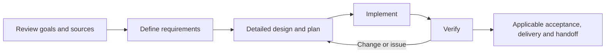

# Project Harness

[한국어](README.md) | **English**

**A working framework for managing software projects with AI agents, connecting customer requirements to detailed plans, implementation and verification.**

The aim is to define behavior and implementation approaches early enough to reduce guesswork and rework during development. Documents preserve the reasons for the work and its results so another session or contributor can continue it.

This repository provides policies and guidance for agents. There is no separate harness application to install; each product supplies its own build and test environment.

[Getting started](#getting-started) · [Development flow](#development-flow) · [Reading the documents](#what-documents-record) · [Example requests](#example-requests) · [Checking results](#verification-and-completion)

## Purpose

The framework helps you keep track of four things throughout a project:

- **What to build:** customer requirements and the conditions for satisfying them.
- **How to build it:** detailed design, implementation order, failure handling and verification methods.
- **Where the work stands:** completed work, observed results, blockers and next actions.
- **What a change affects:** related requirements and work that need updates.

Detailed planning, separate documents for requirements and their related work, stable IDs, and the agent's own judgment and verification are core principles. Existing content is reused after checking that it still applies.

## Getting started

1. Have the agent read this repository's [shared policy](AGENTS.md) and the entry guidance for its tool.
2. Describe the intended result, source/code locations, constraints and how far to proceed this time. Mention any build and test approach you have already chosen; otherwise it is decided during design and planning.
3. The agent checks the current state and prepares the documents and work for that scope.

Entry guidance is available for [Codex](CODEX_START_PROMPT.md) and [Claude](CLAUDE_START_PROMPT.md). When adopting the harness in another project, inspect its existing policies and documents before integrating the relevant guidance.

A first request can look like this. You do not need to specify every document ID or file path yourself.

> Use this harness to plan an administrator user-management feature.
> Administrators should be able to search users and export search results as CSV.
> Existing code and requirements are at [source location].
> Keep the existing login and permission model. For now, prepare requirements, design and a detailed plan only.

If the goal is still unclear, start with discovery and requirements. The agent prepares evidence and options for decisions that need your input.

## Development flow

Plans cover normal behavior, errors and boundary cases, data and interfaces, work order and verification methods. They should be concrete enough that the implementer does not have to guess consequential behavior.

Work stops at the requested stage. A planning-only request ends with the plan; a request to implement a concrete scope continues through ready implementation and verification work. The same scope does not require approval again at every step.

Existing projects start from their actual progress. The agent distinguishes implemented behavior from remaining work and uses existing documents, IDs and history. Behavior observed in code is also distinguished from requirements confirmed by the customer.

## What documents record

**Start with the project overview.** It shows progress and blockers by requirement and links to the details you want to inspect.

| Document | What you can learn |
|---|---|
| Project overview | Overall goals, progress by requirement, major blockers and document links |
| Requirements | Customer outcomes and the conditions for satisfying them |
| Design | How screens, APIs and data behave and connect |
| Plan | Implementation order, dependencies, verification methods and completion criteria |
| Task | Owner, concrete execution steps and progress |
| Verification | Which version was checked, the method, actual results and limitations |
| Open items and decisions | Questions still to settle, their impact and next action, and actual decisions |

Requirements, designs, plans, tasks and verification have separate linked files. Files are prepared for the relevant stage; a design or contract shared by several requirements has one owning document.

For example, **user search** and **CSV export** are separate requirements. “Display zero when no results match” is a condition within the search requirement. Fixing a search defect continues to reference that requirement.

IDs such as `REQ-001` and `PLAN-001` let you trace an item even when its title or owner changes. Relationships come from document links, not matching or similar numbers. The agent applies numbering and filename rules from the [document standard](docs/DATA_MODEL.md).

## Example requests

### Analyze an existing project

> Analyze the current code and documents and identify implemented features and remaining work.
> Distinguish observed facts, inferred intent and confirmed customer requirements.
> Stop after analysis and planning this time.

Use this to understand the current project and the work ahead.

### Implement a prepared plan

> Implement the presented scope using its verification methods.
> Exclude production deployment this time.

Use this to execute a concrete plan you have reviewed.

### Fix a defect

> Fix the search result count showing one when there are no matches.
> Show zero, and check non-empty and paginated results too.

The agent reuses existing requirements and detailed documents and specifies the correction and its affected work.

### Review a proposed change

> I want to add registration dates to the CSV export.
> First assess the impact on requirements, APIs, tasks and verification.

Use this to understand affected scope and work before deciding on a change.

### Check progress and requirement trace

> Summarize the current project progress from the project documents.
> For each requirement, show how far design, plan, tasks and verification are linked, and where links or work are missing or blocked.
> Report only; do not edit the documents.

Use this to see the current stage, the trace state and evidence level of each requirement, and inconsistencies between records, using only the project records. The agent reads the overview and each requirement's owning documents and reports the baseline version, a per-requirement trace table, counts with stated definitions, gaps and blockers. Where an overview summary and the owning record differ, the owning record is reported and the difference is flagged. You do not need to supply requirement IDs or file paths.

### Hand off to another session or contributor

> Summarize the changes and actual verification results so far.
> Include unfinished work, blockers and what the next contributor should do first.

The handoff lets work continue from the retained records.

## Implementation decisions and changes

You decide the goals, priorities, constraints and execution scope. Within that scope, the agent investigates technical details and performs detailed planning, implementation and verification.

When a material commitment changes, such as behavior, cost, data handling or use of an external service, the agent presents the reason and impact and obtains any needed decision. Production deployment, production data changes, destructive actions, protected-credential access and final customer acceptance need specific authorization and safeguards for the subject and effect. Sending external messages also needs explicit authority. See [decisions](docs/APPROVALS.md) and [security](docs/SECURITY.md) for the boundaries.

For a correction, the agent reuses applicable content and keeps affected documents current. Changes to shared functions or APIs also require checking other requirements that use them. The overview is updated when its summary changes, including major stages, blockers or dependencies.

Concurrent agents agree owners and edit boundaries. Work that needs an unresolved contract or input waits; independent work with ready prerequisites can continue. Questions are tracked through their answers and incorporation into related documents, without copying the same evidence into multiple records.

## Verification and completion

Look for three things in a result report:

1. **Completed scope:** which requirements and tasks were addressed.
2. **Observed results:** what was checked, against which version and environment, and what passed or failed.
3. **Remaining work:** unrun checks, unresolved issues, required decisions and next actions.

Planning completion, implementation, verification, customer acceptance and project closure are distinct. Prepared documents or existing code do not by themselves establish working behavior or customer acceptance. Failed, unrun and partial checks are reported as such. The commands and environments used for checks are recorded in the project overview once decided, and verification records refer to them.

If work is blocked, the report identifies the cause and affected scope. A handoff states what the next contributor should do and which inputs are needed.

The policy does not guarantee development speed or token savings. Results depend on planning quality, the project and how the guidance is applied.

## Detailed documentation

This README explains the harness for people using it. Agents apply the relevant detailed rules through the [shared policy's reading guide](AGENTS.md#startup-and-context).

| To learn more about | Read |
|---|---|
| Overall operating principles | [Shared policy](AGENTS.md) · [Constitution](docs/CONSTITUTION.md) |
| Detailed planning and existing-project analysis | [Development method](docs/DEVELOPMENT_METHOD.md) |
| Document organization and IDs | [Information model](docs/DATA_MODEL.md) · [ID dictionary](docs/ID_DICTIONARY.md) |
| Decisions, permissions and protection | [Approvals](docs/APPROVALS.md) · [Security](docs/SECURITY.md) |
| Open items, progress and closure | [Workflow](docs/WORKFLOW.md) |
| Concurrent work and handoff | [Collaboration](docs/COLLABORATION.md) |
| Reusing content and verification | [Context efficiency](docs/CONTEXT_EFFICIENCY.md) |
| A worked project flow | [Web project example](docs/EXAMPLE_WEB_PROJECT.md) |
