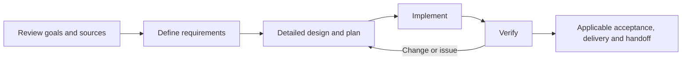

# Project Harness

[한국어](README.md) | **English**

**A working framework for managing software projects with AI agents, connecting customer requirements to detailed plans, implementation and verification.**

The aim is to define behavior and implementation approaches early enough to reduce guesswork and rework during development. Documents preserve the reasons for the work and its results so another session or contributor can continue it.

This repository provides policies and guidance for agents. There is no separate harness application to install; each product supplies its own build and test environment.

[Getting started](#getting-started) · [Development flow](#development-flow) · [Reading the documents](#what-documents-record) · [Example requests](#example-requests) · [Checking results](#verification-and-completion)

## Purpose

The framework helps you keep track of four things throughout a project:

- **What to build:** customer requirements and the conditions for satisfying them.
- **How to build it:** detailed design, implementation order, failure handling and verification methods.
- **Where the work stands:** completed work, observed results, blockers and next actions.
- **What a change affects:** related requirements and work that need updates.

Detailed planning, separate documents for requirements and their related work, stable IDs, and the agent's own judgment and verification are core principles. Existing content is reused after checking that it still applies.

## Getting started

1. Have the agent read this repository's [shared policy](AGENTS.md) and the entry guidance for its tool.
2. Describe the intended result, source/code locations, constraints and how far to proceed this time. Mention any build and test approach you have already chosen; otherwise it is decided during design and planning.
3. The agent checks the current state and prepares the documents and work for that scope.

Entry guidance is available for [Codex](CODEX_START_PROMPT.md) and [Claude](CLAUDE_START_PROMPT.md). When adopting the harness in another project, inspect its existing policies and documents before integrating the relevant guidance.

A first request can look like this. You do not need to specify every document ID or file path yourself.

> Use this harness to plan an administrator user-management feature.
> Administrators should be able to search users and export search results as CSV.
> Existing code and requirements are at [source location].
> Keep the existing login and permission model. For now, prepare requirements, design and a detailed plan only.

If the goal is still unclear, start with discovery and requirements. The agent prepares evidence and options for decisions that need your input.

### Applying it to another project

1. **Bring in the policy files.** Copy [AGENTS.md](AGENTS.md) and [docs/](docs/) into the project, or keep this repository alongside and reference it by path. Copying keeps the policy versioned with the project, which helps tracing. Put the tool entry file ([CLAUDE.md](CLAUDE.md) or [CODEX_START_PROMPT.md](CODEX_START_PROMPT.md)) at the project root. If the project already has a CLAUDE.md or AGENTS.md, compare the two sets of rules, resolve conflicts and integrate them. The harness policy never weakens the project's contracts or CI rules.
2. **Choose a document root.** Decide where project documents live, for example `project-docs/`. The project chooses folder names and records them in the overview.
3. **The first session creates the overview.** On the first request the agent creates the project overview and records the objective and scope, the document root and type-to-folder mapping, the ID format table (only the kinds needed, from the [starter table](docs/ID_DICTIONARY.md)), the ID allocation section, and any build, test and check commands and environments already decided. An undecided convention is recorded as undecided and settled during design and planning.
4. **An existing project starts from its actual state.** Record the intake commit, analysis scope, what is already implemented and the known verification and deployment status in the overview. Requirements recovered from code are marked as observed or inferred; only what the customer confirmed counts as a confirmed requirement. Existing documents and IDs stay as they are and are referenced.

The document folder ends up roughly like this. Folder names and IDs are illustrative, and only the files needed for the requested stage are created.

```text
project-docs/
  overview/DOC-001.md            # overview: objective, folder mapping, ID formats and allocation, conventions, item index
  requirements/REQ-001.md        # one file per requirement
  designs/DES-001.md             # shared design
  contracts/API-001.md           # API contract
  plans/PLAN-001.md              # implementation order and task links
  tasks/TASK-AUTH-001.md         # tasks per area
  verifications/VER-001.md       # verification records
  open-items/OI-001.md           # open items
```

## Development flow



Plans cover normal behavior, errors and boundary cases, data and interfaces, work order and verification methods. They should be concrete enough that the implementer does not have to guess consequential behavior.

Work stops at the requested stage. A planning-only request ends with the plan; a request to implement a concrete scope continues through ready implementation and verification work. The same scope does not require approval again at every step.

Existing projects start from their actual progress. The agent distinguishes implemented behavior from remaining work and uses existing documents, IDs and history. Behavior observed in code is also distinguished from requirements confirmed by the customer.

## What documents record

**Start with the project overview.** It shows progress and blockers by requirement and links to the details you want to inspect.

| Document | What you can learn |
|---|---|
| Project overview | Overall goals, progress by requirement, major blockers and document links |
| Requirements | Customer outcomes and the conditions for satisfying them |
| Design | How screens, APIs and data behave and connect |
| Plan | Implementation order, dependencies, verification methods and completion criteria |
| Task | Owner, concrete execution steps and progress |
| Verification | Which version was checked, the method, actual results and limitations |
| Open items and decisions | Questions still to settle, their impact and next action, and actual decisions |

Requirements, designs, plans, tasks and verification have separate linked files. Files are prepared for the relevant stage; a design or contract shared by several requirements has one owning document.

For example, **user search** and **CSV export** are separate requirements. “Display zero when no results match” is a condition within the search requirement. Fixing a search defect continues to reference that requirement.

IDs such as `REQ-001` and `PLAN-001` let you trace an item even when its title or owner changes. Relationships come from document links, not matching or similar numbers. The agent applies numbering and filename rules from the [document standard](docs/DATA_MODEL.md).

## Example requests

The only required input is which feature and what to do with it. You do not need IDs, file paths, folder names or new numbers. The agent finds the matching documents in the overview and plans and reports which items it resolved to, with their IDs. When several items could match, it presents the candidates before editing; when nothing matches, it says so instead of creating a new item.

Everything else has a default and is added only when you want something different.

| Optional line | Default | Example addition |
|---|---|---|
| Stopping point | Continue through ready stages | `plan only`, `define the task only` |
| Exclusions | Production deployment, production data, secrets and final acceptance need separate approval even if unstated | `propose changes to the shared API contract, do not edit it` |
| Area | Derived from the item record after planning | `authentication area` |

Name the area only during planning. Once planning is done, every task, requirement and contract records the area it belongs to, so the agent derives the area from the feature. When a feature spans several areas, the agent asks. If it sees someone else's uncommitted work in the same area, it does not overwrite it and asks for confirmation instead.

`〈 〉` marks a placeholder; delete lines you do not need.

### Planning stage: name the area

**Analyze an existing project**

> Analyze the current code and documents and identify implemented features and remaining work.
> Distinguish observed facts, inferred intent and confirmed customer requirements.
> Stop after analysis and planning this time.

**Set up team work**

> This project has 〈3〉 people, each working on their own branch and merging through pull requests.
> The areas are 〈authentication (src/auth), backend API (src/api), screens (web)〉.
> Task numbers use 〈the GitHub issue number〉, and task assignment and status live in 〈GitHub Issues〉.
> Record the areas, ID formats, where task status lives and how changes land in the overview.

The agent records the area list, ID format table, tracker designation and change flow in the overview. Once that is recorded, later requests need not name the area and two people cannot create the same number. No table of owners or assignees is needed. Who is doing what is visible from issue assignees and branches, and overlap surfaces at merge. A team without issues says "task numbers continue per area", and the agent then fetches before creating a new item; if numbers still collide, whoever merges second renumbers.

**Join and check the current state**

> I am joining this project. The area I will work in is 〈authentication〉.
> Read the overview and my area's items, and tell me the current stage, assigned tasks, open items and blockers.
> Report only; do not edit documents.

In a small project with a single area, the first line can simply be "tell me the current state".

**Plan a new feature**

> Plan a 〈password reset link expiry〉 feature in the 〈authentication area〉.
> Write the requirement, design and detailed plan only, and flag any impact on other areas.

**Define a new task**

> Create a new task in the 〈authentication area〉.
> Content: 〈notify an administrator when an unlock is requested〉. It belongs to the 〈account lockout〉 requirement.
> Allocate the ID under the area's allocation rule and link it in that plan's task list.
> Define the task only; do not implement it.

If the behavior is not in any requirement, the agent reports that a requirement change comes first.

### After planning: name only the feature

**Implement a defined task**

> Work on the 〈lock the account after five failed sign-ins〉 task.
> Follow the task document's actions and completion checks, and continue through verification.

The agent first states which task it is. Documents of other areas and shared contracts are not edited; the agent leaves a change proposal instead. The completion report lists the checks actually run and their results.

**Fix a defect**

> Fix 〈the lock notice not appearing after failed sign-ins〉.
> Report the cause and affected scope first, then after the fix check 〈before lock, at lock and after unlock〉.

The agent finds the related requirement from the symptom and reuses that requirement and its existing verification. No new requirement is created.

**Review a proposed change**

> I want to change 〈the session timeout from 30 to 15 minutes〉.
> Summarize the impact on related requirements, shared contracts, and other areas' tasks and verification.
> Mark the parts that need a decision in another area. Do not edit yet.

**Request a change to a shared document**

> The 〈sign-in API〉 response needs 〈a lock-status field〉.
> Do not edit it; leave a proposal with the change, reason and impact.
> Mark work that depends on this input as waiting until the proposal is applied, and continue independent work.

**Check progress and requirement trace**

> Summarize the current project progress from the project documents.
> For each requirement, show how far design, plan, tasks and verification are linked, and where links or work are missing or blocked.
> Report only; do not edit the documents.

Where an overview summary and the owning record differ, the owning record is reported and the difference is flagged.

**Report a blocker and record an open item**

> The 〈account lockout〉 task is blocked because 〈the sign-in API has no lock-status response definition〉.
> Record it as an open item with affected work, resolution criterion, owner and needed-by point.
> Continue the remaining unblocked work.

**Prepare for integration**

> Prepare my changes for integration.
> Summarize the diff of changed documents and code, the verification actually run, and checks that failed or did not run, and confirm new IDs and links follow the rules.
> Fetch and tell me about conflicts with 〈main〉; push only after I confirm.

**Hand off to another session or contributor**

> Summarize the changes to my assigned items so far and the actual verification results.
> Include unfinished work, blockers, pending shared-document changes and what the next contributor should do first.

## Implementation decisions and changes

You decide the goals, priorities, constraints and execution scope. Within that scope, the agent investigates technical details and performs detailed planning, implementation and verification.

When a material commitment changes, such as behavior, cost, data handling or use of an external service, the agent presents the reason and impact and obtains any needed decision. Production deployment, production data changes, destructive actions, protected-credential access and final customer acceptance need specific authorization and safeguards for the subject and effect. Sending external messages also needs explicit authority. See [decisions](docs/APPROVALS.md) and [security](docs/SECURITY.md) for the boundaries.

For a correction, the agent reuses applicable content and keeps affected documents current. Changes to shared functions or APIs also require checking other requirements that use them. The overview is updated when its summary changes, including major stages, blockers or dependencies.

Concurrent agents keep separate edit scopes, usually separate branches. Work that needs an unresolved contract or input waits; independent work with ready prerequisites can continue. Questions are tracked through their answers and incorporation into related documents, without copying the same evidence into multiple records.

### When the agent stops and asks

In these situations the agent stops the affected work and asks for a decision or input. Unaffected work continues.

- **The request alone cannot fix the outcome.** "Improve this" with no target, where the agent would have to choose the result for you.
- **A material commitment changes.** Behavior or acceptance criteria, interfaces other systems rely on, data collection, retention or deletion, security or permission boundaries, cost, external services or delivery promises, or the assumptions behind an earlier decision. The agent presents the before and after and asks for a decision.
- **A high-risk boundary is reached.** Production deployment, production data changes, destructive operations, secret access and final customer acceptance. Ordinary implementation approval is not enough; a human decision naming the subject, version and effect is needed.
- **Essential input is missing.** Someone else's uncommitted work in the same area, a description that matches several items, or a decision the plan lacks that implementation now needs.
- **The basis is unreliable.** Uncertain authority provenance, an ownership conflict, or contradictory current evidence.

The agent does not ask about the following. Unknown filenames or test commands, splitting or reordering tasks, starting the next task in the same scope, or approval of planning completion itself. A clear fix request is its own scope decision, so the agent does not ask "shall I proceed?" again.

## Verification and completion

Look for three things in a result report:

1. **Completed scope:** which requirements and tasks were addressed.
2. **Observed results:** what was checked, against which version and environment, and what passed or failed.
3. **Remaining work:** unrun checks, unresolved issues, required decisions and next actions.

Planning completion, implementation, verification, customer acceptance and project closure are distinct. Prepared documents or existing code do not by themselves establish working behavior or customer acceptance. Failed, unrun and partial checks are reported as such. The commands and environments used for checks are recorded in the project overview once decided, and verification records refer to them.

If work is blocked, the report identifies the cause and affected scope. A handoff states what the next contributor should do and which inputs are needed.

### States and verification levels

The policy requires these states to be kept distinct. A verification record carries the actual method, environment, subject version, result and limits alongside the label, so the label alone is never the judgment.

| State | Meaning | What it does not prove |
|---|---|---|
| Planning complete | The planning completion checks passed: source coverage, executable detail and dispositions for unknowns. | Authority to execute. A scope decision and ready prerequisites are still needed. |
| IMPLEMENTED | The code or document change is done. | Any check may still be unrun. |
| STATIC_VERIFIED | Checks that need no execution passed, such as compilation, static analysis and document or link checks. | Actual behavior or integration. |
| INTEGRATION_VERIFIED | Connected components were run together in a check environment. | Real screen behavior or the live environment. |
| BROWSER_VERIFIED | Confirmed through a real browser or user interface. | Live-environment data and configuration. |
| LIVE_ENV_VERIFIED | Confirmed in the live environment or one equivalent to it. | Customer acceptance. |
| CUSTOMER_ACCEPTED | The authorized customer explicitly accepted a specific candidate version. | Completion of handover and maintenance obligations. |
| CLOSED | All contributing work and the acceptance, delivery, handover and maintenance obligations are settled. | Nothing. This is closure. |

Failed, unrun, partial or stale checks are not a pass at any level. If the subject changed after the checked version, the verification is stale and is not reported as a pass until rerun.

### Example result report

After taking the "lock the account after five failed sign-ins" task through verification, the report looks roughly like this.

> **Scope completed**: TASK-AUTH-003 under REQ-005 (account lockout). Lock counter, lock response and lock notice text. Other tasks in PLAN-002 untouched.
>
> **Actually verified**: commit 9f3e21a, local Node 20 environment. `npm test`: 47 passed. Before-lock, at-lock and after-unlock scenarios confirmed by integration tests. State: INTEGRATION_VERIFIED. No browser check performed.
>
> **Remaining**: API-001 still lacks the lock-status response field, recorded as OI-003, follow-up by minsu, needed before the next integration. Unlock notification is out of scope. Next action: run contract test CT-API-001-02 once API-001 is updated.

Three things to check in such a report: whether what was checked is stated as a command and environment, whether any unrun check is hidden, and whether each blocker has an owner and a next action.

The policy does not guarantee development speed or token savings. Results depend on planning quality, the project and how the guidance is applied.

## Detailed documentation

This README explains the harness for people using it. Agents apply the relevant detailed rules through the [shared policy's reading guide](AGENTS.md#startup-and-context).

| To learn more about | Read |
|---|---|
| Overall operating principles | [Shared policy](AGENTS.md) · [Constitution](docs/CONSTITUTION.md) |
| Detailed planning and existing-project analysis | [Development method](docs/DEVELOPMENT_METHOD.md) |
| Document organization and IDs | [Information model](docs/DATA_MODEL.md) · [ID dictionary](docs/ID_DICTIONARY.md) |
| Decisions, permissions and protection | [Approvals](docs/APPROVALS.md) · [Security](docs/SECURITY.md) |
| Open items, progress and closure | [Workflow](docs/WORKFLOW.md) |
| Concurrent work and handoff | [Collaboration](docs/COLLABORATION.md) |
| Reusing content and verification | [Context efficiency](docs/CONTEXT_EFFICIENCY.md) |
| A worked project flow | [Web project example](docs/EXAMPLE_WEB_PROJECT.md) |
