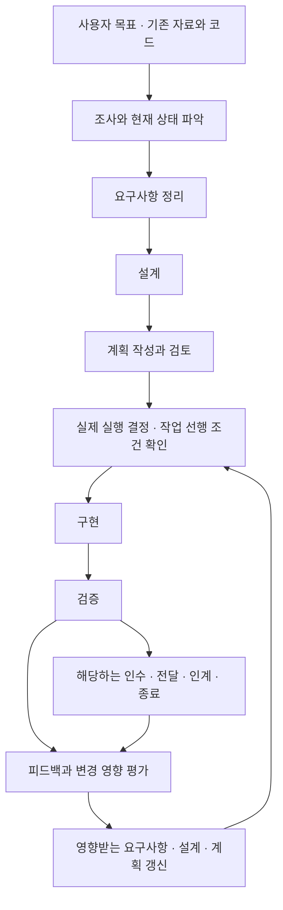

# Project Harness

**Project Harness는 사용자와 AI 에이전트가 소프트웨어 프로젝트를 조사부터 유지보수까지 일관된 기준으로 진행하기 위한 정책·문서 프레임워크입니다.**

무엇을 만들고, 왜 그렇게 설계했으며, 어떤 범위까지 수행하기로 했고, 무엇을 실제로 검증했는지 연결해 남깁니다. 에이전트는 이 근거를 바탕으로 작업을 이어가고, 사용자는 중요한 범위와 변경을 판단합니다.

여기서 하네스는 에이전트의 작업에 방향과 확인 기준을 제공하는 장치를 뜻합니다. 핵심 구성은 저장소 정책, 개발 절차, 프로젝트 문서와 실제 의사결정 기록입니다. **기본 운영에는 전용 런타임이나 CLI 초기화가 필요하지 않습니다.** 기존 Python CLI는 선택적으로 사용하는 도구입니다.

## 무엇을 위한 프로젝트인가

소프트웨어 개발은 코드를 작성한 것만으로 끝나지 않습니다. 사용자 의도를 구체적인 요구사항으로 만들고, 구현 가능한 설계를 준비하며, 변경 영향을 판단하고, 결과가 기준을 충족하는지 확인해야 합니다. 담당자가 바뀌어도 이 과정과 남은 작업을 이해할 수 있어야 합니다.

Project Harness는 이러한 연결을 프로젝트 안에 유지하기 위해 만들어졌습니다. 특히 에이전트가 여러 대화와 작업 세션에 걸쳐 개발할 때 필요한 판단 근거를 문서와 버전으로 남깁니다.

| 진행 중 발생할 수 있는 문제 | 하네스가 제공하는 기준 |
|---|---|
| 요청이 곧바로 코드 변경으로 이어져 범위가 불분명해짐 | 목표·인수 기준·설계·작업 범위를 구체화하고 실제 실행 결정을 연결합니다. |
| 새 세션이나 담당자가 이전 결정을 알기 어려움 | 기준 버전, 결정 출처, 진행 상태와 다음 작업을 인계 가능한 형태로 남깁니다. |
| 구현과 문서가 서로 다른 상태를 설명함 | 요구사항·설계·작업·검증의 관계를 추적하고 변경 영향을 반영합니다. |
| 계획을 나누거나 순서를 바꿀 때마다 같은 승인을 반복함 | 검토된 범위 안의 작업 조정에는 기존의 유효한 결정을 사용합니다. |
| 코드가 있다는 이유로 기능이 검증됐다고 보고함 | 구현·정적 확인·통합 검사·실환경 확인·고객 인수를 구분합니다. |
| 이미 개발한 프로젝트에 절차를 적용하려면 처음부터 다시 작성해야 함 | 실제 진행 상태와 이력을 보존하고 남은 작업부터 계획합니다. |
| 도구의 상태나 기록 형식 때문에 무관한 작업까지 멈춤 | 실제 권한·의존성·안전·검증에 미치는 영향으로 중단 범위를 판단합니다. |

## 어떤 프로젝트에 사용할 수 있는가

새 프로젝트의 요구사항과 설계를 준비할 때부터, 이미 운영 중인 제품의 변경이나 인계까지 사용할 수 있습니다. 문서의 상세 수준과 검증 방법은 실제 작업의 규모와 위험에 맞춥니다.

| 적용 상황 | 주요 활용 |
|---|---|
| 아이디어만 있는 신규 프로젝트 | 목표와 제약을 정리하고 요구사항·설계·계획을 작성합니다. |
| 코드가 먼저 만들어진 프로젝트 | 구현을 분석해 현재 명세를 복원하고 미확정 요구와 남은 작업을 찾습니다. |
| 개발 중 요구가 바뀌는 프로젝트 | 기존 기준을 보존하며 변경 범위, 영향과 재검증 대상을 정리합니다. |
| 검토 또는 문서화만 필요한 작업 | 요청한 단계의 결과와 한계를 보고하고 그 범위에서 마칩니다. |
| 여러 작업 흐름이 있는 프로젝트 | 계획별 의존성과 소유권을 관리하고 전체 결과를 모아 전달합니다. |
| 담당자나 에이전트 세션이 바뀌는 작업 | 실제 결정, 변경 버전, 검사 결과와 미완료 작업을 인계합니다. |

웹·모바일·라이브러리·데이터 프로젝트 등에 같은 운영 원칙을 적용할 수 있지만, 각 분야의 설계와 테스트 방법은 해당 프로젝트에 맞게 준비해야 합니다. 하네스 자체가 제품별 구현 도구나 테스트 환경을 제공하는 것은 아닙니다.

## 무엇으로 구성되어 있는가

현재 운영의 기준은 [AGENTS.md](AGENTS.md)입니다. README는 프로젝트를 이해하고 시작하기 위한 안내이며, 세부 판단은 관련 정책과 실제 프로젝트의 결정·근거를 함께 확인합니다.

| 구성 | 역할 |
|---|---|
| 공통 정책 | 에이전트의 권한, 개발 방식, 변경 처리, 검증과 안전 기준을 정의합니다. |
| 시작 프롬프트와 어댑터 | 사용하는 에이전트가 공통 정책과 현재 작업 맥락을 읽도록 안내합니다. |
| 개발·운영 문서 | 단계별 산출물, 승인, 협업, 인계와 종료 방법을 설명합니다. |
| 실제 프로젝트 문서 | 목표, 요구사항, 설계, 계획, 결정, 검증과 진행 상태를 담습니다. |
| 선택적 CLI | 기존 하네스 기록을 작성·점검·보고하는 보조 도구입니다. |
| 외부 권한 통제 | 보호된 CI·환경 승인·접근 제어 등을 통해 고위험 작업의 실제 권한을 통제합니다. |

이 저장소가 제공하는 주요 파일의 역할은 다음과 같습니다.

| 경로 | 내용 |
|---|---|
| `AGENTS.md` | 공통 운영 정책 |
| `CODEX_START_PROMPT.md` | Codex 작업 시작 안내 |
| `CLAUDE_START_PROMPT.md`, `CLAUDE.md` | Claude 작업 시작 안내와 어댑터 |
| `docs/` | 개발 방법, 진행 절차, 승인, 보안, 협업과 예시 |
| `scripts/`, `.harness/tooling/` | 선택적 Python CLI와 검사 도구 |
| `docs/archive/runtime-required-policy/` | 런타임 필수 운영에서 전환하기 전의 정책 보관본 |

프로젝트 문서는 성격에 맞는 폴더 안에 `<ID>.md`로 작성합니다. 예를 들면 `project-docs/requirements/REQ-00001.md`입니다. 폴더 이름과 계층은 에이전트가 프로젝트 상황에 맞게 정하고, 전체 개요에서 기능·작업별 관계를 연결합니다. 구체적인 구성과 연결 예시는 [문서는 무엇을 남기는가](#문서는-무엇을-남기는가)에서 설명합니다.

## 사용자와 에이전트는 어떻게 역할을 나누는가

사용자는 해결하려는 문제, 원하는 결과, 제약과 우선순위를 제공합니다. 에이전트는 자료를 분석하고 대안을 검토하며, 작업과 검증을 구체화합니다. 사용자는 구체적인 실행 범위와 중요한 변경을 결정하고, 에이전트는 그 범위 안의 작업을 수행합니다.

| 참여자 | 주된 역할 |
|---|---|
| 사용자 또는 프로젝트 책임자 | 목표·제약 제공, 구체적인 실행 범위와 중요한 변경 결정 |
| 에이전트 | 조사·문서화·계획, 작업 전 조건 확인, 허용된 구현·검증, 결과와 한계 보고 |
| 권한 있는 고객 | 해당 결과물과 버전에 대한 최종 인수 판단 |
| 운영 담당자와 외부 시스템 | 운영 배포, 데이터 변경, 보호 자원 접근 등 실제 고위험 권한 통제 |

에이전트가 사용자의 동의를 만들어 내거나 검사 통과를 승인으로 해석할 수는 없습니다. 검토된 범위 안에서 계획명을 바꾸거나 작업 순서를 조정할 때는 항목 ID와 기존의 유효한 결정을 유지합니다.

## 어떻게 진행되는가

개발은 조사, 요구사항, 설계, 계획, 구현, 검증, 인수, 전달, 종료와 유지보수의 단계로 정리합니다. 각 단계에서 입력과 산출물을 명확히 하는 폭포수 방식의 기본 구조를 사용하면서, 어느 단계에서든 변경 영향을 반영할 수 있습니다.

아래 흐름은 작업의 관계를 설명합니다. 반드시 통과해야 하는 CLI 상태 전이도는 아닙니다.



요청한 종료 지점도 작업 범위의 일부입니다. 요구사항만 요청하면 요구사항과 미확정 사항을 보고하고 마칩니다. 계획만 요청했다면 구현 허가를 받아야 계획 작성이 끝나는 것은 아닙니다. 전체 진행을 요청한 경우에는 실제 권한과 준비 상태가 충족된 단계를 이어갑니다.

### 단계별 입력과 산출물

| 단계 | 주요 입력 | 산출물과 완료 판단 |
|---|---|---|
| 조사 | 사용자 요청, 관련 자료, 기존 코드와 진행 상태 | 문제, 포함·제외 범위, 제약, 불확실성과 확인할 질문을 정리합니다. |
| 요구사항 | 조사 결과, 실제 결정과 출처 | 원하는 결과, 인수 기준, 우선순위와 근거를 검토할 수 있게 작성합니다. |
| 설계 | 기준 버전이 있는 요구사항과 제약 | 구성 요소, 인터페이스, 데이터, 예외 처리, 대안과 기술적 위험을 정리합니다. |
| 계획 | 요구사항, 설계, 이미 완료한 작업 | 작업·순서·의존성·수정 범위·검증 방법·위험과 미확정 사항을 작성하고 검토합니다. |
| 구현 | 구체적인 실행 결정, 준비된 입력과 권한 | 허용된 범위의 변경을 수행하고 차이, 발견한 문제와 남은 작업을 남깁니다. |
| 검증 | 결과물의 버전, 완료 기준, 검사 환경 | 실제 검사 방법과 결과, 실패·미실행 항목, 적용 범위와 한계를 기록합니다. |
| 인수 | 검증한 후보와 합의한 인수 기준 | 권한 있는 고객의 실제 확인 또는 피드백을 해당 버전에 연결합니다. |
| 배포·전달 | 전달 대상, 준비된 결과물, 필요한 승인 | 합의한 방식으로 전달하고 전달된 버전과 필요한 후속 확인을 기록합니다. |
| 종료 | 전체 기여 작업, 근거와 남은 의무 | 인수·전달·인계·유지보수 등 적용되는 의무의 처리를 확인합니다. |
| 유지보수 | 전달한 기준 버전, 변경 요청이나 장애 | 영향을 평가하고 허용된 수정과 재검증을 수행합니다. |

단계가 준비됐다는 판단은 문서와 근거로 확인합니다. 모든 단계에 별도의 사람 승인이나 스프린트를 추가할 필요는 없습니다. 다만 중요한 실행 결정과 고위험 권한은 해당 경계에서 확인합니다.

## 실제로 시작하는 방법

기본 운영에는 저장소 파일을 읽고 편집할 수 있는 에이전트와 프로젝트 자료가 필요합니다. 버전과 변경을 추적할 수 있도록 Git을 사용할 수 있으며, Git이 없는 작업에서는 기존 파일을 대체하기 전에 기준 사본을 보존합니다. 제품을 구현하거나 테스트할 때 필요한 환경은 제품의 기술 구성에 따라 별도로 준비합니다.

1. 에이전트가 [공통 정책](AGENTS.md)과 해당 시작 안내를 읽도록 합니다.
2. 원하는 결과와 이번 요청의 종료 지점을 알려 줍니다.
3. 관련 코드·문서의 위치, 기존 결정, 제약과 수정하면 안 되는 범위를 제공합니다.
4. 에이전트가 현재 상태와 필요한 자료를 확인하고 요청한 산출물을 작성합니다.
5. 구현으로 이어질 때는 구체적인 범위의 실제 결정과 작업 선행 조건을 확인합니다.
6. 결과물, 수행한 검사와 남은 한계를 확인합니다.

사용하는 도구의 진입 안내는 [Codex 시작 프롬프트](CODEX_START_PROMPT.md), [Claude 시작 프롬프트](CLAUDE_START_PROMPT.md), [Claude 어댑터](CLAUDE.md)에 있습니다.

### 새 프로젝트의 계획까지 준비하기

> 소규모 팀을 위한 업무 관리 서비스를 만들려고 해. 목표와 제약을 정리하고 요구사항, 설계, 작업 계획까지 작성해 줘. 이번에는 계획까지만 진행하고, 중요한 미확정 사항과 대안을 알려 줘.

이 요청은 조사와 문서 작성을 진행할 수 있는 범위를 제공합니다. 에이전트는 요구사항의 충족 여부를 어떻게 확인할지 정리하고, 설계와 작업 순서가 그 요구를 뒷받침하는지 검토합니다. 요청한 계획이 완성되면 결과와 실행에 남은 조건을 보고합니다.

### 기존 프로젝트를 분석하고 이어가기

> 현재 코드를 기준으로 요구사항과 설계를 복원해 줘. 실제로 구현된 내용, 코드에서 추정한 의도, 확인이 필요한 사항을 구분하고 남은 작업을 계획해 줘. 기존 변경과 이력은 보존해 줘.

에이전트는 기준 커밋이나 스냅샷을 확인한 뒤 관련 코드를 분석합니다. 이미 구현한 작업을 처음부터 다시 계획하기보다, 근거가 부족한 부분과 실제 남은 작업을 식별합니다.

### 준비된 범위의 구현을 진행하기

> 제시한 계획의 범위와 검증 방법으로 진행해. 운영 배포는 이번 범위에서 제외해.

이 문장은 앞서 실제로 제시한 구체적인 계획에 대한 응답일 때 그 범위의 결정이 됩니다. 에이전트는 응답과 제안 버전을 연결해 남기고, 적용되는 작업을 진행합니다. README의 예시 문구 자체는 어떤 프로젝트의 실제 승인 기록도 아닙니다.

### 검토나 인계만 요청하기

> 이번 릴리스의 변경과 검증 근거를 검토하고 인계 문서를 작성해 줘. 미실행 검사, 알려진 문제와 다음 담당자의 첫 작업을 포함해 줘.

해당 요청은 검토와 인계 자료 작성 범위에서 끝납니다. 검토 중 발견한 제품 결함을 수정하는 일은 실제 수정 권한과 범위를 따로 확인합니다.

## 기존 코드에서 문서를 복원하는 방법

이미 진행 중인 프로젝트를 받아 요구사항·설계·계획을 작성하는 것은 역공학의 한 활용입니다. 구현에서 구조와 동작을 분석하고, 이를 검토 가능한 설명과 계획으로 정리합니다.

먼저 분석 대상의 버전, 수정 중인 파일, 사용 가능한 자료, 실제 개발·검증·배포 상태를 파악합니다. 그다음 관련 코드, 테스트, 설정, 인터페이스와 기존 문서를 읽고 중요한 판단에 출처를 연결합니다.

| 구분 | 기록 예시 | 해석 시 주의할 점 |
|---|---|---|
| 관찰한 구현 | 특정 리비전의 목록 API에 페이지 크기 제한이 있음 | 분석한 코드와 경로에 관한 관찰입니다. |
| 추정한 의도 | 응답 크기나 성능을 고려한 제한으로 보임 | 근거가 있는 추정으로 표시하고 확정 요구와 구분합니다. |
| 확인된 요구사항 | 책임자가 목록 응답의 최대 항목 수를 명시함 | 실제 출처와 인수 기준에 연결합니다. |
| 모순 또는 미확정 사항 | 문서는 다른 제한값을 설명함 | 어느 기준을 적용할지와 영향받는 작업을 확인합니다. |
| 제안하는 변경 | 사용 시나리오에 맞춰 제한을 조정할 필요가 있음 | 현재 구현과 분리하고 변경 영향과 검증을 준비합니다. |

코드가 있다는 사실은 원래 의도, 정상 동작, 테스트 통과 또는 고객 인수를 증명하지 않습니다. 테스트 코드를 읽은 것과 실행한 것도 구분합니다. 실제 실행에는 적합한 환경과 권한이 필요합니다.

복원 작업의 결과에는 분석한 범위와 놓친 부분을 함께 적습니다. 이전 승인이나 검증이 없으면 없다고 기록하며, 과거 작업을 승인된 것처럼 소급 작성하지 않습니다.

자세한 흐름은 [개발 방법](docs/DEVELOPMENT_METHOD.md#existing-project-intake-and-reverse-engineering)과 [기존 웹 프로젝트 예시](docs/EXAMPLE_WEB_PROJECT.md)를 참고할 수 있습니다.

## 문서는 무엇을 남기는가

새로 작성하는 하네스 관리 문서는 모두 Markdown(`.md`)을 사용하며, 다음 작업과 판단에 필요한 정보를 담습니다.

| 정보 | 남겨야 할 핵심 내용 |
|---|---|
| 프로젝트 개요 | 목표, 범위, 공통 제약, 기준 버전, 기능·작업별 문서 목록과 진행 요약, ID 규칙 |
| 요구사항 | 결과, 인수 기준, 우선순위, 출처와 미확정 사항 |
| 설계 | 구조, 데이터와 인터페이스, 대안, 선택 이유와 위험 |
| 계획 | 작업, 의존성, 수행 순서, 변경 범위와 검증 |
| 결정 | 검토한 제안 버전, 사용자의 실제 응답과 출처, 조건 |
| 변경 이력 | 요청, 이전·이후 차이, 영향, 관련 결정과 재검증 |
| 검증 근거 | 대상 버전, 방법과 환경, 예상·관찰 결과, 산출물과 한계 |
| 인계·종료 | 기여 작업, 전달한 버전, 남은 의무, 담당자와 다음 행동 |

### 전체 개요와 기능·작업별 문서

기본 구조는 **문서 종류별 폴더 + 항목별 `ID.md` 파일**입니다. 예를 들어 요구사항은 `project-docs/requirements/REQ-00001.md`에 작성합니다. 독립적으로 관리하는 요구사항·설계·계획·작업은 각각 자기 종류의 폴더에 별도 파일을 갖습니다. 전체 개요는 이 문서들을 기능·작업별로 묶어 안내하고, 공통 요구사항과 아키텍처도 해당 문서의 링크로 연결합니다.

다음은 배치 예시입니다. **문서 성격에 맞는 폴더로 분류하고 파일명은 정확히 `ID.md`로 작성하는 것이 정책입니다.** `project-docs`, `requirements`, `backend-plans` 같은 폴더 이름과 계층은 고정이 아니며, 에이전트가 프로젝트 상황과 기존 규칙을 고려해 정합니다. 파일명에는 기능명·설명·날짜를 덧붙이지 않습니다. 아래 ID는 설명용이며 현재 저장소의 실제 항목이 아닙니다. 각 문서는 필요할 때 작성하고, 빈 폴더·미래 단계의 빈 파일을 미리 만들지는 않습니다.

```text
project-docs/
  overview/
    DOC-00001.md             전체 개요, 기능별 문서 목록과 ID·폴더 규칙
  requirements/
    REQ-00001.md             로그인 요구사항과 인수 기준
    REQ-00002.md             검색 요구사항과 인수 기준
  designs/
    DES-00001.md             공통 아키텍처
    DES-00002.md             로그인 설계
  backend-plans/
    API-00001.md             백엔드 계획과 관련 작업 링크
  screen-plans/
    SCR-00001.md             화면별 계획과 관련 작업 링크
  tasks/
    TASK-API-00001.md        백엔드 작업
    TASK-SCR-00001.md        화면 작업
  verifications/
    VER-00001.md             검증 대상·방법·실행 상태와 실제 결과
  decisions/
    DEC-00001.md             실제 결정과 출처
  changes/
    CHG-00001.md             작은 변경의 범위와 관련 단계 기록
  handoffs/
    HANDOFF-00001.md         인계 내용과 다음 작업
```

로그인 기능의 요구사항·설계·계획·작업·검증은 각 종류의 폴더에 저장하고, 전체 개요와 문서 간 링크로 하나의 기능에 속한다는 관계를 나타냅니다. 작은 변경은 `changes/CHG-00001.md` 안에 밀접한 단계 기록을 둘 수 있지만, 별도로 관리하는 요구사항이나 작업은 각자의 파일을 만들고 참조합니다. 하나의 요구사항에 속하는 인수 기준이나 설명 문장까지 파일로 나눌 필요는 없습니다. 세부 기준은 [문서 구성 안내](docs/DATA_MODEL.md#document-organization)에 있습니다.

### 문서와 항목의 ID

에이전트가 허용된 프로젝트 범위에서 생성하는 **모든 Markdown 문서와 개별 추적 항목**에는 **종류별 접두어 + 5자리 일련번호**의 고유 ID를 붙입니다. 요구사항·계획 외에 조사·가이드·회의록·검토·인계 등에도 적용하며, 에이전트가 내용과 목적에 맞춰 문서 종류, 추적할 항목의 단위와 접두어를 판단합니다.

| 용도 | ID 예시 |
|---|---|
| 여러 항목을 모은 문서 또는 프로젝트 개요 | `DOC-00001` |
| 요구사항 | `REQ-00001` |
| 설계 항목 | `DES-00001` |
| 백엔드 계획 / 화면별 계획 | `API-00001` / `SCR-00001` |
| 작업 | `TASK-API-00001`, `TASK-SCR-00001` |
| 검증 항목 | `VER-00001` |

접두어는 예시이며 적용 대상을 제한하지 않습니다. 새로운 종류가 필요하면 에이전트가 기존 규칙을 확인하고 의미에 맞는 접두어를 정해 프로젝트 개요에 기록합니다. 새로운 종류마다 사용자에게 분류를 요청하지 않습니다. `TASK-XXX-00001`의 `XXX`는 작업 영역이며, 소속 계획은 실제 계획 ID와 링크로 따로 연결합니다.

한 항목을 다루는 문서는 그 항목의 ID를 문서 ID로 사용하고, 여러 항목을 안내하는 개요·목록은 별도 문서 ID를 사용해 원본 문서들을 연결합니다. 에이전트는 독립적으로 참조·수정·배정·검증할 항목의 경계를 판단합니다. 설명 문장이나 일반 제목까지 별도 ID를 붙일 필요는 없습니다.

경로는 `<문서 루트>/<분류 경로>/<문서-ID>.md`이며, 확장자를 제외한 파일명과 본문 상단의 문서 ID가 정확히 같아야 합니다. 예를 들어 `backend-plans/API-00001.md`는 `API-00001` 계획을 식별하고, `tasks/TASK-API-00001.md`의 작업을 링크로 연결합니다. 개요·공통 문서·조사·보고서·인계에도 같은 규칙을 적용합니다. 새 문서에 `requirements.md`나 `REQ-00001-login.md` 같은 이름을 사용하지 않습니다.

새로운 문서 종류나 상황이 생기면 에이전트가 의미에 맞는 폴더와 ID 접두어를 선택하고 전체 개요에 대응 관계를 기록합니다. 예를 들어 백엔드 계획을 `backend-plans` 대신 `plans/backend`에 둘 수 있습니다. 프로젝트 안에서는 정한 분류 규칙을 일관되게 재사용하고, 폴더를 바꿀 때는 ID를 유지하며 관련 링크를 갱신합니다. 문서의 기능명과 설명은 본문 제목과 전체 개요에 적습니다.

### 항목을 연결하는 방법

다음은 로그인 요구사항을 구현 작업과 검증까지 연결한 가상의 예시입니다. 이 절의 ID는 설명용이며 현재 프로젝트의 실제 항목이나 완료 근거가 아닙니다.

| 항목 | 연결할 대상과 의미 |
|---|---|
| `REQ-00001` 로그인 요구사항 | `DES-00002`가 이 요구사항을 어떻게 충족하는지 설명합니다. |
| `API-00001` 백엔드 계획 | `REQ-00001`과 `DES-00002`를 참조하고, `TASK-API-00001`을 포함합니다. |
| `SCR-00001` 로그인 화면 계획 | 같은 요구사항과 설계를 참조하고, `TASK-SCR-00001`을 포함합니다. |
| `VER-00001` 검증 항목 | 확인할 요구사항·작업·후보 버전을 연결하고, 실행 상태와 실제 결과를 기록합니다. |

실제 문서에서는 ID를 해당 항목으로 이동할 수 있는 링크로 작성합니다. 예를 들어 다음과 같이 ID만 있는 제목을 두면 제목 설명을 바꾸어도 ID에 기반한 링크를 유지할 수 있습니다.

```markdown
### REQ-00001

사용자는 유효한 계정으로 로그인할 수 있어야 한다.

인수 기준: 유효한 계정으로 로그인하면 사용자 화면으로 이동한다.
```

`designs/DES-00002.md`에서는 `[REQ-00001](../requirements/REQ-00001.md#req-00001)`처럼 종류별 폴더를 가로질러 참조합니다. 여러 계획이 하나의 요구사항을 구현하거나 여러 기능이 공통 설계를 참조할 수도 있습니다. 파일명이나 ID 자체가 승인·검증을 증명하지는 않으므로 실제 결정, 검토한 버전과 관찰 결과도 함께 남깁니다.

### 변경할 때 유지할 규칙

- 일련번호는 프로젝트 전체에서 같은 접두어끼리 중복되지 않게 부여합니다. 파일이나 기능이 달라져도 번호를 다시 시작하지 않습니다.
- 작업 순서·제목·내용·문서 위치가 바뀌어도 ID는 유지하고, 파일을 옮기면 참조 링크를 갱신합니다. 폐기한 ID는 재사용하지 않습니다.
- 항목을 분할·병합·대체할 때는 이전 항목의 처리 상태와 새 항목의 관계를 기록하고 과거 결정과 검증을 보존합니다.
- 여러 작성자가 동시에 번호를 부여할 때는 범위나 접두어를 나누고 공유 문서에 기록합니다.
- 문서 완료 전에 모든 새 `.md` 파일이 해당 종류 폴더에 있고 파일명이 정확히 `<본문 문서-ID>.md`인지, 항목 ID 누락·중복이나 끊어진 링크가 없는지, 요구사항부터 검증까지 연결되는지 확인합니다. 아직 실행하지 않은 검사는 미실행 상태로 남깁니다.

기존 문서에 새로 추가하는 추적 항목에도 ID 규칙을 적용합니다. 기존 기록·ID·서명 자료·스냅샷은 보존하며, 정책 적용만으로 과거 항목을 일괄 재번호화하거나 파일을 변환·삭제하지 않습니다.

새 관리 기록을 JSON 등 다른 형식으로 작성하거나 병행 사본을 만들지는 않습니다. 문서 분류와 `ID.md` 파일명은 필수이며, 구체적인 폴더 이름·계층·접두어는 에이전트가 판단해 정합니다. 고정 스키마나 front matter는 요구하지 않습니다. 제품의 설정·코드·데이터, 원본 로그·테스트 보고서, 선택적 CLI 내부 파일과 계약·외부 통제가 요구하는 형식은 유지합니다. 상세 기준은 [항목 ID 규칙](docs/DATA_MODEL.md#item-ids)과 [관리 문서 형식 정책](AGENTS.md#management-document-format)에 있습니다.

## 실행 결정과 변경은 어떻게 처리하는가

구현 전에 제시하는 범위에는 원하는 결과와 인수 기준, 변경할 구성 요소·경로·동작·데이터, 제외 범위, 가능성·대안·위험·의존성과 검증이 포함됩니다. 사용자의 실제 응답을 그 제안과 연결하고, 각 작업이 여전히 그 범위에 속하는지 확인합니다.

**하나의 유효한 결정은 여러 계획과 작업을 포함할 수 있습니다.** 예를 들어 화면과 API 작업을 나누거나 테스트 순서를 조정하더라도, 검토된 결과와 위험·조건이 같다면 기록을 다듬으며 계속할 수 있습니다.

| 변경 상황 | 처리 |
|---|---|
| 하나의 작업을 몇 개로 나누거나 의존성에 맞춰 순서를 조정 | 기존 범위 안인지 확인하고 계획을 갱신합니다. |
| 문서 형식, 작업명이나 메타데이터 변경 | 항목 ID, 의미와 출처를 보존하고 필요한 참조 링크를 갱신합니다. |
| 요구사항·인수 기준·데이터 영향·위험·전달 조건의 중요한 변경 | 차이와 영향을 구체화하고 해당 변경의 실제 결정을 받습니다. |
| 새 결함이나 상충하는 현재 검증 결과 발견 | 사실과 영향 범위를 기록하고 해당 작업·주장의 처리 방침을 정합니다. |
| 운영 배포 등 고위험 행동 추가 | 해당 대상과 효과에 대한 사람의 구체적인 승인과 외부 통제를 확인합니다. |

이전 버전은 보존합니다. 변경이 생겼다고 과거의 결정이나 관찰 자체를 무효한 이력으로 고쳐 쓰지 않습니다. 대신 그 근거를 현재 버전에 계속 적용할 수 있는지 평가하고, 바뀐 부분과 실제 영향받는 부분을 다시 검증합니다.

검토된 범위 안에서 계획을 나누거나 작업 순서·묶음·문서 위치를 바꿀 때는 기존의 유효한 결정을 유지합니다. 항목 ID는 재번호화하지 않고, 항목을 분할·대체했다면 이전 항목과의 관계를 남깁니다. 상세 기준은 [승인과 결정](docs/APPROVALS.md)에 있습니다.

## 무엇을 검증했고 무엇이 완료됐는가

검증 결과는 대상 버전과 환경, 확인한 기준, 실제 관찰과 한계를 함께 설명해야 합니다. 각 결과는 증명하는 내용이 다르므로 구분해 보고합니다.

| 구분 | 의미 |
|---|---|
| `IMPLEMENTED` | 해당 범위의 구현이 존재합니다. 동작 검증 완료를 뜻하지 않습니다. |
| `STATIC_VERIFIED` | 명시한 정적 검사 범위에서 결과를 확인했습니다. |
| `INTEGRATION_VERIFIED` | 명시한 환경에서 구성 요소 간 연결과 상호작용을 검사했습니다. |
| `BROWSER_VERIFIED` | 명시한 브라우저와 시나리오에서 화면 동작을 확인했습니다. |
| `LIVE_ENV_VERIFIED` | 권한이 있는 실제 대상 환경에서 명시한 동작을 확인했습니다. |
| `CUSTOMER_ACCEPTED` | 권한 있는 고객이 특정 후보와 범위를 실제로 인수했습니다. |
| `CLOSED` | 선언한 프로젝트 또는 전달 범위의 적용되는 종료 의무를 처리했습니다. |

이 구분은 모든 프로젝트가 순서대로 통과해야 하는 등급표가 아닙니다. 브라우저가 없는 라이브러리에 브라우저 검사를 붙일 필요는 없고, 문서 작성 계약이 제품 운영 배포까지 포함하는 것도 아닙니다. 실제 산출물과 합의한 기준에 맞는 검사를 선택합니다.

미실행·실패·부분·모호한 결과를 PASS로 표시하지 않습니다. 오래된 성공은 적용 가능성을 확인한 뒤 사용하며, 더 최근의 실패를 가려서는 안 됩니다. 문서의 링크와 형식 검사를 통과한 것은 제품 테스트의 성공을 의미하지 않습니다.

## 협업과 인계는 어떻게 하는가

단독 작업에는 별도의 claim 기록이 필요하지 않습니다. 여러 작성자가 동시에 작업하면 경로와 논리적 자원의 소유권을 합의하고, 가능한 경우 분리된 worktree를 사용합니다. 파일이 달라도 같은 데이터 구조나 생성물을 건드리면 충돌할 수 있으므로 실제 영향을 확인합니다.

인계에는 다음 담당자가 바로 판단할 수 있는 내용을 남깁니다.

- 무엇을 기준으로 시작했고 어떤 버전과 파일을 변경했는지
- 어떤 실제 결정이 현재 작업을 허용하는지
- 무엇을 검사했으며 어떤 실패·미실행·제한이 남았는지
- 무엇이 미완료이고 누구의 어떤 결정이나 작업이 필요한지
- 다음 담당자가 먼저 수행할 행동은 무엇인지

합의한 전달 조건을 충족한다면 Markdown 문서로 인계할 수 있습니다. 프로젝트 종료 시에는 여러 계획의 기여 결과를 함께 확인하고, 필수 작업과 인수·전달·유지보수 의무를 빠짐없이 처리합니다.

구체적인 기준은 [협업과 인계](docs/COLLABORATION.md)에 있습니다.

## 어떤 장점이 있는가

다음은 정책이 지향하는 실무상의 효과입니다. 실제 효과는 문서와 근거를 유지하는 품질, 프로젝트 규모와 사용하는 도구에 따라 달라집니다.

### 판단의 근거를 이어갈 수 있다

요구사항, 설계 선택, 실제 결정과 검증을 연결하므로 변경 시 무엇을 확인해야 하는지 설명할 수 있습니다. 세션이나 담당자가 바뀌어도 코드만 보고 이전 의도를 다시 추측해야 하는 부담을 줄이는 데 도움이 됩니다.

### 기존 프로젝트의 진행을 보존할 수 있다

새로운 형식에 맞추기 위해 개발을 초기화하지 않습니다. 현재 버전과 실제 구현을 출발점으로 삼아 문서를 복원하고, 확인이 필요한 부분과 남은 작업을 계획할 수 있습니다.

### 작업 조정과 중요한 범위 변경을 구분할 수 있다

에이전트가 작업을 분할하거나 순서를 조정할 여지를 유지하면서, 실제 약속이 바뀌는 지점에서는 사용자 판단을 받습니다. 일상적인 계획 정리와 중요한 의사결정이 뒤섞이지 않도록 돕습니다.

### 완료 보고의 의미가 분명해진다

구현, 각종 검증, 인수와 종료를 구분하므로 사용자가 결과의 실제 확인 범위를 판단할 수 있습니다. 누락된 테스트나 환경 제약을 후속 작업으로 연결하기도 쉬워집니다.

### 필요한 만큼 도입할 수 있다

정책과 문서만으로 시작할 수 있고, 기존 파일과 작업 관리 방식을 활용할 수 있습니다. 작은 작업에 모든 기록 종류를 만들 필요가 없으며, 요청한 단계만 수행할 수도 있습니다.

### 중단 원인과 영향 범위를 설명할 수 있다

실제 의존성과 권한을 기준으로 막힌 작업을 특정합니다. 무관한 초안이나 선택적 도구의 형식 제약 때문에 전체 진행을 멈추지 않으면서, 실제로 위험하거나 근거가 부족한 작업은 중단할 수 있습니다.

토큰 절감률, 개발 속도 향상률, 결함 감소율 같은 수치를 이 정책만으로 보장하지는 않습니다. 그러한 효과를 비교하려면 같은 범위와 조건에서 별도로 측정해야 합니다.

## 작업이 멈추는 기준과 고위험 통제

현재 권한이 없거나, 필수 입력·의존성이 준비되지 않았거나, 소유권이 충돌하거나, 안전·결정 출처·현재 검증에 문제가 있으면 영향받는 작업과 후속 작업을 멈춥니다. 실제로 전역에 영향을 주는 문제일 때 전체 진행을 중단합니다.

관련 없는 미완성 초안이나 현재에는 적용되지 않는 과거 근거는 그 자체로 독립 작업까지 중단시키지 않습니다. 문제와 한계를 보존하고 실제 영향 범위를 판단합니다.

다음 행동에는 해당 대상·버전·영향에 대한 권한 있는 사람의 구체적인 결정이 필요합니다.

| 고위험 행동 | 확인할 대상 |
|---|---|
| 운영 배포 | 배포 후보, 환경, 수행할 동작 |
| 운영 데이터 변경 | 데이터 범위, 영향, 복구와 확인 방법 |
| 파괴적 작업 | 정확한 대상, 실제 효과와 필요한 사전 확인 |
| 비밀·보호 자격 증명 접근 | 접근 목적과 허용 범위, 보호된 접근 방식 |
| 최종 고객 인수 | 인수할 후보와 범위, 고객의 실제 확인 |

보호된 CI·환경 승인, 사람이 서명한 변경 기록, 권한 있는 사람의 실행 등 에이전트가 스스로 승인할 수 없는 통제 지점을 사용합니다. 프로젝트나 외부 시스템이 요구하는 암호학적 서명과 더 강한 통제는 유지합니다.

자격 증명과 보호 자료를 문서·로그에 남기지 않으며, 외부 메시지나 실제 외부 변경도 명시적인 권한 범위에서 수행합니다. 상세 기준은 [보안 정책](docs/SECURITY.md)에 있습니다.

## 도입할 때 알아둘 한계

정책 문서는 외부 시스템의 권한을 기술적으로 강제하지 않습니다. 에이전트의 준수 여부, 실제 접근 제어, 필요한 사람의 판단과 제품별 검증 환경을 함께 운영해야 합니다.

또한 코드 분석만으로 사업적 의도나 고객 요구를 전부 복원할 수는 없습니다. 근거가 없거나 서로 모순되는 부분은 미확정 상태로 남기고, 중요한 판단에 필요한 정보를 확인해야 합니다.

이 저장소의 정책은 기본적으로 이 저장소에 적용됩니다. 다른 프로젝트에 도입하려면 대상의 기존 정책·계약·도구·보호된 CI를 확인하고, 권한 있는 범위에서 필요한 지침을 통합해야 합니다. 기존 `AGENTS.md`를 확인 없이 덮어쓰거나, 여기서 받은 권한이 외부 프로젝트까지 자동으로 확장된다고 가정하지 않습니다.

문서를 유지하는 작업도 필요합니다. 모든 실행을 장황하게 기록하기보다 다음 판단에 필요한 기준과 변경·검증 근거를 유지하는 것이 목적입니다. 문서의 분량만으로 프로젝트 품질이 보장되지는 않습니다.

## 선택적 CLI와 이전 운영 방식

저장소에는 기존 `scripts/harness.py`, `scripts/check_repo.py`, `.harness/tooling/`과 스키마가 남아 있습니다. 필요할 때 기존 기록의 작성·점검·보고에 사용할 수 있습니다. 이를 사용할 경우에는 Python 환경과 선택한 명령의 실제 요구사항이 필요합니다.

기본 문서 기반 운영에는 `init`, `next`, PLAN/TASK 생성, 해시 기반 승인 기록이나 CLI 게이트 통과를 요구하지 않습니다. 다만 기존 CLI의 상태·형식·서명·claim 제약은 구현된 그대로 유지됩니다. 정책 전환이 런타임의 결함 수정이나 지원 기능 추가를 의미하지 않습니다.

선택한 도구의 실패는 사실대로 보고합니다. 도구 형식이나 상태 제약만으로 문서 기반 작업 전체를 멈추지는 않지만, 계약이나 보호된 CI가 따로 필수화한 검사와 승인은 계속 지켜야 합니다. 기록을 조작하거나 실패한 검사를 통과로 표시할 수는 없습니다.

기존 운영에서 전환할 때는 실제 결정의 출처와 범위, 기준 버전, 남은 작업과 검증 근거를 현재 문서에 연결합니다. 과거 기록과 서명은 보존하며, 런타임 삭제·기록 마이그레이션·외부 통제 변경은 해당 범위의 별도 작업으로 다룹니다.

[런타임 제약](docs/RUNTIME_GAPS.md)은 기존 CLI의 정적 분석 기록입니다. [전환 전 정책 보관본](docs/archive/runtime-required-policy/README.md)은 전환 당시의 미커밋 정책 변경까지 포함한 역사적 자료이며 현재 운영 지침은 아닙니다.

## 상세 문서 안내

처음에는 공통 정책과 요청에 관련된 문서를 읽고, 필요할 때 세부 절을 확인합니다. 매 작업마다 모든 문서와 기록을 다시 읽을 필요는 없습니다.

| 문서 | 확인할 내용 |
|---|---|
| [공통 정책](AGENTS.md) | 현재 운영의 권한, 진행, 검증, 안전과 예외 기준 |
| [개발 방법](docs/DEVELOPMENT_METHOD.md) | 단계별 입력·산출물, 역공학, 변경 영향과 기준 버전 |
| [진행 절차](docs/WORKFLOW.md) | 시작, 실행 준비, 변경, 인계·종료와 선택적 도구 사용 |
| [승인과 결정](docs/APPROVALS.md) | 실제 결정의 출처·범위, 재사용과 고위험 경계 |
| [정보 모델](docs/DATA_MODEL.md) | 문서에 남길 정보와 근거의 연결 |
| [협업과 인계](docs/COLLABORATION.md) | 소유권, 동시 작업, 전달과 통합 |
| [보안 정책](docs/SECURITY.md) | 사람의 승인, 보호 자료와 외부 통제 |
| [구조](docs/ARCHITECTURE.md) · [기본 원칙](docs/CONSTITUTION.md) | 정책·문서·도구의 역할과 핵심 원칙 |
| [컨텍스트 효율](docs/CONTEXT_EFFICIENCY.md) | 필요한 자료 선택, 근거 재사용과 인계 맥락 |
| [기존 웹 프로젝트 예시](docs/EXAMPLE_WEB_PROJECT.md) | 문서 복원에서 구현·검증·전달까지의 예시 |
| [진행 순서 화면](docs/HARNESS_POLICY_REPORT.html) | 단계별 수행과 완료 기준의 시각적 안내 |
| [런타임 제약](docs/RUNTIME_GAPS.md) | 선택적 CLI의 알려진 제약과 검증 한계 |
| [계획 계층안](docs/PLAN_HIERARCHY.md) · [기록 형식안](docs/RECORD_FORMAT.md) | 현재 운영 요구사항과 구분된 기존 CLI 설계 참고 |
