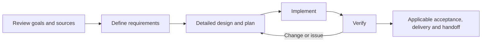

# Project Harness

**English** | [한국어](README.ko.md)

**A working framework for managing software projects with AI agents, connecting customer requirements to detailed plans, implementation and verification.**

The aim is to define behavior and implementation approaches early enough to reduce guesswork and rework during development. Documents keep current decisions and necessary rationale, and commit messages keep the results, so another session or contributor can continue the work.

This repository provides policies and guidance for agents. There is no separate harness application to install; each product supplies its own build and test environment.

[Getting started](#getting-started) · [Development flow](#development-flow) · [Reading the documents](#what-documents-record) · [Example requests](#example-requests) · [Checking results](#verification-and-completion)

## Purpose

The framework helps you keep track of four things throughout a project:

- **What to build:** customer requirements and the conditions for satisfying them.
- **How to build it:** design, implementation order, failure handling and verification methods at the depth the work needs.
- **Where the work stands:** completed work, observed results, blockers and next actions.
- **What a change affects:** related requirements and work that need updates.

Planning depth matched to risk, separate documents for independent items, stable document paths, and the agent's own judgment and verification are core principles. Existing content is reused after checking that it still applies.

## Getting started

1. Have the agent read this repository's [shared policy](AGENTS.md) and the entry guidance for its tool.
2. Describe the intended result, source/code locations, constraints and how far to proceed this time. Mention any build and test approach you have already chosen; otherwise it is decided during design and planning.
3. The agent checks the current state and prepares the documents and work for that scope.

Entry guidance is available for [Codex](CODEX_START_PROMPT.md) and [Claude](CLAUDE.md). When adopting the harness in another project, inspect its existing policies and documents before integrating the relevant guidance.

A first request can look like this. You do not need to specify every document name or path yourself.

> Use this harness to plan an administrator user-management feature.
> Administrators should be able to search users and export search results as CSV.
> Existing code and requirements are at [source location].
> Keep the existing login and permission model. For now, prepare requirements, design and a detailed plan only.

If the goal is still unclear, start with discovery and requirements. The agent prepares evidence and options for decisions that need your input.

### Applying it to another project

1. **Bring in the harness copy and write the project's entry files.** Copy this repository's tracked files unchanged into one folder of the project, `harness/` by default, so the policy is versioned with the project. Do not edit that copy; a harness update replaces the folder with a newer commit's files. The project owns its root entry files and keeps only those of the tools it uses: a root `CLAUDE.md` imports the Claude adapter from the copy (for example `@harness/CLAUDE.md`), and a root `AGENTS.md` tells Codex to read the policy and the [Codex adapter](CODEX_START_PROMPT.md) there. One entry file holds what work cannot start without (the stack, the real build and test commands, the top-level code layout, writer rules no other record owns), plus the copy's source commit and a short pointer to the overview and the current resumption point. Where both files exist, the other routes to it. If that file is `AGENTS.md`, the root `CLAUDE.md` also imports it with `@AGENTS.md`, because Claude Code reads a root `AGENTS.md` by itself only when no `CLAUDE.md` exists. Content that an item owns stays with that item; see the [harness copy](docs/DATA_MODEL.md#harness-copy) and [project instruction files](docs/DATA_MODEL.md#project-instruction-files). If the project already has a CLAUDE.md or AGENTS.md, compare the rules, resolve conflicts and keep the project's rules in its own entry files. A project that already copied the harness into its root keeps that layout until you ask to move it. The harness policy never weakens the project's contracts or CI rules. In a large repository, rules for one area can live in a [path-scoped instruction file](docs/DATA_MODEL.md#path-scoped-instruction-files) inside that subtree, read together with the root policy by work that touches those paths. A path-scoped file adds detail; it cannot weaken the root policy or a contract.
2. **Choose a document root and path conventions.** Make folders beneath `project-docs/` by business division, such as `user/` and `order/`, with `shared/` for definitions several divisions use, and filenames describing each subject and role. Do not split folders by document kind, backend and frontend, or individual feature. When a module covers several divisions, give each its own folder from the start, because moving documents later needs a separate reorganization. Preserve established layouts and record the chosen conventions in the overview. See the [path examples](docs/DATA_MODEL.md#folders-by-area-and-purpose).
3. **Establish the overview when document work starts.** Reuse an existing overview; otherwise follow [compact documentation](docs/DATA_MODEL.md#minimum-documentation-for-a-small-change), which allows an eligible work document to also serve as the overview. A report-only request creates no files. Record the objective and scope, the document root and path conventions, shared-document ownership boundaries, and the integration and quality conventions already decided. Build, test and check commands go in the root entry file from step 1. An undecided convention is recorded as undecided and settled during design and planning. Material that is not a development basis — customer communication documents, a superseded source, a legacy implementation being replaced — is designated in the overview as a [non-authoritative input](docs/DEVELOPMENT_METHOD.md#non-authoritative-inputs): it is not used as requirement, scope or evidence, and its divergence from the product is not raised as a defect or blocker.
4. **An existing project starts from its actual state.** Record the intake commit, analysis scope, what is already implemented and the known verification and deployment status in the overview. Requirements recovered from code are marked as observed or inferred; only what the customer confirmed counts as a confirmed requirement. Existing documents and IDs stay as they are and are referenced.
5. **Add tool settings when the project has secrets, deployments or shared branches.** Policy text changes what the agent attempts; it does not stop execution. Configure blocked secret-file reads and prompts for risky commands from the [tool-level supporting controls](docs/SECURITY.md#tool-level-supporting-controls), and keep the actual boundary, such as refusing force pushes, in controls the agent cannot change, like branch protection.
6. **Write a model roster and pin the main model.** Record in the root entry file which models each tier may use, such as judgment (definition, design, planning, completion), implementation and recording, with the basis and the date checked. Before listing a model, run it briefly in the actual tool and account; a model shown in the tool's list can still be refused for the account. Pin the main session to a judgment-tier model through tool configuration, rather than expecting a model to notice its own gaps. Each tool's adapter gives the setting; the rules are in the [project model roster](docs/CONTEXT_EFFICIENCY.md#project-model-roster).

Before completing adoption, check that each tool's root entry file reaches the policy and its adapter in the harness copy, and the project overview and current resumption point. The project's README introduces the product and links its overview, with a separate link to harness usage guidance. The actual stack, commands and paths must be discoverable. Also check that each recorded check runs where the entry says it runs. For a check agents run, try it in the agent's sandbox; if it cannot run there, record where it runs and who runs it. See the [project entry rules](docs/DATA_MODEL.md#project-instruction-files).

Place each item's Markdown file under its feature or area path. This illustrates a layout; create only needed files. Do not automatically change existing projects' folders, filenames or IDs.

```text
project-docs/
  overview.md                       # objective, path conventions, item index
  user/                             # one business division
    user-search.md                  # search requirement
    csv-export.md                   # export requirement
    user-search-design.md           # design
    user-search-api.md              # API contract
    user-search-screen.md           # screen specification
    user-admin-plan.md              # implementation order and task links
    user-search-api-task.md         # independent task
    csv-download-task.md
    user-search-verification.md     # planned checks and standing failures
    search-response-check.md        # separately managed contract check
    export-limit-question.md        # open item
    csv-encoding-decision.md        # decision
  shared/
    search-storage-design.md        # shared architecture
```

Do not number new documents or items. Identify documents by their full project-root-relative paths, and referenced sections by paths with stable fragments. New ordinary filenames use lowercase English subject words joined by hyphens, with no fixed word count. Leave mutable versions, states and dates out of names, and put the full title in the body. Research, guides, reviews and reports follow the same [path rules](docs/DATA_MODEL.md#document-paths). Resolve name conflicts by making the subject or role more specific. Connect features through document links.

## Development flow



Each stage has defined inputs and outputs. You do not approve every stage — only the decisions in the last column.

| Stage | Inputs | Outputs | What you decide |
|---|---|---|---|
| Discovery | Goals, sources, existing code | Problem boundaries, stakeholders, constraints, unresolved questions | How far to investigate |
| Requirements | Discovery results and supporting evidence | Intended outcomes, acceptance criteria, priorities, source trace | Whether these are the right requirements |
| Design | Requirements at a fixed version, and constraints | Components, interfaces, data, alternatives, risks, requirement coverage | Which alternative to take |
| Planning | Original scope sources, requirements, design, current progress | Work order, exception handling, verification methods and unknown dispositions at the selected depth | Only where a choice is left open |
| Implementation | A concrete scope decision, ready inputs and permissions | Code and document changes, a plan showing what remains, and a commit message stating what was done | What to implement this time |
| Verification | Candidate version, criteria, check environment | Actual results, failures, limits of applicability | How far to verify |
| Acceptance | The candidate and its verification | The authorized customer's acceptance or feedback | Whether to accept — never done on your behalf |
| Delivery | Release scope, operational prerequisites, permissions | The deployed version and post-delivery checks | Approval to go to production |
| Closure | All contributing work, evidence, outstanding obligations | An honest disposition per item, and acceptance, delivery, handover and maintenance obligations settled | When to declare closure |
| Maintenance | The released baseline, new requests and incidents | Traced changes and recheck results | The next request |

**Moving between stages.** Work stops at the requested stage. A planning-only request ends with the plan; a request to implement a concrete scope continues through ready implementation and verification work, and the same scope does not require approval again at every step. Planning is finished when it passes its completion checks, not when a document exists: the original sources are reflected in the plan, the detail is concrete enough that the implementer does not have to guess consequential behavior, and every unknown has a disposition. Listing open questions is not a pass. Starting implementation additionally needs a scope decision and ready prerequisites.

Compact planning is the default for bounded, reversible low-risk work with a clear outcome, including corrections and small additions using established contracts. Record the expected result, paths, steps and checks in the work document, review them and proceed; no separate exception justification or planning-review log is needed. Public contract, data lifecycle or access-policy changes, coordinated independent outputs and high-risk external effects require detailed planning for the affected scope. See [planning depth](docs/DEVELOPMENT_METHOD.md#choosing-planning-depth).

**Models suited to the work.** Definition, analysis, design, planning, decisions and verification judgments use the strongest suitable model currently available. Implementation models vary with difficulty and failure impact; analysis or design judgments discovered during development return to a strong model. Concrete models are selected from the execution environment using current evidence, respecting explicit model pins and usage constraints. Where a project designates the models each tier may use, selection stays within that roster. See [model selection](docs/CONTEXT_EFFICIENCY.md#model-selection-and-delegation).

**Going back.** When implementation behaves unexpectedly, the cause is investigated first, then the affected plan is revised or the missing decision requested. Where that change touches what was already agreed, the related requirements, design, tasks and verification are updated with it. A failed check or a withdrawn pass is reported as it stands, and dependent work waits until the condition for restoring it is met.

**What needs its own approval.** Production deployment, production data changes, destructive operations, access to secrets and protected credentials, and final customer acceptance are never covered by development authority. These five are confirmed separately even when you do not mention them, and acceptance requires the authorized customer's own sign-off.

**Existing projects** start from their actual progress. The agent distinguishes implemented behavior from remaining work and uses existing documents, IDs and version history, keeping behavior observed in code, inferred intent, requirements confirmed by the customer and open unknowns apart from each other.

## What documents record

**Start with the overview for the whole project, or the task document for work already identified.** Work items own execution state, the current execution mode with a link to the decision behind it, immediate next action and prerequisites; verification records own planned checks and failures that still stand. Passing results go to the commit message. Plans manage order, dependencies and resumption positions. Overviews and parent plans link these owners without repeating task statuses or pass counts.

Work spanning sessions uses a resumption record linking the current item, next item and first owning sections to read. Read execution mode, next action and blockers from the work item, and checkpoint results from the commit message. Check [current instructions](docs/WORKFLOW.md#updating-current-work-state) when switching, resuming or handing off. A task status change alone requires no overview edit. Derive progress reports from the owners when requested; a kept report is a deliverable at its basis version, not a current status record.

Write documents around the decisions in force. State the decided outcome, scope and constraints directly, with only the rationale needed to apply them. Do not narrate discussions or successive changes. Keep only what later work needs and cannot recover from the code or Git history: the decisions in force (requirements, designs, contracts, plans and tasks), open questions that block work, failures that still stand and the current position of work spanning sessions. See [current state only](docs/DEVELOPMENT_METHOD.md#current-state-only). Checks run and their results, investigation results, the starting state and handoff notes go in the commit message instead. When work stays uncommitted past a session, the starting state and handoff notes stay with the current position; without Git, all of them do. Overturned decisions, finished or cancelled tasks, finished work in a plan, and open questions whose answer is in its owner are deleted. Do not write change notes, dated history entries, session diaries, history files or snapshots; Git or the existing tracker's version history carries the past. Each fact lives in one document, and other places link to it. Keep an anchor that other documents link to, or repair those links in the same change.

| Document | What you can learn |
|---|---|
| Project overview | Overall goals, shared conventions, item index and links to current owning work |
| Requirements | Customer outcomes and the conditions for satisfying them |
| Design | How screens, APIs and data behave and connect |
| Plan | Implementation order, dependencies, verification methods, completion criteria and the current resumption point for work spanning sessions; finished work is deleted, and the contracts it uses stay in the design |
| Task | Owner, what the work may currently produce, the inputs it reads and the paths it shares with other work, concrete execution steps, declared stop conditions, completion checks written as actual commands, and progress; deleted once done or cancelled |
| Verification | What to check and how, and failures that still stand; passing results are in the commit message |
| Open items and decisions | Questions still to settle, their impact and next action (deleted once the answer is in its owner), and actual decisions |

Independently managed requirements and shared designs or contracts have their own linked documents. For bounded low-risk work, [compact documentation](docs/DATA_MODEL.md#minimum-documentation-for-a-small-change) keeps missing local approach, plan and verification definitions in distinct sections of the work document. Existing owners stay in place and are updated only when their facts change.

For example, **user search** and **CSV export** are separate requirements. “Display zero when no results match” is a condition within the search requirement. Fixing a search defect continues to reference that requirement.

Documents use project-root-relative paths such as `project-docs/user/user-search.md` as identity, without separate numbering. Preserve paths when titles change; repair incoming links during authorized moves or renames. Relationships come from actual links, not similar names. Identify reviewed or tested versions by their commit/version and path. See [item identity](docs/DATA_MODEL.md#item-identity).

## Example requests

The only required input is which feature and what to do with it. You do not need file paths or folder names. The agent finds the matching documents in the overview and plans and reports which items it resolved to, with their owning paths. When several items could match, it presents the candidates before editing; when nothing matches, it says so instead of creating a new item.

Everything else has a default and is added only when you want something different.

| Optional line | Default | Example addition |
|---|---|---|
| Stopping point | Continue through ready stages within the request's authority and stopping point | `plan only`, `define the task only` |
| Exclusions | Production deployment, production data, secrets and final acceptance need separate approval even if unstated | `propose changes to the shared API contract, do not edit it` |
| Area | Derived from the item record after planning | `authentication area` |

Name the area during planning; later requests can use the item records. A feature spanning several areas can proceed when the requested scope and ownership are clear. The agent preserves others' uncommitted work and clarifies actual edit overlap or uncertain ownership. Being in the same area does not alone stop independent work.

`〈 〉` marks a placeholder; delete lines you do not need.

### Planning stage: name the area

**Analyze an existing project**

> Analyze the current code and documents and identify implemented features and remaining work.
> Distinguish observed facts, inferred intent and confirmed customer requirements.
> Stop after analysis and planning this time.

**Set up team work**

> This project has 〈3〉 people, each using a separate worktree on their own branch and merging through pull requests.
> The areas are 〈authentication (src/auth), backend API (src/api), screens (web)〉.
> Task assignment and status live in 〈GitHub Issues〉, and documents link the relevant issues.
> Record the areas, document path conventions, where task status lives and how changes land in the overview.

The agent records the area list, path conventions, tracker designation and change flow in the overview. Reference tracker keys as issued; do not add sequence numbers to Markdown documents. With separate worktrees and branches, issue assignees and reviewed pull-request merges as in this example, no separate owner table is needed. Shared documents can change within authorized scope through the same merge process.

Before integration, check for different items created at one path and duplicate definitions created at different paths. Reconcile ownership and content, choose distinct subject or role names, and repair references under [path collisions and integration](docs/DATA_MODEL.md#branch-path-collisions-and-integration).

**Join and check the current state**

> I am joining this project. The area I will work in is 〈authentication〉.
> Read the overview and my area's items, and tell me the current stage, assigned tasks, open items and blockers.
> Report only; do not edit documents.

In a small project with a single area, the first line can simply be "tell me the current state".

**Plan a new feature**

> Plan a 〈password reset link expiry〉 feature in the 〈authentication area〉.
> Write the requirement, design and detailed plan only, and flag any impact on other areas.

**Define a new task**

> Create a new task in the 〈authentication area〉.
> Content: 〈notify an administrator when an unlock is requested〉. It belongs to the 〈account lockout〉 requirement.
> Create a descriptive file under the area's path conventions and link it in that plan's task list.
> Define the task only; do not implement it.

If the behavior is not in any requirement, the agent reports that a requirement change comes first.

### After planning: name only the feature

**Implement a defined task**

> Work on the 〈lock the account after five failed sign-ins〉 task.
> Start from its task document and check the currently applicable requirements, design and decisions.
> Follow the task document's actions and completion checks, and continue through verification.

The agent first states which task it is. Documents of other areas and shared contracts can be edited when covered by the authorized scope and ownership/integration rules. Uncovered changes remain proposals; changes to another writer's files go through that owner or the agreed merge process. The completion report lists the checks actually run and their results.

**Fix a defect**

> Fix 〈the lock notice not appearing after failed sign-ins〉.
> Report the cause and affected scope first, then after the fix check 〈before lock, at lock and after unlock〉.

The agent finds the related requirement from the symptom and reuses applicable definitions and verification. The correction itself does not become a separate requirement. One writer handling one compact item without management records can use a single work document that also serves as its overview, subject to the [compact documentation conditions](docs/DATA_MODEL.md#minimum-documentation-for-a-small-change). Distinguish project context, expected behavior, approach, steps and failures that still stand there; the commit message carries the actual verification. Additional independent items or concurrent writers require a separate overview. See the [small correction without existing documents](docs/EXAMPLE_WEB_PROJECT.md#small-correction-without-existing-management-documents).

**Revise the plan during development**

> The observed 〈library response format〉 differs from the plan's assumption.
> Investigate while preserving the existing requirements and contracts, then update the affected design, work instructions and planned checks from the findings.
> Tell me where a new behavior or scope decision is needed, and continue ready work.

Resolve technical questions through authorized investigation or a bounded experiment. Use the findings to revise the affected plan and reuse applicable planning and verification evidence. Planning an experiment or revising a document does not establish passed product verification.

**Review a proposed change**

> I want to change 〈the session timeout from 30 to 15 minutes〉.
> Summarize the impact on related requirements, shared contracts, and other areas' tasks and verification.
> Mark the parts that need a decision in another area. Do not edit yet.

**Request a change to a shared document**

> The 〈sign-in API〉 response needs 〈a lock-status field〉.
> Do not edit it; leave a proposal with the change, reason and impact.
> Mark work that depends on this input as waiting until the proposal is applied, and continue independent work.

**Check progress and requirement trace**

> Summarize the current project progress from the project documents.
> For each requirement, show how far design, plan, tasks and verification are linked, and where links or work are missing or blocked.
> Report only; do not edit the documents.

Where an overview summary and the owning record differ, the owning record is reported and the difference is flagged.

**Prepare a scheduled report** (a weekly or milestone report the project owes)

> Prepare the report due 〈Wednesday〉. Take every progress figure from 〈the current WBS〉 only.
> Report what is confirmed as of today as done, and what is planned before the due date as planned.
> Leave anything unconfirmed as unconfirmed instead of filling it in.

A scheduled report is a deliverable, not a status summary produced on request. Its cadence, writing and delivery points, per-issue records and the single source for each figure are fixed in advance, and what is confirmed at the writing point is not mixed with what is merely expected before delivery. An issued report is not rewritten to match later facts; it is corrected in the next issue, and the current position stays in the owning records rather than in the report. A report written for a customer is communication, not a source of requirements or status.

**Report a blocker and record an open item**

> The 〈account lockout〉 task is blocked because 〈the sign-in API has no lock-status response definition〉.
> Record it as an open item with affected work, resolution criterion, owner and needed-by point.
> Continue the remaining unblocked work.

**Prepare for integration**

> Prepare my changes for integration.
> Summarize the diff of changed documents and code, the verification actually run, and checks that failed or did not run, and confirm document paths, anchors and links follow the rules.
> Fetch and tell me about conflicts with 〈main〉; push only after I confirm.

**Hand off to another session or contributor**

> Summarize the changes to my assigned items so far and the actual verification results.
> Include unfinished work, blockers, pending shared-document changes and what the next contributor should do first.

## Implementation decisions and changes

You decide the goals, priorities, constraints and execution scope. Within that scope, the agent investigates technical details and performs detailed planning, implementation and verification.

When you delegate judgment, the agent records the [subject and limits](docs/APPROVALS.md#decision-requests-and-delegated-judgment), then records its choice and rationale within them. Delegated choices and routine implementation decisions need no repeated approval. A new specification version or plan prompts a coverage check against the actual delegation.

When an instruction, a specification, a contract, the running code and provisional material disagree, the agent follows a fixed [input precedence](docs/DEVELOPMENT_METHOD.md#input-precedence). A lower basis does not win by being newer or more detailed, and the conflict itself is recorded where it belongs.

When a material commitment changes, such as behavior, cost, data handling or use of an external service, the agent presents the reason and impact and obtains any needed decision. Production deployment, production data changes, destructive actions, protected-credential access and final customer acceptance need specific authorization and safeguards for the subject and effect. Sending external messages also needs explicit authority. See [decisions](docs/APPROVALS.md) and [security](docs/SECURITY.md) for the boundaries.

Before editing a file, we recommend investigating its related definitions, references, dependencies and affected checks. Scale the investigation to the expected impact and reuse current findings. For a correction, reuse applicable content and update affected owners. Changes to shared functions or APIs require checking consumers, tests and requirements. [Corrections across tasks](docs/WORKFLOW.md#fixes-across-work-item-boundaries) link to owning work; deferred corrections retain responsibility, a next action and a needed-by point. Update the overview when its own scope, dependencies or navigation change.

Do not copy or quote user prompts or replies into documents or commit messages. Routine decisions need no request-origin note or account of the conversation behind them. Record the decided content, scope and constraints, keeping technical rationale only when needed for application or verification. Separately required approval and acceptance evidence follows its owning rules. See [decision recording](docs/APPROVALS.md#preparing-and-recording-one-decision).

When a decision is settled in conversation, replace the instruction it supersedes in its owner before the next action that depends on it. The next session should not need to recover the conversation to discover the current decision. For a report-only request, report the needed amendments without editing files.

Concurrent agents use a separate worktree or clone for each writer, and a single working tree runs one writing agent at a time; see [collaboration](docs/COLLABORATION.md#concurrent-writers). Work that needs an unresolved contract or input waits; independent work with ready prerequisites can continue.

### When the agent stops and asks

In these situations the agent stops the affected work and asks for a decision or input. Unaffected work continues.

- **The request alone cannot fix the outcome.** "Improve this" with no target, where the agent would have to choose the result for you.
- **A material commitment exceeds existing authority.** Behavior or acceptance criteria, interfaces other systems rely on, data collection, retention or deletion, security or permission boundaries, cost, external services or delivery promises, or the assumptions behind an earlier decision. The agent presents the before and after and asks for a decision.
- **A high-risk boundary is reached.** Production deployment, production data changes, destructive operations, secret access and final customer acceptance. Ordinary implementation approval is not enough; a human decision naming the subject, version and effect is needed.
- **Essential input is missing.** Actual edit overlap with another writer needs coordination, the intended item is unclear among several candidates, or a scope/behavior choice cannot be resolved from available sources.
- **The basis is unreliable.** Uncertain authority provenance, an ownership conflict, or contradictory current evidence.

The agent does not ask about the following. Unknown filenames or test commands, splitting or reordering tasks, starting the next task in the same scope, or approval of planning completion itself. A clear fix request is its own scope decision, so the agent does not ask "shall I proceed?" again.

## Verification and completion

Look for three things in a result report:

1. **Scope addressed:** which requirements and tasks were worked on, with each task's state.
2. **Observed results:** what was checked, against which version and environment, and what passed or failed.
3. **Remaining work:** unrun checks, unresolved issues, required decisions and next actions.

Planning completion, implementation, verification, customer acceptance and project closure are distinct. Prepared documents or existing code do not by themselves establish working behavior or customer acceptance. Failed, unrun and partial checks are reported as such. Once decided, the project's build, test and check commands and where each runs (locally or in CI) are recorded in its root entry file. Shared verification environments, such as staging, are recorded in the overview, and verification results refer to both.

Checks run against the subject the claim names and are chosen from the intended result and the failure they must detect. A result from a stand-in — a fixture, a copied sample, a mock — is evidence about that stand-in, and element existence alone cannot establish readability in the rendered product. For UI and graphics, a representative result in the actual product is checked before a shared treatment is extended, and [product assumptions](docs/DEVELOPMENT_METHOD.md#testing-product-assumptions) such as enjoyment or usability get a planned check before dependent work expands. See [verification and completion](docs/WORKFLOW.md#verification-and-completion).

If work is blocked, the report identifies the cause and affected scope. A handoff states in the commit message what was done and which inputs are needed; the next action stays in the work item.

You can check document links and heading anchors yourself with `node tools/check-docs.mjs [document path]`. In an adopting project, run it from the harness copy, such as `node harness/tools/check-docs.mjs project-docs`. It needs only Node and changes no files; its scope is described under [document checker](docs/CONTEXT_EFFICIENCY.md#document-checker).

### States and verification kinds

The policy requires these to be kept distinct. A report or commit message carries the actual method, environment, subject version, result and limits alongside each label, so the label alone is never the judgment. The definitions are in [task states](docs/WORKFLOW.md#task-states) and [verification and completion](docs/WORKFLOW.md#verification-and-completion).

**Task states.** A task is PLANNED, IN_PROGRESS, BLOCKED, IMPLEMENTED (changes made, completion checks not all run), DONE (its own completion checks passed) or CANCELLED. DONE does not mean acceptance or closure. A done or cancelled task's document is deleted.

**Verification kinds.** These are separate kinds, not steps on one scale. A browser check does not imply an integration check.

| Kind | Meaning | What it does not prove |
|---|---|---|
| STATIC_VERIFIED | Checks that need no execution passed, such as compilation, static analysis and document or link checks. | Actual behavior or integration. |
| INTEGRATION_VERIFIED | Connected components were run together in a check environment. | Real screen behavior or the live environment. |
| BROWSER_VERIFIED | Confirmed through a real browser or user interface. | Live-environment data and configuration. |
| LIVE_ENV_VERIFIED | Confirmed in the live environment or one equivalent to it. | Customer acceptance. |

**Beyond verification.** Planning complete means the planning completion checks passed; it is not authority to execute. CUSTOMER_ACCEPTED means the authorized customer explicitly accepted a specific candidate version; it does not complete handover or maintenance obligations. CLOSED always names what was closed: an open item, a release or the project. Project closure means all contributing work and the acceptance, delivery, handover and maintenance obligations are settled.

A subject examined without passing, one that cannot be checked because a required input is missing, one needing rework and one the criteria do not apply to each carry their own disposition and stay out of pass counts. When a later check overturns an earlier pass, the pass is withdrawn explicitly, and the overturning finding stays in the owning document as a failure that still stands. See [verification and completion](docs/WORKFLOW.md#verification-and-completion) and [verification reuse](docs/CONTEXT_EFFICIENCY.md#reuse-and-verification).

### Example result report

After taking the "lock the account after five failed sign-ins" task through verification, the report looks roughly like this.

> **Scope addressed**: `project-docs/auth/account-lock-task.md` under `project-docs/auth/account-lock.md`. Lock counter, lock response and lock notice text. Other tasks in `project-docs/auth/account-lock-plan.md` untouched.
>
> **Actually verified**: commit 9f3e21a, local Node 20 environment. `npm test`: 47 passed. Before-lock, at-lock and after-unlock scenarios confirmed by integration tests: INTEGRATION_VERIFIED. No browser check performed. Task state: IMPLEMENTED, because contract test `project-docs/auth/lock-response-check.md` cannot run yet.
>
> **Remaining**: `project-docs/auth/account-lock-api.md` still lacks the lock-status response field, recorded as `project-docs/auth/lock-response-question.md`, follow-up by minsu, needed before the next integration. Unlock notification is out of scope. Next action: run contract test `project-docs/auth/lock-response-check.md` once `project-docs/auth/account-lock-api.md` is updated.

Three things to check in such a report: whether what was checked is stated as a command and environment, whether any unrun check is hidden, and whether each blocker has an owner and a next action.

The policy does not guarantee development speed or token savings. Results depend on planning quality, the project and how the guidance is applied.

## Detailed documentation

This README explains the harness for people using it. Agents apply the relevant detailed rules through the [shared policy's reading guide](AGENTS.md#startup-and-context).

| To learn more about | Read |
|---|---|
| Overall operating principles | [Shared policy](AGENTS.md) |
| Planning depth and existing-project analysis | [Development method](docs/DEVELOPMENT_METHOD.md) |
| Document organization and paths | [Information model](docs/DATA_MODEL.md) |
| Decisions, permissions and protection | [Approvals](docs/APPROVALS.md) · [Security](docs/SECURITY.md) |
| Open items, progress and closure | [Workflow](docs/WORKFLOW.md) |
| Concurrent work and handoff | [Collaboration](docs/COLLABORATION.md) |
| Reusing content and verification, and running heavy work | [Context efficiency](docs/CONTEXT_EFFICIENCY.md) |
| A worked project flow | [Web project example](docs/EXAMPLE_WEB_PROJECT.md) |

## License

This project is licensed under the [Apache License, Version 2.0](LICENSE).
