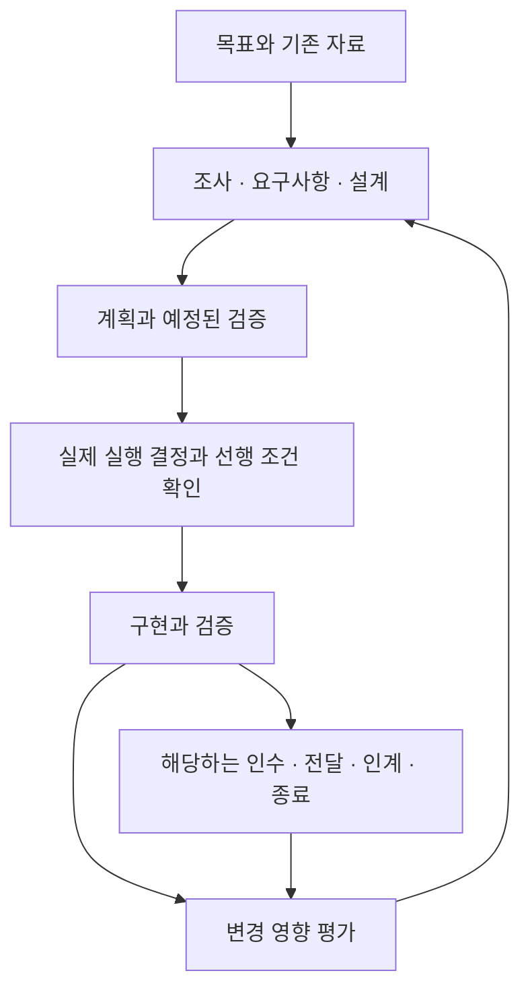

# Project Harness

**한국어** | [English](README.en.md)

**사용자와 AI 에이전트가 목표·요구사항·작업·검증을 연결하며 소프트웨어 프로젝트를 이어가기 위한 정책·문서 프레임워크입니다.**

에이전트는 현재 상태와 실제 요청을 바탕으로 작업 범위를 구체화하고, 허용된 작업을 수행하며, 결과와 남은 조건을 기록합니다. 다음 세션이나 담당자는 그 기록에서 작업을 이어갑니다.

이 저장소는 정책과 안내 문서를 제공합니다. 런타임·CLI·스키마 설치는 필요하지 않으며, 구현·테스트 환경은 실제 제품에 맞게 준비합니다. 문서 종류와 ID 형식도 프로젝트에 필요한 만큼 선택하고 확장합니다.

[시작 방법](#실제로-시작하는-방법) · [문서 구성](#문서는-무엇을-남기는가) · [ID와 파일명](#문서와-항목의-id) · [실행 결정](#실행-결정과-변경은-어떻게-처리하는가) · [검증](#무엇을-검증했고-무엇이-완료됐는가) · [상세 안내](#상세-문서-안내)

## 실제로 시작하는 방법

1. 에이전트가 [AGENTS.md](AGENTS.md)와 해당 도구의 시작 안내를 읽도록 합니다.
2. 목표, 관련 자료·코드 위치, 제약과 이번 요청의 종료 지점을 알려 줍니다.
3. 에이전트가 Git 상태와 기존 문서·결정·구현 상태를 확인합니다. Git이 없으면 기존 파일을 대체하기 전에 기준 사본을 보존합니다.
4. 기존 프로젝트 개요와 ID 규칙을 재사용합니다. 새 프로젝트라면 개요에 필요한 문서 형식과 폴더, 연결 관계를 정합니다.
5. 요청한 산출물을 작성하고 관련 검사를 수행합니다. 명확한 구현·수정 요청은 해당 범위의 실행 결정으로 사용하며, 필수 입력이나 별도 권한이 필요한 지점은 확인합니다.
6. 결과물과 실제 검증 범위, 미완료 항목과 다음 행동을 확인합니다.

도구별 진입 안내: [Codex](CODEX_START_PROMPT.md), [Claude](CLAUDE_START_PROMPT.md), [Claude 어댑터](CLAUDE.md). 에이전트는 [작업별 읽기 안내](AGENTS.md#startup-and-context)에 따라 필요한 상세 규칙을 적용합니다.

### 작은 수정을 바로 요청하기

> 검색 결과가 없을 때 결과 수에 1이 표시되는 문제를 수정해 줘. 0으로 표시하고, 결과가 있는 경우의 개수도 확인해 줘.

이 요청은 관련 수정과 검증 범위를 제공합니다. 같은 범위에 대해 다시 진행 허락을 받을 필요는 없습니다. 문서는 [작은 수정의 최소 구성](#작은-수정의-최소-문서)에 맞춥니다.

### 새 프로젝트의 계획까지 준비하기

> 웹·서버·DB·AI와 사용자·관리자 화면이 있는 서비스를 계획해 줘. 요구사항, 화면·API 명세, 설계와 작업 계획을 준비하되 이번에는 계획까지만 진행해. ID 딕셔너리는 필요한 종류만 사용하고 부족한 분류는 추가해 줘.

에이전트는 목표와 입력을 구체화하고 실행 가능한 계획을 작성합니다. 중요한 미확정 사항을 해결하거나 명시된 범위에서 처리한 뒤 계획 완료 여부를 판단하며, 구현은 이번 요청에 포함하지 않습니다.

### 기존 프로젝트를 분석하고 이어가기

> 현재 코드에서 요구사항과 설계를 복원하고 남은 작업을 계획해 줘. 관찰한 구현, 추정한 의도, 확인된 요구사항을 구분하고 기존 파일명·ID·변경 이력은 보존해 줘.

기존 진행 상태에서 출발합니다. 이전에 `API`를 계획 ID로 사용했다면 그 의미를 유지하며, 새 예시에 맞춰 기존 문서를 일괄 변경하지 않습니다.

### 준비된 범위의 구현을 진행하기

> 제시한 계획의 범위와 검증 방법으로 진행해. 운영 배포는 이번 범위에서 제외해.

앞서 제시한 구체적인 계획에 대한 실제 응답이라면 해당 범위의 결정이 됩니다. 에이전트는 결정과 입력 버전을 연결하고, 준비된 작업을 수행합니다.

### 검토나 인계만 요청하기

> 이번 릴리스의 변경과 검증 근거를 검토하고 인계 문서를 작성해 줘. 미실행 검사, 알려진 문제와 다음 담당자의 첫 작업을 포함해 줘.

검토·인계 자료 작성에서 마칩니다. 위 요청 문구는 사용 예시이며, 이 README 자체가 실제 승인이나 검증 근거가 되지는 않습니다.

## 무엇을 위한 프로젝트인가

여러 세션과 담당자 사이에서 목표와 변경 이유, 실제 결정, 검증 결과를 잃지 않고 작업을 이어가는 것이 목적입니다. 요구사항에서 설계·계약·작업·검증으로 이어지는 연결을 유지하고, 구현이 있다는 사실과 동작을 확인했다는 사실을 구분합니다.

## 어떤 프로젝트에 사용할 수 있는가

새 프로젝트의 조사·계획, 기존 제품의 기능 추가·수정, 코드에서 문서 복원, 검토·인계에 사용할 수 있습니다. 웹·모바일·서버·DB·AI를 함께 사용하는 서비스에도 적용할 수 있으며, 분야별 기술 선택과 검증 방법은 해당 프로젝트에서 정합니다.

작은 수정은 간단한 문서로 처리하고, 여러 팀이나 독립된 작업 흐름이 있으면 개요와 작업 경계를 나눕니다. 문서 종류가 많다는 이유만으로 모든 종류의 파일을 만들지는 않습니다.

## 무엇으로 구성되어 있는가

| 구성 | 역할 |
|---|---|
| [AGENTS.md](AGENTS.md) | 공통 권한·작업·검증 기준과 상세 규칙의 진입점 |
| 도구별 시작 안내와 어댑터 | 에이전트가 공통 정책과 현재 작업 맥락을 읽도록 안내 |
| [정보 모델](docs/DATA_MODEL.md) | 문서 경계, ID, 채번, 경로와 참조 규칙 |
| [ID 딕셔너리](docs/ID_DICTIONARY.md) | 프로젝트가 선택·확장할 수 있는 간단한 형식과 코드 예시 |
| 실제 프로젝트 개요와 항목 문서 | 목표, 명세, 계획, 결정, 진행 상태와 검증 근거 |
| 제품 환경과 외부 통제 | 실제 빌드·테스트·배포 환경, 접근 제어와 필요한 승인 |

README는 사용 방법과 대표 예시를 소개합니다. 상세 절차와 필수 점검은 각 소유 문서에서 관리합니다.

## 문서는 무엇을 남기는가

새 관리 문서는 Markdown으로 작성하고 각 정보의 정의는 한 곳에서 관리합니다. 기존 기록·원본 증거·제품 파일은 필요한 형식을 유지하며, 지정된 외부 작업 도구가 소유하는 정보는 중복 문서 대신 링크로 연결합니다. 기준은 [관리 문서 형식](AGENTS.md#management-document-format)과 [정보 모델](docs/DATA_MODEL.md)에 있습니다.

**요구사항은 제품 범위를 나누는 기본 기준입니다.** 독립된 결과나 제약은 별도 요구사항으로 관리하고, 부속 조건과 인수 기준은 그 요구사항에 둡니다. 기존 동작을 복구하는 수정은 기존 요구사항을 참조합니다.

| 정보 | 무엇을 담는가 |
|---|---|
| 프로젝트 개요 | 목표·범위·기준 버전, 항목 목록, 진행 요약, ID 형식과 폴더 |
| 요구사항·기능 | 요구사항은 기대 결과와 조건을 정의하고, 기능은 관련 항목을 연결 |
| 화면·API·설계 | 화면 동작, API 계약, 구성 요소·데이터·상호작용과 설계 근거 |
| 계획·작업 | 계획은 순서·의존성·전체 완료 기준을, 작업은 산출물·담당자·실행 내용·검사를 정의 |
| 미결사항·결정 | 질문·영향·다음 행동·해결 조건, 실제 결정과 출처 |
| 검증 | 대상 버전·환경, 예상·관찰 결과, 실행 상태·증거·한계 |
| 변경·인계 | 변경 영향, 현재 상태, 미완료 의무와 다음 담당자의 행동 |

이 표는 정보의 종류를 보여 줍니다. 별도 담당·산출물·완료 상태나 공통 정의를 관리해야 할 때 파일을 분리하며, 상세 기준은 [항목 경계](docs/DATA_MODEL.md#independent-items-and-supporting-detail)를 따릅니다.

### 문서와 항목의 ID

**프로젝트별 간단한 형식표를 사용합니다.** 평면 ID, 화면·작업 분류, 부모에 속한 상세 번호 중 필요한 구조를 선택합니다. 다음은 [딕셔너리](docs/ID_DICTIONARY.md)의 대표 예시이며 필수 목록이나 실제 발급된 ID가 아닙니다.

| 용도 | ID 예시 | 해석 |
|---|---|---|
| 요구사항·기능 | `REQ-001`, `FEATURE-001` | 서로 독립된 번호이며 관계는 링크로 기록 |
| 화면 | `SCR-PC-001`, `SCR-MOB-001`, `SCR-AD-001` | 데스크톱 사용자·모바일 사용자·관리자 화면 분류 |
| API 계약 | `API-024` | 요청·응답·동작을 명세하며 구현 계획은 별도 역할 |
| 작업 | `TASK-API-060`, `TASK-ADMIN-001` | 작업 분류별 번호이며 실제 담당자는 본문에 기록 |
| 미결사항·결정 | `OI-012`, `OD-012-01`, `ADR-001` | OI의 결정·해결 상세는 OD, 아키텍처 선택 근거는 ADR |
| API 관련 검증 | `CT-API-024-01`, `BT-API-024-01` | API-024에 대한 계약·백엔드 검사이며 두 종류의 번호는 독립 |

개요·공통 설계·계획·통합 검증 등에는 `DOC`, `DES`, `PLAN`, `VER` 같은 형식을 필요에 따라 등록합니다. 번호 자릿수와 접두어 길이, 공통 영역 구간은 일괄 강제하지 않습니다.

프로젝트 개요에 필요한 형식만 적어도 됩니다. 독립 관리가 필요해지면 딕셔너리 문서를 만들고 개요에서 연결합니다. DB·AI 작업을 따로 관리해야 한다면 `TASK-DB-001`, `TASK-AI-001`처럼 분류를 추가할 수 있습니다. 등록·채번·호환성 기준은 [항목 ID](docs/DATA_MODEL.md#item-ids)에 있습니다.

파일명은 **`<ID>.md` 또는 `<ID>-<word>-<word>.md`**입니다. 설명은 소문자 영문 두 단어를 `-`로 연결하며, ID에 포함되지 않습니다.

```text
API-024-service-context.md
ID: API-024
설명: service-context
```

프로젝트가 `API-{area}-NNNNN`을 등록하고 `USER` 영역을 사용한다면 `API-USER-00001-service-context.md`도 같은 방식입니다. 이 경우 ID는 `API-USER-00001`입니다.

설명만 다른 파일을 같은 ID로 중복 생성하지 않습니다. 제목 변경 때마다 파일명을 바꿀 필요는 없으며, 파일명을 바꾸면 실제 경로를 참조하는 링크를 갱신합니다. 상세 기준은 [파일 경로](docs/DATA_MODEL.md#document-paths)에 있습니다.

### 작은 수정의 최소 문서

빈 검색 결과의 개수를 고치는 작업은 **기존 개요 + `CHG-001-result-count.md` 같은 변경 문서 하나**로 정리할 수 있습니다. 기존 요구사항을 연결하고 실제 요청·기준 버전, 수정 범위·방법·담당자, 작업 순서와 검사 결과·한계를 담습니다.

독립 관리할 출력이 없다면 계획·작업·검증 파일을 각각 만들 필요는 없습니다. 요구사항이 아직 없다면 실제 기대 동작의 출처를 적습니다. [작은 수정의 최소 기준](docs/DATA_MODEL.md#minimum-documentation-for-a-small-change)을 적용합니다.

### 전체 개요와 기능·작업별 문서

다음은 관리자 사용자 목록 기능의 문서 배치 예시입니다. 폴더와 번호는 프로젝트가 정하며, 실제 요청 단계와 독립 관리 경계에 필요한 파일만 만듭니다.

```text
project-docs/
  overview/DOC-001-project-overview.md
  features/FEATURE-001-user-management.md
  requirements/REQ-001-user-list.md
  screens/SCR-AD-001-user-list.md
  contracts/API-024-user-list.md
  plans/PLAN-001-user-list.md
  tasks/TASK-ADMIN-001-user-list.md
  tasks/TASK-API-060-user-list.md
  open-items/OI-012-access-scope.md
  decisions/OD-012-01-access-policy.md
  verifications/CT-API-024-01-response-contract.md
  verifications/BT-API-024-01-access-scope.md
  verifications/VER-001-user-list.md
```

전체 개요는 문서와 진행 상태를 연결하고, 세부 정의는 각 소유 문서에 둡니다. 기능·팀이 늘면 [영역별 개요](docs/DATA_MODEL.md#area-overviews)로 탐색을 나눌 수 있습니다. 지정된 [외부 작업 도구](docs/DATA_MODEL.md#external-work-trackers)가 담당·상태를 관리한다면 그 정보를 Markdown에 병행 관리하지 않습니다.

### 항목을 연결하는 방법

위 예시의 `FEATURE-001`은 `REQ-001`과 관련 화면·계약·작업을 묶습니다. `PLAN-001`은 입력 명세를 참조하고 `TASK-ADMIN-001`, `TASK-API-060`의 순서와 완료 기준을 정합니다. 검증 문서는 해당 계약·요구사항과 검사한 버전을 연결합니다.

`OD-012-01`은 `OI-012`의 별도 결정·해결 상세입니다. 짧은 결론은 OI 본문에 남기면 되고, ADR에 이미 기록한 결정을 OD에 다시 복사할 필요도 없습니다. 문서가 존재한다는 사실만으로 해결이나 승인이 성립하지는 않습니다.

본문 ID와 링크 라벨에는 설명을 넣지 않습니다. 실제 파일 경로에는 설명이 포함될 수 있습니다.

```markdown
### API-024

관리자가 권한 범위 안의 사용자 목록을 조회하는 계약.

관련 요구사항: [REQ-001](../requirements/REQ-001-user-list.md#req-001)
```

표시된 관계 외에는 같은 번호라는 이유로 부모·자식을 추정하지 않습니다. 여러 계획이 하나의 작업을 공유할 수도 있으며, 실제 관계는 링크로 표현합니다.

### 변경할 때 유지할 규칙

기존 ID와 의미, 결정·검증 이력을 보존하고 경로 변경 시 링크를 갱신합니다. 기존 프로젝트의 `API`·`SCR` 의미나 번호 형식이 예시와 다르면 기존 규칙을 유지합니다. 도구가 요구하는 `README.md`, `AGENTS.md`, `SKILL.md` 등은 [필수 파일명 예외](docs/DATA_MODEL.md#required-name-exceptions)를 적용합니다.

새 문서 완료 전에는 [문서 검증](docs/DATA_MODEL.md#document-validation)을 수행합니다. ID 범위·부모 관계·중복 소유 파일과 링크를 확인하며, 검증 재사용은 [배정 결과 재사용](docs/DATA_MODEL.md#allocation-and-validation-reuse)을 따릅니다.

## 사용자와 에이전트는 어떻게 역할을 나누는가

사용자는 목표·제약·우선순위와 구체적인 실행 범위를 결정합니다. 에이전트는 입력을 분석하고 명세·계획·검증을 구체화하며, 허용된 작업을 수행합니다. 최종 고객 인수와 운영 환경의 권한은 해당 권한을 가진 사람과 외부 통제가 담당합니다.

### 여러 에이전트의 협업 기준

모든 작성자는 같은 항목 정의, ID 형식·채번 범위와 폴더 매핑을 사용합니다. 동시 편집 전에는 작업 산출물, 파일·공유 자원의 소유권, 공유 문서 담당자와 Git 통합 방법을 정합니다. 다른 체크아웃에서도 같은 배정을 사용하며, 작성자마다 새 접두사나 중복 파일을 만들지 않습니다.

단독 작업에는 별도 claim 체계가 필요하지 않습니다. 자세한 기준은 [협업 기반](docs/COLLABORATION.md#collaboration-basis)을 따릅니다.

## 어떻게 진행되는가

조사 → 요구사항 → 설계 → 계획 → 구현 → 검증 → 해당하는 인수·전달·종료 순서로 입력과 출력을 구체화합니다. 폭포수 단계 안에서도 변경이 생기면 영향받는 명세와 계획을 수정합니다.



### 단계별 입력과 산출물

각 단계에는 입력 버전·산출물·의존성·종료 기준이 있습니다. 요청한 단계까지만 수행하며, 전체 진행 요청은 실제 권한과 준비 상태가 충족되는 단계를 이어갑니다. 단계마다 별도 사람 승인을 반복하거나, 준비됐다는 이유로 실행 권한을 추정하지 않습니다. 기준은 [단계 계약](docs/DEVELOPMENT_METHOD.md#stage-contract)에 있습니다.

### 개발 계획의 상세 수준과 누락 검토

계획과 연결된 명세·작업은 구현 담당자가 중요한 동작과 결정을 추측하지 않아도 될 만큼 구체적이어야 합니다. [상세 계획 절차](docs/DEVELOPMENT_METHOD.md#detailed-planning-procedure)와 [완료 점검](docs/DEVELOPMENT_METHOD.md#planning-completion-checks)을 적용해 원본 입력의 커버리지, 실행 내용과 검증, 중요한 미확정 사항의 처리를 확인합니다.

### 미결사항을 해결까지 추적하기

담당자·다음 행동·영향·해결 조건은 소유 문서에 둡니다. `RESOLVED`는 해결 근거 확보, `CLOSED`는 확인과 관련 문서·작업 반영까지 완료한 상태입니다. 보류는 해결이 아니며, 새 근거가 기존 해결을 무효화하면 이력을 보존하고 다시 엽니다. [미결사항 절차](docs/WORKFLOW.md#open-item-lifecycle)와 [필수 내용](docs/DATA_MODEL.md#open-items)을 따릅니다.

## 기존 코드에서 문서를 복원하는 방법

분석할 버전, 수정 중인 파일, 기존 정책과 실제 구현·검증·배포 상태를 먼저 확인합니다. 관련 코드·테스트·설정·문서를 읽고 다음을 구분합니다.

| 구분 | 기록할 내용 |
|---|---|
| 관찰한 구현 | 확인한 버전과 코드 위치에서 실제로 보이는 동작 |
| 추정한 의도 | 관찰을 바탕으로 한 해석과 한계 |
| 확인된 요구사항 | 실제 요구 출처와 기대 결과 |
| 미확정 사항 | 부족하거나 모순되는 근거, 영향과 다음 행동 |
| 제안하는 변경 | 현재 구현과 구분된 변경안과 필요한 검증 |

코드와 테스트를 읽은 것은 실행 성공의 증거가 아닙니다. 과거 권한이나 결과를 소급해 만들지 않고 분석 범위·누락을 보고합니다. [기존 프로젝트 도입 절차](docs/DEVELOPMENT_METHOD.md#existing-project-intake-and-reverse-engineering)와 [웹 프로젝트 예시](docs/EXAMPLE_WEB_PROJECT.md)를 참고하세요.

## 실행 결정과 변경은 어떻게 처리하는가

**명확한 구현·수정 요청은 해당 범위의 실행 결정으로 사용합니다.** 구현 전에 요청과 입력 버전, 구체적인 범위를 연결하고 선행 조건을 확인한 뒤 작업합니다. 조사·계획만 요청한 경우에는 그 종료 지점을 지킵니다.

하나의 유효한 결정은 여러 계획·작업을 포함할 수 있습니다. 범위 안의 파일 선택이나 작업 순서 조정 때문에 같은 허락을 반복하지 않습니다. 실제 약속이나 위험·외부 효과가 달라지면 변경안을 구체화하고 필요한 결정을 받습니다. [결정 준비](docs/APPROVALS.md#preparing-and-recording-one-decision)와 [중요 변경 기준](docs/APPROVALS.md#material-changes)을 적용합니다.

취소·중단은 자동으로 삭제나 롤백을 허용하지 않습니다. 영향을 받은 작업과 이력을 보존하고, [취소·철회·재개 절차](docs/APPROVALS.md#cancellation-withdrawal-and-resumption)에 따라 현재 권한과 선행 조건을 다시 확인합니다.

## 무엇을 검증했고 무엇이 완료됐는가

검증 결과에는 대상 버전·환경, 예상 결과·관찰 결과, 증거와 한계를 남깁니다.

| 상태 | 뜻 |
|---|---|
| `IMPLEMENTED` | 구현이 존재함 |
| `STATIC_VERIFIED` | 명시한 정적 검사 범위에서 확인함 |
| `INTEGRATION_VERIFIED` | 구성 요소 간 상호작용을 확인함 |
| `BROWSER_VERIFIED` | 명시한 브라우저·시나리오에서 동작을 확인함 |
| `LIVE_ENV_VERIFIED` | 권한 있는 실제 대상 환경에서 확인함 |
| `CUSTOMER_ACCEPTED` | 권한 있는 고객이 특정 버전과 범위를 실제로 인수함 |
| `CLOSED` | 해당 범위의 종료 의무를 처리함 |

이 상태들은 서로 다른 주장입니다. 모든 프로젝트에 모든 검사가 필요한 것은 아니지만, 미실행·실패·부분·모호한 결과를 PASS로 표시할 수는 없습니다. 이전 성공으로 새로운 실패를 가리지 않습니다.

문서 검사와 제품 검증도 구분합니다. ID·파일명·링크 검사가 통과해도 API·화면·모델 동작을 확인한 것은 아닙니다. 관련 변경과 의존성을 검사하고 유효한 기존 근거는 [검증 재사용 기준](docs/CONTEXT_EFFICIENCY.md#reuse-and-verification)에 따라 활용합니다.

## 협업과 인계는 어떻게 하는가

동시 작업에는 가능한 경우 분리된 worktree를 사용하고 실제 파일·자원 충돌을 확인합니다. 인계에는 기준과 변경 버전, 실제 결정, 검증·실패·미실행 범위, 미완료 의무와 다음 담당자의 첫 행동을 남깁니다.

프로젝트 종료는 여러 계획의 결과와 해당하는 인수·전달·유지보수 의무를 함께 확인합니다. 배포만으로 종료가 성립하지는 않습니다. [협업과 인계](docs/COLLABORATION.md), [종료 준비](docs/WORKFLOW.md#closure-preparation)를 따릅니다.

## 어떤 장점이 있는가

다음 작업자가 변경의 이유와 확인할 범위를 찾을 수 있고, 기존 진행 상태에서 남은 작업을 이어갈 수 있습니다. 필요한 문서와 형식만 사용하면서 실제 결정·검증·미완료 상태를 구분하는 데 목적이 있습니다.

효과는 자료와 문서의 품질, 작업 규모와 도구에 따라 달라집니다. 토큰 절감률·개발 속도·결함 감소율 같은 수치를 정책만으로 보장하지는 않습니다.

## 작업이 멈추는 기준과 고위험 통제

필수 권한·입력·의존성이 없거나 소유권이 충돌하고, 안전·결정 출처·현재 검증에 문제가 있으면 영향받는 작업과 후속 작업을 멈춥니다. 무관한 초안이나 오래된 기록만으로 독립 작업까지 중단하지 않습니다.

위험은 실제 효과로 판단합니다. 운영 배포·운영 데이터 변경·파괴적 작업·보호 자격 증명 접근·최종 고객 인수는 대상과 효과에 맞는 구체적인 사람의 결정 및 독립 통제를 따릅니다. 외부 메시지와 중요한 외부 효과에도 명시적인 권한이 필요합니다. [보안 정책](docs/SECURITY.md)과 [개발 행동의 경계](docs/SECURITY.md#classifying-development-actions)를 적용하며, 비밀 값은 문서·로그에 남기지 않습니다.

프로젝트 기록 초기화는 명시적인 현재 요청이 있을 때만 [초기화 절차](docs/WORKFLOW.md#starting-over)에 따라 준비합니다.

## 도입할 때 알아둘 한계

정책 문서 자체가 외부 시스템의 권한을 기술적으로 강제하지는 않습니다. 실제 접근 제어와 승인, 제품별 검증 환경이 함께 필요합니다. 코드 분석만으로 사업 의도와 고객 요구를 모두 확인할 수도 없습니다.

다른 저장소에 도입할 때는 기존 정책·계약·도구·CI와의 충돌을 확인하고 권한 있는 범위에서 통합합니다. 기존 `AGENTS.md`와 프로젝트 기록을 확인 없이 덮어쓰지 않습니다. 이 저장소에서 받은 권한이 다른 프로젝트로 자동 확장되지는 않습니다.

## 하네스 정책 자체를 수정할 때

하네스의 정책·README·안내 문서는 프로젝트 산출물의 ID 대상에서 제외됩니다. 의미 있는 파일명을 사용하고 현재 파일을 직접 수정하며, Git diff·이력과 대화로 범위·실제 결정·검증을 추적합니다.

정책 수정만을 기록하기 위한 별도 변경 문서·정책 작업 목록·아카이브를 추가하지 않습니다. 기존 기록은 보존하고, 커밋·푸시는 해당 요청이 있을 때 수행합니다. 기준은 [정책 유지보수](AGENTS.md#harness-policy-maintenance)와 [ID 적용 범위](docs/DATA_MODEL.md#id-scope)에 있습니다.

## 상세 문서 안내

[AGENTS.md의 진입 안내](AGENTS.md#startup-and-context)는 작업별 필수 읽기 기준입니다. 아래 목록은 필요한 내용을 찾기 위한 안내이며 매번 전부 읽으라는 뜻은 아닙니다.

| 문서 | 다루는 내용 |
|---|---|
| [공통 정책](AGENTS.md) | 권한·범위·작업·검증과 상세 규칙의 진입점 |
| [정보 모델](docs/DATA_MODEL.md) | 항목 경계, ID·채번, 파일명, 링크와 검증 |
| [ID 딕셔너리](docs/ID_DICTIONARY.md) | 선택 가능한 형식·분류, 두 단어 설명과 확장 예시 |
| [개발 방법](docs/DEVELOPMENT_METHOD.md) | 단계, 상세 계획, 기존 프로젝트 도입과 변경 영향 |
| [진행 절차](docs/WORKFLOW.md) | 작업 전환, 미결사항, 인계·종료와 과거 런타임 기록 |
| [승인과 결정](docs/APPROVALS.md) | 실제 결정의 출처·범위, 재사용과 중요 변경 |
| [협업과 인계](docs/COLLABORATION.md) | 소유권, 동시 작업, 위임과 Git 통합 |
| [보안 정책](docs/SECURITY.md) | 고위험 행동, 보호 자료와 외부 통제 |
| [효율 지침](docs/CONTEXT_EFFICIENCY.md) | 필요한 맥락 선택과 근거 재사용 |
| [아키텍처](docs/ARCHITECTURE.md) · [핵심 원칙](docs/CONSTITUTION.md) | 정책·문서·도구의 역할과 공통 원칙 |
| [기존 웹 프로젝트 예시](docs/EXAMPLE_WEB_PROJECT.md) | 명세 복원부터 구현·검증·전달까지의 적용 예시 |
